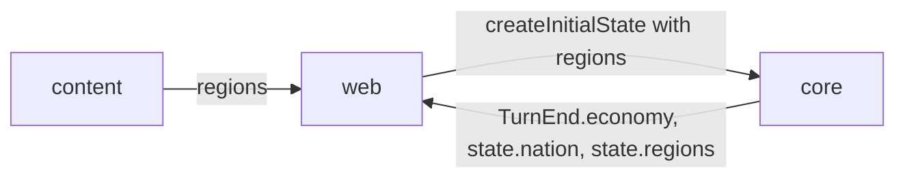

# Brief: Regions and treasury: 九州 regions, taxes, upkeep, 輿圖 view

## Summary
Adds 9 home regions with 民心, 人口 and 富庶, and a 國庫 that collects taxes as the game enters 春上 and 秋上, pays court upkeep every turn, and lowers every region's 民心 while it is negative. 人口 changes once a year. The player can only watch: the header shows 國庫, a free 輿圖 screen lists the regions, and the turn summary shows tax, upkeep and region changes. The region list is data in `content`, passed to `core` through a typed `RegionData` interface.

## Risk
`high`: the `GameState` data model (schema version 2 to 3) and the `content` schema change, in all three modules.

## Doc impact
- Root: module dependencies no, data flow yes (region data goes from `content` through `web` into `core`). Use case table yes.
- `core`: use cases yes, data flow no, class diagram yes (`GameState`, `RegionState`, `RegionData`, stat registry, `BALANCE`, state diagram).
- `content`: use cases yes (UC-CONTENT-001, region table), data flow yes, class diagram yes (`RegionEntry`, new `UiText` keys and format functions).
- `web`: use cases yes, data flow yes (`atlas` screen state).

## IDs added or changed
- Added: `UC-CORE-014` regions, `UC-CORE-015` treasury, `UC-CORE-016` population, `UC-CONTENT-001` region data, `UC-WEB-006` 輿圖
- Changed: `UC-WEB-004` (header 國庫, 輿圖 entry on the map, summary tax and region lines), `UC-CORE-001` and `UC-CORE-012` (`createInitialState` takes regions; turn end settles the economy)

## Core paths
- `docs/architecture.md`
- `packages/core/ARCHITECTURE.md`
- `packages/content/ARCHITECTURE.md`
- `packages/web/ARCHITECTURE.md`
- `packages/core/src/model/**`
- `packages/core/src/index.ts`
- `packages/content/src/schema.ts`

## Schema and interface changes
```diff
-GameState { schemaVersion: 2, …, stats, turnDeltas, dead }
+GameState { schemaVersion: 3, …, stats, turnDeltas, nation: { treasury }, regions: RegionState[], dead }
-STAT_IDS = health, learning, arts, resolve (all emperor)
+STAT_IDS adds treasury (nation), morale, population, prosperity (region); StatValues stays emperor-only
-createInitialState(seed, eraName)
+createInitialState(seed, eraName, regions: readonly RegionData[])
-TurnEnd { aging, totals }
+TurnEnd { aging, totals, economy: { taxIncome, upkeep, regionChanges } }
+GameText.regions: RegionEntry[] (RegionData + name, capital); 7 UiText keys; formatAmount, formatTaels, formatEconomy
-chooseEraName(screen, input)
+chooseEraName(screen, input, regions); Screen adds 'atlas'; summary adds economy
```
No saves exist, so nothing migrates. Numbers the issue left open are chosen in the `core` balance table and the `content` region table, for review at this gate: start 國庫 500,000; tax per collection `floor(人口 × 富庶 × 民心 / 200000)` per region (547,437 at start); upkeep 120,000 a turn; bankruptcy 民心 −3; 人口 ±2% a year when 民心 + 富庶 ≥ 120 or ≤ 80.

## Data flow


## Rejected alternatives
- Region list in `core`: the issue puts region definitions in `content`, and `owner` must not assume the player.
- 輿圖 as a `core` location: it is a read-only view, so a `web` screen keeps it out of the turn rules and clearly uses no action point.
- Tax at the start of the 春上 turn itself (including turn 0): taxes settle at the turn change into 春上 or 秋上, so they show in a summary and no free tax arrives at ascension.
- Separate stat registries per owner: the issue asks for one registry with owner `region`.

## Open questions
None.
