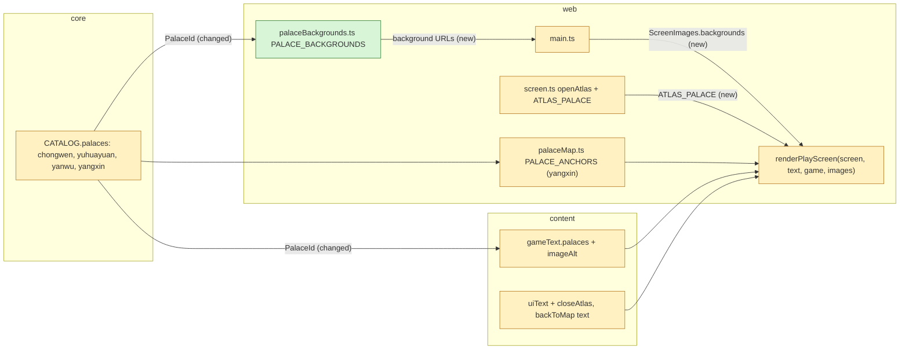

# Brief: Palace backgrounds, header banner over the image, 輿圖 in 崇文館, 寢宮 becomes 養心殿

## Summary
Each palace view gets its own full-width background picture, with the palace text and buttons in a semi-transparent panel over the lower part. On the map and palace views, the game header becomes a dark banner across the top of the picture. 輿圖 leaves the map and becomes a button inside 崇文館, and 寢宮 is renamed 養心殿.

## Features
- Entering any palace shows its picture (window-wide up to 1344px, never cropped or stretched) with a panel holding the name, description, action buttons and 返回宮城.
- On the map and palace views the header (date, action point, age, four stats, 國庫) sits as a dark, gold-text band over the top of the picture. Result, summary and 輿圖 keep the plain header bar.
- The map has no 輿圖 button. 崇文館 has a gold-outlined 輿圖 button, set apart from the red action buttons. Closing 輿圖 returns to 崇文館 with 「返回崇文館」, using no action point.
- 寢宮 is now 養心殿 (「天子起居理政之所，可閉目調息，養護龍體。」), with 靜養 and the same map spot.
- On narrow screens (under 768px) the panel moves below the picture. The banner stays on the picture.

## Risk
`high`: the palace registry (`core/src/model`) and the content schema (`GameText.palaces`, `UiText`) change, across all three modules.

## Decisions to review
- The palace back button reads 「返回宮城」 (was 「返回」), as the issue names it. The 輿圖 close button gets its own new string, 「返回崇文館」.
- Alt text: 崇文館「崇文館內燈籠高懸，書畫長卷與案几羅列」, 御花園「御花園中曲池映橋，石燈佇立，桃花盛開」, 演武場「演武場上廊柱環立，武人持槍演練」, 養心殿「養心殿內帷幔低垂，床榻靜置，燈火柔和」, written from the images.
- Breakpoint: the panel sits over the picture from 768px wide. Below that it sits under the picture on solid dark brown. At 768px a 16:9 picture is about 439px tall, enough for a two-line banner plus the 崇文館 panel.
- Banner: dark brown at 72% opacity, gold text, slightly smaller font (`clamp(0.8125rem, 1.4vw, 1.125rem)`). Panel: dark brown at 78% opacity, gold border, cream text, centred near the bottom, at most 40rem wide and 62% of the picture tall, scrolling if longer.
- On a phone, the banner covers the top of the map, where 御花園 (11%) and 崇文館 (15%) sit. Palace buttons are layered above the banner, so they stay visible and clickable, and may cover part of the banner text.
- 輿圖 sits in a nav row under the actions, separated by a thin gold line: 輿圖 on the left (outlined, not filled), 返回宮城 on the right.
- The existing `palace-empty` screenshot already shows 御花園, so only `palace-yanwu` and `palace-yangxin` are added.
- The 崇文館 rule is one constant, `ATLAS_PALACE = 'chongwen'` in `web/src/screen.ts`, used by both `openAtlas` and the render code.

## What you'll see
- `palace-map` (changed): the header is a dark banner over the top of the map image. No 輿圖 button below the image.
- `palace` (changed): 崇文館 picture with the banner on top and a panel holding the name, description, 讀經史, 習書畫琴棋, then 輿圖 (outlined) and 返回宮城.
- `palace-empty` (changed): 御花園 picture with its panel and 「此處暫無可行之事。」.
- `palace-yanwu` (new): 演武場 picture with its panel and 騎射.
- `palace-yangxin` (new): 養心殿 picture with its panel and 靜養.
- `atlas` (changed): reached through 崇文館. The button reads 返回崇文館.
- `turn-summary`, `turn-summary-tax` (route only): they now click 養心殿. The screens look the same.

## Use cases
**Changed `UC-WEB-004` Game screens**
- Header always a bar above the screen → on the map and palace views it is a semi-transparent dark banner with gold text over the top of the image, taking no space. Result, summary and 輿圖 keep the bar. Contents and order unchanged.
- Map: 輿圖 button follows the map → no 輿圖 button and nothing below the image. Palace buttons stay above the banner where they meet.
- Palace: plain text screen → its own background image (sized like the map, alt text from `content`), with a semi-transparent panel over the lower part holding the name, description, actions (or the "nothing to do here" line) and the back button. 崇文館 also has 輿圖, styled apart from actions. Every catalog palace must have a background (type check plus test). When the panel does not fit over the image, it moves below the image and the banner stays on the image.

**Changed `UC-WEB-006` 輿圖**
- Opened from the palace map only → opened from 崇文館 only. `openAtlas` from the map, any other palace or any other screen returns the screen unchanged.
- Closing returns to the palace map → closing returns to 崇文館 (same `state` object), with a button text that names 崇文館.
- Screen flow: `play → atlas` "on the map" → "in 崇文館". `atlas → play` now "back to 崇文館".

## Architecture

Legend: green = new, amber = changed, red dashed = removed.

`web` gains `src/palaceBackgrounds.ts`, a `Record<PalaceId, string>` of imported image URLs, so a palace without a background fails the type check, like `PALACE_ANCHORS`. `packages/web/ARCHITECTURE.md` (Assets) records it as the one exception to "only `main.ts` imports assets". `packages/content/ARCHITECTURE.md` notes the new `imageAlt`. Module boundaries do not change.

## Data flow
No change between modules. Inside `web`, background URLs flow `palaceBackgrounds.ts` → `main.ts` → `ScreenImages` → render, as in the diagram above.

## Schema and interface changes
- `PALACE_IDS` and `CATALOG.palaces` (`core`): `qingong` becomes `yangxin` in the same slot, still offering `['rest']`. The issue asks for the rename.
- `GameText.palaces` (`content` schema): each entry gains `imageAlt: string`, the background's alt text. It is typed per `PalaceId`, so a missing alt fails the type check.
- `UiText` (`content` schema): adds `closeAtlas` (the 輿圖 close button). `backToMap` keeps its key and now reads 返回宮城.
- `ScreenImages` (`web`): gains `backgrounds: Record<PalaceId, string>`.
- `renderPlayScreen` (`web`): the 4th parameter changes from `mapImage: string` to `images: ScreenImages`, since the palace views now need their own image.
- `openAtlas` (`web`): accepts only `play` in 崇文館 (`ATLAS_PALACE`), not `play` on the map.
- New `PALACE_BACKGROUNDS` in `web/src/palaceBackgrounds.ts`. `PALACE_ANCHORS` renames its key `qingong` to `yangxin`.

Migration: `GameState.schemaVersion` stays the same. Only an allowed value of `location` changes, and no saves exist.

<details><summary>Full diff</summary>

```diff
-PALACE_IDS = ['chongwen', 'yuhuayuan', 'yanwu', 'qingong']
+PALACE_IDS = ['chongwen', 'yuhuayuan', 'yanwu', 'yangxin']
-GameText.palaces: Record<PalaceId, { name; description }>
+GameText.palaces: Record<PalaceId, { name; description; imageAlt }>
+UiText.closeAtlas: string
-uiText.backToMap = '返回'
+uiText.backToMap = '返回宮城'
-type ScreenImages = { palace; scroll; map }
+type ScreenImages = { palace; scroll; map; backgrounds: Record<PalaceId, string> }
-renderPlayScreen(screen, text, game, mapImage: string)
+renderPlayScreen(screen, text, game, images: ScreenImages)
+ATLAS_PALACE: PalaceId = 'chongwen'
-openAtlas: play && location === 'map'
+openAtlas: play && location === ATLAS_PALACE
+PALACE_BACKGROUNDS: Record<PalaceId, string>
-PALACE_ANCHORS.qingong
+PALACE_ANCHORS.yangxin
```
</details>

## Out of scope
- Backgrounds for the result, summary, 輿圖, 年號 or ending screens.
- Moving map anchors to clear the banner on phones. Buttons are layered over the banner instead.
- Re-encoding or resizing the four JPEGs, or changing `CREDITS.md`.
- Any new action for 御花園 or 養心殿, and any balance change.
- Narrow-screen screenshots: the pipeline shoots at 1280px only. Task 4 checks 390px by hand.

## Rejected alternatives
- Backgrounds imported in `main.ts` only: no test could check that every palace has one, as the issue asks.
- Background as a CSS `background-image` with `cover`: it crops, and needs per-palace CSS rules.
- Header kept outside the image with a negative margin: harder to keep it over the image at every width than placing it inside the stage.
- Hiding the banner on the map at narrow widths: the issue asks for the banner on the map.

<details><summary>Core paths</summary>

## Core paths
- `packages/core/src/model/**`
- `packages/content/src/schema.ts`
- `packages/content/ARCHITECTURE.md`
- `packages/web/ARCHITECTURE.md`

</details>
