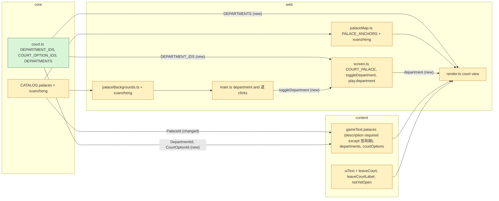

# Brief: 宣政殿 with on-image department buttons and placeholder options

## Summary
A fifth palace, 宣政殿, joins the palace map on the great hall above the white stairs. Inside there is no text panel. Instead, a row of eight buttons sits over the lower right of the throne-hall picture: 內閣, the six 部 and 退. Clicking a department opens its list of options, which are shown but disabled, each tagged 「尚未開放」.

## Features
- A 宣政殿 button appears on the map, below 養心殿, over the hall above the terraced stairs. Entering and leaving use no action point, at any time of day.
- 宣政殿 shows its own background picture with the header banner on top and no panel. Its name is a hidden heading for screen readers.
- A row of buttons over the lower right of the picture, scaling with it: 內閣 吏 戶 禮 兵 刑 工, a gap, then 退. Screen readers hear 內閣, 吏部, 戶部 and so on.
- 退 goes back to the map like 返回宮城.
- Clicking a department highlights it and opens its options as a vertical list always right-aligned directly above the 工 button, whichever department was clicked. Clicking another department switches the list. Clicking the open one closes it. Leaving 宣政殿 closes it.
- Each option is a greyed-out, disabled button with a small 「尚未開放」 tag. Nothing happens on click.

## Risk
`high`: the palace registry and a new department registry (`core/src/model`) and the content schema (`GameText`, `UiText`) change, across all three modules.

## Decisions to review
- Department and option IDs go in a new `DEPARTMENTS` registry (`core/src/model/court.ts`), not in `CATALOG`, so the `Catalog` that tests build stays unchanged.
- The English option IDs follow the issue's order: `name-heir`, `change-era`, `recommend-officials`, `appoint-officials`, `hold-exams`, `take-census`, `adjust-taxes`, `relieve-disaster`, `hold-sacrifice`, `conduct-diplomacy`, `conscript-soldiers`, `drill-troops`, `grant-amnesty`, `try-major-case`, `build`, `forge-weapons`.
- Department text is `{ label, name }`: the short button text (吏) and the full name (吏部) that screen readers hear.
- Only 宣政殿 may lack a palace description: the type requires it for every other `PalaceId`, and a test checks the others have one.
- 退 gets its own ID, `leave-court`, and the screen-reader name 「退出宣政殿」, so its styling stays separate from the panel's `back-to-map`.
- `xuanzheng` goes last in `PALACE_IDS`, so its map button is last in tab order.

## What you'll see
- `palace-map` (changed): a fifth button, 宣政殿, on the hall above the white stairs, below 養心殿.
- `palace-xuanzheng` (new): the throne-hall picture with the banner, no panel, and the row 內閣 吏 戶 禮 兵 刑 工 | 退 at the lower right.
- `palace-xuanzheng-personnel` (new): the same with 吏 filled gold and a list right-aligned above the 工 button: 舉薦人選, 官員任命, 開科取士, each greyed with 「尚未開放」.

## Use cases
**Added `UC-WEB-007` 宣政殿**
- Entered from the map like any palace, at any action point, using no action point. Shows the background and banner but no panel. The name is a visually hidden heading.
- One row over the lower right of the image, scaling with it: the seven departments in `DEPARTMENT_IDS` order showing their short label and announced by their full name, then 退, set apart by a gap and a different style.
- 退 returns to the map and uses no action point.
- Clicking a department highlights it and opens its options (registry order) as a vertical list directly above the 工 button, right-aligned with it, whichever was clicked. Another department switches. The open one closes. Leaving 宣政殿 closes it.
- Options are disabled buttons with a "not yet open" tag and do nothing.
- The open department is `web` screen state only: the `GameState` object is kept and no action point is used. `toggleDepartment` from any other screen or palace, or with an unknown ID, changes nothing.

**Changed `UC-WEB-004` Game screens**
- Every palace view has the panel → every palace view except 宣政殿, which has the image and banner but no panel (UC-WEB-007).

**Changed screen flow (web `USE_CASES.md`)**
- `play → play` "enter palace, 返回" → "enter palace, 返回, 退", plus a new `play → play` "open, switch or close a department, in 宣政殿".

**Changed content text rules**
- Every palace has a description → every palace except 宣政殿, which has no panel to show one.

## Architecture

Legend: green = new, amber = changed, red dashed = removed.

`core` gains a data-only registry of departments and their options, which `content` keys its text by. `web` adds an optional `department` to the `play` screen, so which list is open never touches `GameState`. Module boundaries do not change.

## Data flow
No change between modules. Inside `web`, a department click goes `main.ts` → `toggleDepartment` → a `play` screen with `department` set → render, without calling `core`.

## Schema and interface changes
- `PALACE_IDS` and `CATALOG.palaces` (`core`): add `xuanzheng`, last, offering no actions. The issue adds the palace.
- New `core` exports from `src/model/court.ts`: `DEPARTMENT_IDS`, `DepartmentId`, `COURT_OPTION_IDS`, `CourtOptionId`, and `DEPARTMENTS: Record<DepartmentId, { options: readonly CourtOptionId[] }>`. The issue asks for department and option IDs in `core`, with no rules.
- `GameText.palaces` (`content` schema): `description` is required for every palace except 宣政殿, which has none (typed per `PalaceId`).
- `GameText` (`content` schema): adds `departments: Record<DepartmentId, { label: string; name: string }>` and `courtOptions: Record<CourtOptionId, { name: string }>`, so missing text fails the type check.
- `UiText` (`content` schema): adds `leaveCourt` (退), `leaveCourtLabel` (its screen-reader name) and `notYetOpen` (the option tag).
- `Screen` `play` (`web`): gains optional `department?: DepartmentId`.
- New `web` exports in `src/screen.ts`: `COURT_PALACE: PalaceId = 'xuanzheng'` and `toggleDepartment(screen, departmentId): Screen`.
- `PALACE_ANCHORS` and `PALACE_BACKGROUNDS` (`web`): add `xuanzheng`.

Migration: `GameState.schemaVersion` stays the same. Only a new allowed value of `location` is added, and no saves exist.

<details><summary>Full diff</summary>

```diff
-PALACE_IDS = ['chongwen', 'yuhuayuan', 'yanwu', 'yangxin']
+PALACE_IDS = ['chongwen', 'yuhuayuan', 'yanwu', 'yangxin', 'xuanzheng']
+CATALOG.palaces.xuanzheng = { actions: [] }
+DEPARTMENT_IDS = ['cabinet', 'personnel', 'revenue', 'rites', 'war', 'justice', 'works']
+COURT_OPTION_IDS = [16 IDs]
+DEPARTMENTS: Record<DepartmentId, { options: readonly CourtOptionId[] }>
-GameText.palaces: Record<PalaceId, { name; description; imageAlt }>
+GameText.palaces: { [K in PalaceId]: { name; imageAlt } & (K is 'xuanzheng' ? { description? } : { description }) }
+GameText.departments: Record<DepartmentId, { label; name }>
+GameText.courtOptions: Record<CourtOptionId, { name }>
+UiText.leaveCourt, UiText.leaveCourtLabel, UiText.notYetOpen: string
-{ screen: 'play'; state }
+{ screen: 'play'; state; department?: DepartmentId }
+COURT_PALACE: PalaceId = 'xuanzheng'
+toggleDepartment(screen: Screen, departmentId: DepartmentId): Screen
+PALACE_ANCHORS.xuanzheng = { x: 50, y: 50 }
+PALACE_BACKGROUNDS.xuanzheng
```
</details>

## Out of scope
- 早朝 itself, and any dawn-only rule for it (UC-CORE-003 later).
- Any effect for the options. They stay disabled.
- Phone layout of the court row and option list. The pipeline shoots at 1280px only.
- Re-encoding the 宣政殿 image or changing `CREDITS.md` (done in PR #32).

## Rejected alternatives
- Adding `departments` to `CATALOG`: it would change `Catalog`, which `takeAction` takes and tests build by hand, for data no rule uses.
- Keeping the open department in `GameState`: the issue says it is UI state and must not change the state.
- Showing the 宣政殿 panel with an empty description: the issue says there is no panel.
- Positioning the option list above the clicked department: the issue says it always sits right-aligned above 工.

<details><summary>Core paths</summary>

## Core paths
- `packages/core/src/model/**`
- `packages/core/src/index.ts`
- `packages/content/src/schema.ts`
- `packages/core/ARCHITECTURE.md`
- `packages/content/ARCHITECTURE.md`
- `packages/web/ARCHITECTURE.md`

</details>
