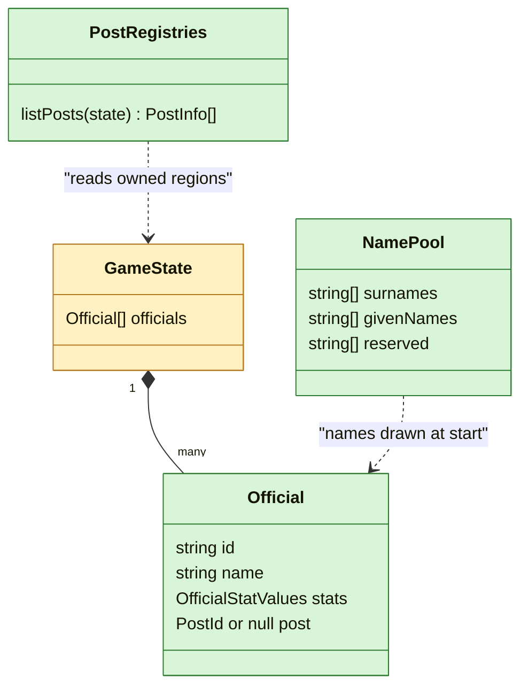
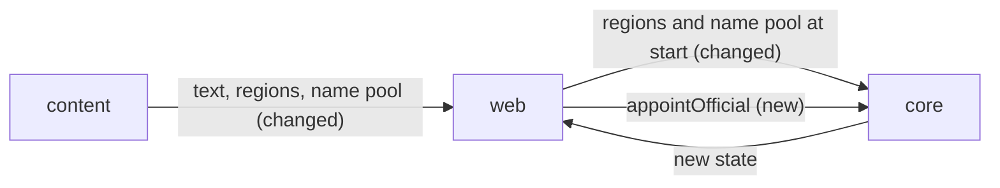

# Brief: 早朝 timing, officials and posts, and 官員任命

## Summary
宣政殿 becomes 早朝. It opens only at 朝, and visiting it uses that action point, so leaving puts the player at 午. A new game starts with generated officials filling every post plus a pool of 賦閑 officials. 吏部 → 官員任命 opens a screen where the player moves 賦閑 officials into posts.

## Features
- 宣政殿 opens only at 朝. At other action points its map button is disabled. 退 returns to the map at 午.
- Officials have a unique generated name and four stats that are only shown: 文治, 武功, 野心 and 忠誠.
- There are 33 posts: 中樞, 六部, and two posts for each region the player owns. All are filled at the start, and there are also some 賦閑 officials.
- 官員任命 is now clickable. Its screen lists posts by group with each holder's stats. Clicking a post lists the 賦閑 officials, which can be sorted by any stat. Appointing one makes the old holder 賦閑. Appointments are free and unlimited.

## Risk
`high`: `GameState` gains `officials` (`SCHEMA_VERSION` bump), and a content schema and `createInitialState`'s signature change.

## Decisions to review
- While inside, the clock stays on 朝, and 退 sets it to 午. The player sees the same thing, and the header stays honest.
- Posts are derived from the registries and owned regions. Each official stores only its `post`, so there is one source of truth.
- Official stats join `STAT_REGISTRY` with owner `official`, following the "registries are data" pattern.
- `createInitialState` takes a `NamePool` with a `reserved` list. Issue 2 only fills `reserved`.
- Choosing a post replaces the post list with the 賦閑 list, because a side panel would not fit narrow screens. Sorting is highest first.
- 返回宣政殿 reopens 吏部, where the player came from. The existing 吏部 scenario is reused.
- `GLOSSARY.md` did not exist, so it is created.

## What you'll see
- `palace-map-noon`: the map at 午, with 宣政殿 dimmed and disabled.
- `palace-xuanzheng-personnel` (changed): 吏部 is open and 官員任命 is live. The other two options are still tagged.
- `appoint-posts`: tables for 中樞, 六部 and 地方, showing post, holder and four stats.
- `appoint-idle`: 丞相 is selected, showing the sortable 賦閑 list with 任命 buttons.

## Use cases
**Added `UC-CORE-003` 早朝**
- `canEnterPalace` allows 宣政殿 only at 朝. Otherwise `enterPalace` leaves the state unchanged.
- Inside is 早朝. Leaving lands on the map at 午 and never ends the turn. Nothing inside draws random numbers.

**Added `UC-CORE-004` Officials and appointments**
- Officials have stats within their `STAT_REGISTRY` bounds and hold one post or are 賦閑. Each post is listed in issue order by `listPosts`.
- The start draws one ordinary official per post plus `BALANCE.officials.startingIdle` 賦閑 officials, using the ordinary or outlier ranges in `BALANCE.officials`. Names are unique and never in `reserved`.
- `appointOfficial` moves a 賦閑 official into a post. It uses no action point or randomness. It is rejected, with the state unchanged, outside 早朝, for an unowned region, for an unknown post or official, or for an official who already holds a post.

**Added `UC-CONTENT-002` Official names and post names**
- There is a large pool of surnames and male given names with no repeats, sized as the issue asks. `reserved` stays empty for now.
- `formatPostName` builds names such as 吏部尚書 and 關中知州. Region IDs never clash with post IDs.

**Added `UC-WEB-008` 官員任命 screen**
- Posts are grouped, and a vacant post is marked as vacant. Choosing a post shows the sortable 賦閑 list. Appointing closes the list. Stale IDs are ignored. Back returns to 宣政殿.

**Changed `UC-CORE-012` Turn loop**
- 宣政殿 could be entered at any action point and used none → it opens only at 朝, and leaving lands at 午.
- `createInitialState(seed, eraName, regions)` → it also takes `names`.

**Changed `UC-WEB-007` 宣政殿**
- Any action point, and 退 used none → only at 朝, and 退 lands at 午. 官員任命 is live.

**Changed `UC-WEB-004` / `UC-WEB-003`**
- Every palace button was always clickable → a refused palace is disabled. `chooseEraName` passes the name pool.

## Architecture

Legend: green = new, amber = changed, red dashed = removed.

`core` gains an officials model and rules, `content` gains names and post text, and `web` gains the `appoint` screen. Module dependencies do not change.

## Data flow

Legend: green = new, amber = changed, red dashed = removed.

## Schema and interface changes
- `GameState.officials` is new, and `SCHEMA_VERSION` is bumped.
- `STAT_REGISTRY` gains the four official stats with owner `official`.
- New post registries and `COURT_PALACE_ID` / `COURT_ACTION_POINT` say which palace is 早朝 and when.
- `createInitialState` takes `names: NamePool`.
- New `canEnterPalace`, `isMorningCourt`, `listPosts` and `appointOfficial`.
- Content `GameText` gains `officialNames` and post text. `formatPostName` is new.
- Web `Screen` gains `appoint`.

Migration: there are no saves, so nothing migrates.

<details><summary>Full diff</summary>

```diff
+  officials: Official[];            // GameState
-function createInitialState(seed, eraName, regions): GameState;
+function createInitialState(seed, eraName, regions, names: NamePool): GameState;
+function appointOfficial(state, postId, officialId): AppointOutcome;
+  | { screen: 'appoint'; state: GameState; post?: PostId; sort?: OfficialStatId }
```
</details>

## Out of scope
- 舉薦人選, 開科取士, 名臣 data and 罷免.
- Any effect of official stats, and region loss.

## Rejected alternatives
- Spending the action point on entry would make the stored clock lie while inside.
- Storing a post-to-holder map would store the holder twice.
- A separate random stream for officials: the issue asks for the game's stream.

<details><summary>Core paths</summary>

## Core paths
- `docs/architecture.md`
- `packages/core/ARCHITECTURE.md`
- `packages/content/ARCHITECTURE.md`
- `packages/web/ARCHITECTURE.md`
- `packages/core/src/model/stats.ts`
- `packages/core/src/model/balance.ts`
- `packages/core/src/model/catalog.ts`
- `packages/core/src/model/state.ts`
- `packages/core/src/model/officials.ts`
- `packages/core/src/index.ts`
- `packages/content/src/schema.ts`

</details>
