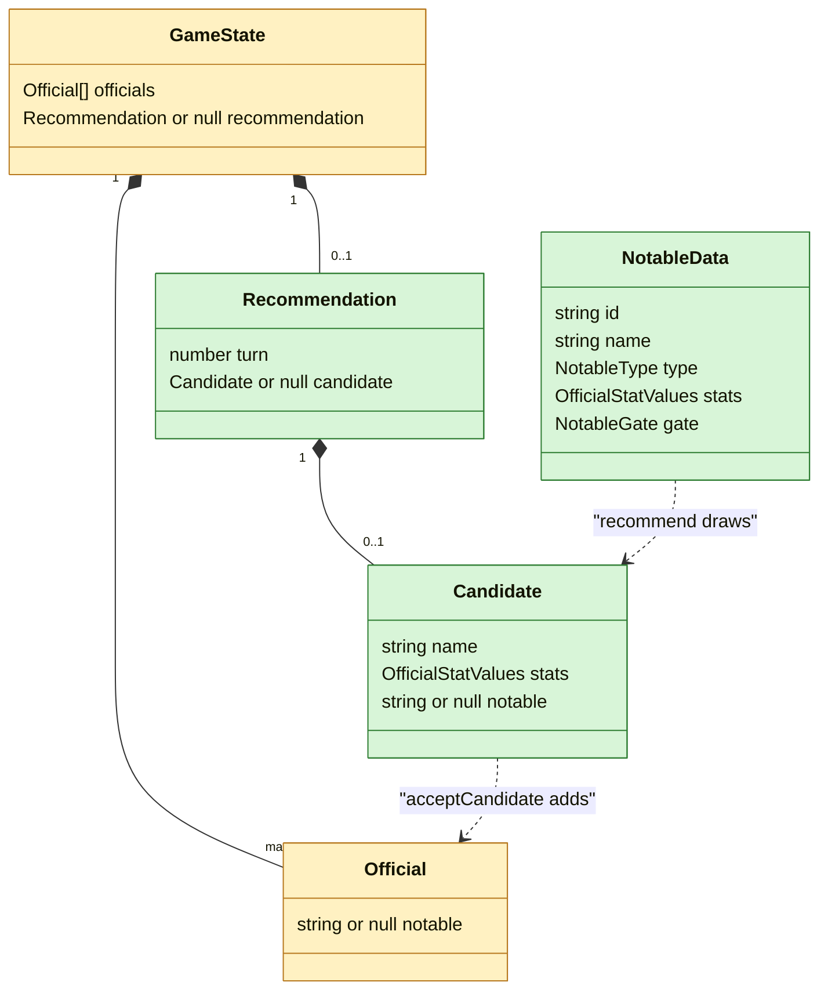
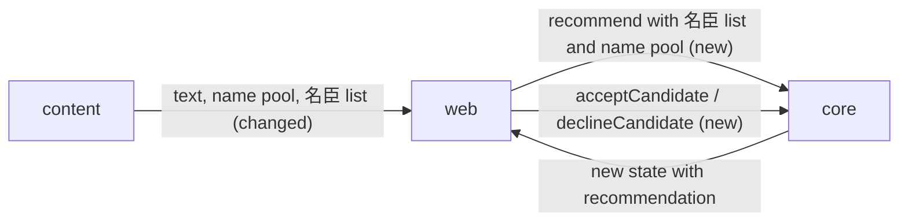

# Brief: 名臣 and 舉薦人選

## Changes since last review
- Removed the 名臣 era everywhere, as asked: the `era` field and the `content` type `NotableEntry` that only added it are gone, so the `content` list is plain `core` `NotableData`. The 舉薦 screen shows the 名臣 mark only, and the Era column is gone from the list below.

## Summary
Adds a list of 60 名臣 from 春秋 to 明, each with fixed stats that match their history and a minimum on one emperor stat before they can appear. 吏部 → 舉薦人選 is turned on. Once per 早朝 it puts forward one candidate, either a 名臣 or an ordinary generated official, and the player accepts or declines.

## Features
- 舉薦人選 can be clicked once per 早朝. It shows one candidate with a name and four stats. A 名臣 also shows a 名臣 mark.
- 錄用 (accept) adds the candidate as 賦閑, so they can be appointed in 官員任命. 婉拒 (decline) sends them away. Either way the player goes back to 宣政殿 with 吏部 open.
- After use, 舉薦人選 is disabled with an 「已舉薦」 tag until the next 早朝.
- The 名臣 chance rises with the emperor's 學識 and 魄力, from 3% to 8%. Which 名臣 appears leans toward 文 名臣 when 學識 is high and toward 武 名臣 when 魄力 is high.
- A 名臣 can be at court only once. A declined 名臣 can come back at a later 早朝. A declined ordinary candidate is gone for good.
- No generated official can take a 名臣's name.

## Risk
`high`: `GameState` gains `recommendation` and `Official` gains `notable` (`SCHEMA_VERSION` 4 → 5), and the `content` schema gains `GameText.notables`.

## Decisions to review
- The 名臣 list is in the folded table below. It has 60 名臣 in historical order. Eight have 野心 ≥ 80: 李斯, 霍光, 王莽, 司馬懿, 長孫無忌, 安祿山, 秦檜 and 張居正. 13 have a gate of 35 or lower, so some can appear early in a reign. Rulers are left out.
- Gates are mostly on 學識 for 文 and 魄力 for 武. A few use 健康 (馬援, 趙雲) or 才藝 (周瑜, 謝安).
- The candidate is stored in `GameState.recommendation` together with the turn it was drawn in. 「Used this 早朝」 is worked out from that turn, so no reset is needed at turn end, and a later save holds an undecided candidate.
- The 舉薦 screen has no back button, so the player must accept or decline. If there is somehow no candidate, it shows only 返回宣政殿.
- If the 名臣 roll hits but no 名臣 is eligible, or every eligible one has weight 0, the candidate is ordinary. There is no re-roll.
- The weights are 文 = 2 × 學識, 武 = 2 × 魄力 and 文武 = 學識 + 魄力. These are the issue's weights doubled, so they stay whole numbers. The proportions are the same.
- A new official's ID is the highest existing `official-N` number plus 1, so IDs stay unique once dismissal exists.
- Button text is 錄用 and 婉拒, the used tag is 已舉薦, and the 名臣 mark is 名臣.
- The screenshot harness fixes the game seed, so the issue's 「use a seed that produces one」 can't be done directly. Instead, the `recommend-notable` scenario clicks through enough half-seasons (舉薦 used or skipped, then 靜養) for the fixed seed to produce a 名臣. A web test replays that path, so the test fails if a later change breaks it.

<details><summary>名臣 list (60)</summary>

| 名臣 | Type | 文治/武功/野心/忠誠 | Gate |
|---|---|---|---|
| 管仲 | 文 | 95/55/45/75 | 學識 55 |
| 晏嬰 | 文 | 85/20/15/90 | 學識 30 |
| 孫武 | 武 | 50/98/25/75 | 魄力 55 |
| 伍子胥 | 文武 | 75/85/40/85 | 魄力 50 |
| 范蠡 | 文 | 88/60/30/70 | 學識 45 |
| 商鞅 | 文 | 92/50/60/70 | 魄力 55 |
| 吳起 | 文武 | 80/92/65/55 | 魄力 60 |
| 孫臏 | 武 | 55/93/25/80 | 學識 45 |
| 白起 | 武 | 30/99/50/85 | 魄力 70 |
| 廉頗 | 武 | 35/88/40/90 | 魄力 30 |
| 李牧 | 武 | 50/92/20/95 | 魄力 50 |
| 藺相如 | 文 | 82/25/20/95 | 學識 25 |
| 樂毅 | 武 | 65/92/30/85 | 魄力 55 |
| 王翦 | 武 | 50/94/30/85 | 魄力 60 |
| 李斯 | 文 | 92/30/85/50 | 學識 55 |
| 蒙恬 | 武 | 55/88/20/98 | 魄力 30 |
| 蕭何 | 文 | 95/35/25/90 | 學識 50 |
| 張良 | 文 | 88/75/10/85 | 學識 60 |
| 韓信 | 武 | 50/100/75/55 | 魄力 70 |
| 衛青 | 武 | 50/95/15/95 | 魄力 60 |
| 霍去病 | 武 | 30/97/30/95 | 魄力 65 |
| 霍光 | 文 | 88/40/85/65 | 學識 50 |
| 王莽 | 文 | 80/25/100/10 | 學識 45 |
| 馬援 | 武 | 55/88/25/90 | 健康 35 |
| 班超 | 文武 | 72/85/30/90 | 魄力 30 |
| 荀彧 | 文 | 94/30/10/95 | 學識 55 |
| 郭嘉 | 文 | 90/70/20/85 | 學識 35 |
| 司馬懿 | 文武 | 92/90/98/30 | 學識 65 |
| 諸葛亮 | 文武 | 98/85/15/100 | 學識 75 |
| 關羽 | 武 | 60/95/40/100 | 魄力 60 |
| 趙雲 | 武 | 50/92/10/100 | 健康 30 |
| 周瑜 | 文武 | 85/92/40/85 | 才藝 55 |
| 陸遜 | 文武 | 85/90/30/85 | 學識 50 |
| 謝安 | 文 | 92/70/20/90 | 才藝 50 |
| 王猛 | 文 | 95/70/25/90 | 學識 55 |
| 高熲 | 文 | 92/70/25/85 | 學識 50 |
| 房玄齡 | 文 | 95/35/15/95 | 學識 55 |
| 杜如晦 | 文 | 92/30/15/90 | 學識 50 |
| 魏徵 | 文 | 88/20/10/92 | 學識 45 |
| 李靖 | 武 | 70/98/20/90 | 魄力 65 |
| 長孫無忌 | 文 | 85/45/80/65 | 學識 45 |
| 狄仁傑 | 文 | 93/45/15/92 | 學識 55 |
| 郭子儀 | 文武 | 75/94/15/98 | 魄力 55 |
| 安祿山 | 武 | 30/85/100/5 | 魄力 30 |
| 趙普 | 文 | 88/40/50/80 | 學識 30 |
| 寇準 | 文 | 85/45/35/90 | 魄力 50 |
| 范仲淹 | 文武 | 92/72/15/95 | 學識 60 |
| 包拯 | 文 | 85/20/10/100 | 學識 30 |
| 王安石 | 文 | 90/30/50/85 | 學識 65 |
| 狄青 | 武 | 40/92/20/90 | 魄力 35 |
| 岳飛 | 武 | 60/97/15/100 | 魄力 65 |
| 秦檜 | 文 | 75/15/90/25 | 學識 30 |
| 文天祥 | 文 | 82/50/10/100 | 學識 55 |
| 耶律楚材 | 文 | 92/40/20/88 | 學識 50 |
| 劉基 | 文武 | 92/75/25/85 | 學識 60 |
| 徐達 | 武 | 65/95/20/95 | 魄力 55 |
| 于謙 | 文武 | 88/75/15/100 | 學識 50 |
| 張居正 | 文 | 96/35/80/70 | 學識 60 |
| 戚繼光 | 武 | 60/96/20/95 | 魄力 55 |
| 王陽明 | 文武 | 92/85/20/90 | 學識 65 |

</details>

## What you'll see
- `recommend-ordinary`: the 舉薦人選 screen with an ordinary candidate's name, four stats, and the 錄用 and 婉拒 buttons.
- `recommend-notable`: the same screen with a 名臣, showing the 名臣 mark next to the name.
- `personnel-recommended`: 宣政殿 with 吏部 open after 舉薦. 舉薦人選 is disabled and tagged 已舉薦, and 官員任命 is still live.
- `palace-xuanzheng-personnel` (changed): 舉薦人選 is now live. Only 開科取士 is still tagged 尚未開放.

## Use cases
**Added `UC-CORE-017` 舉薦人選**
- It can be used during 早朝 if it has not been used this half-season (`canRecommend`). `recommend` is rejected outside 早朝 or when already used, and the state is left unchanged.
- One random draw decides whether a 名臣 comes. The chance is `BALANCE.recommendation.notableBase` + `notableBonus` × (學識 + 魄力) / 200. On a hit, a second draw picks among eligible 名臣: their gate is met and they are not at court. The weights are 學識 for 文, 魄力 for 武, and the average for 文武.
- On a miss, with no eligible 名臣, or when every eligible one has weight 0, an ordinary official is drawn as at game start, with a name that is not taken and not reserved.
- Accept adds the candidate as 賦閑 with a new ID. Decline discards them. Both keep 舉薦 marked as used, draw no random numbers, and are rejected outside 早朝 or with no candidate from this half-season.

**Added `UC-CONTENT-003` 名臣**
- About sixty entries in historical order, one per line. Each has a unique ID and name, a type, stats within bounds that fit their reputation, and a gate on one emperor stat. A few have high 野心, and some gates are low. There is no era.

**Added `UC-WEB-009` 舉薦人選 screen**
- Opening it draws the candidate. The screen shows the name and four stats, plus a 名臣 mark for a 名臣. Accept and decline both return to 宣政殿 with 吏部 open. There is no other way out, unless there is no candidate, in which case only a back button is shown.

**Changed `UC-CORE-004` Officials**
- An official had no 名臣 marker → each official has `notable`: a 名臣 ID or `null`. Starting officials are all `null`.

**Changed `UC-CONTENT-002` Names**
- `reserved` was empty → it holds exactly the 名臣 names.

**Changed `UC-WEB-007` 宣政殿**
- Only 官員任命 was open → 舉薦人選 is open too. Once used, it is disabled and tagged 已舉薦 until the next 早朝.
- `chooseCourtOption(screen, optionId)` → `chooseCourtOption(screen, optionId, notables, names)`.

**Changed `UC-WEB-004` Game screens**
- The 舉薦人選 screen joins the screens that have a header bar.

## Architecture

Legend: green = new, amber = changed, red dashed = removed.

`core` defines the 名臣 shape and the 舉薦 rules but does not hold the list. `content` holds the list as plain `NotableData`, much like regions and names. Module dependencies do not change.

## Data flow

Legend: green = new, amber = changed, red dashed = removed.

## Schema and interface changes
- `GameState.recommendation` (new) holds the last 舉薦's turn and its undecided candidate. It records whether 舉薦 has been used this 早朝.
- `Official.notable` (new) holds the 名臣 ID or `null`. It shows which 名臣 are at court.
- `SCHEMA_VERSION` goes from 4 to 5.
- New `core` types: `NotableType`, `NotableGate`, `NotableData`, `Candidate` and `Recommendation`, plus outcome and rejection types.
- New `core` functions: `canRecommend`, `recommend`, `acceptCandidate` and `declineCandidate`. `BALANCE.recommendation` is new.
- `content`: `GameText.notables` (a `readonly NotableData[]`) and six new `UiText` keys. `officialNames.reserved` is now built from the list.
- `web`: `Screen` gains `recommend`. `chooseCourtOption` takes `notables` and `names`. `acceptRecommendation` and `declineRecommendation` are new, and `backToCourt` also accepts `recommend`.

Migration: there are no saves, so nothing migrates.

<details><summary>Full diff</summary>

```diff
 interface Official { id; name; stats; post: PostId | null;
+  notable: string | null }
 interface GameState { …; officials: Official[];
+  recommendation: Recommendation | null; dead: boolean }
-SCHEMA_VERSION = 4
+SCHEMA_VERSION = 5
+interface NotableData { id; name; type: 'civil' | 'military' | 'both'; stats: OfficialStatValues; gate: { stat: EmperorStatId; min: number } }
+interface Candidate { name; stats; notable: string | null }
+interface Recommendation { turn: number; candidate: Candidate | null }
+function canRecommend(state): boolean;
+function recommend(state, notables: readonly NotableData[], names: NamePool): RecommendOutcome;
+function acceptCandidate(state): CandidateOutcome;
+function declineCandidate(state): CandidateOutcome;
+  notables: readonly NotableData[];                           // content GameText
+  | { screen: 'recommend'; state: GameState }                 // web Screen
-function chooseCourtOption(screen, optionId): Screen;
+function chooseCourtOption(screen, optionId, notables, names): Screen;
```
</details>

## Out of scope
- Event-based 名臣 triggers, and any intrigue driven by 野心.
- 開科取士, 罷免, and any effect of official stats on play.
- Showing a 名臣's type anywhere, and any 名臣 era.

## Rejected alternatives
- Keeping the candidate only in `web` screen state: a later save would lose it, and `core` could not check what is accepted.
- Recognising 名臣 by name instead of a `notable` ID: this works only as long as names never change, and it hides intent.
- A URL seed parameter for the screenshot: the harness always loads the bare page and can't be changed by this issue.
- Resetting a 「used」 flag at turn end: the turn stamp already gives the same result without touching the turn loop.

<details><summary>Core paths</summary>

## Core paths
- `docs/architecture.md`
- `packages/core/ARCHITECTURE.md`
- `packages/content/ARCHITECTURE.md`
- `packages/web/ARCHITECTURE.md`
- `packages/core/src/model/notables.ts`
- `packages/core/src/model/officials.ts`
- `packages/core/src/model/state.ts`
- `packages/core/src/model/balance.ts`
- `packages/core/src/index.ts`
- `packages/content/src/schema.ts`

</details>
