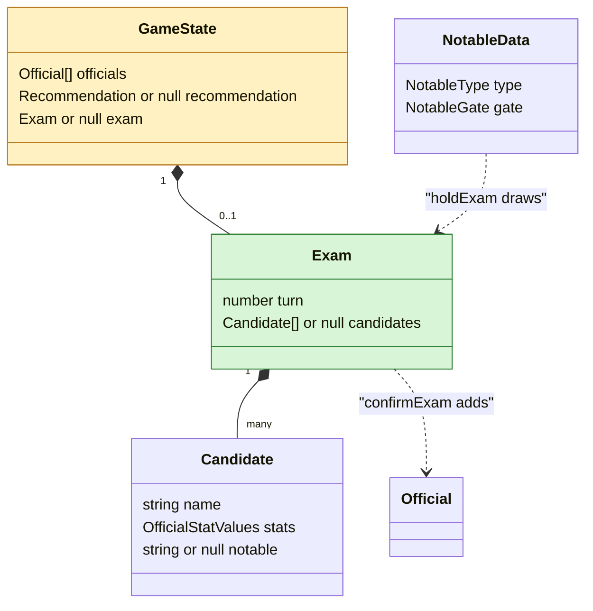
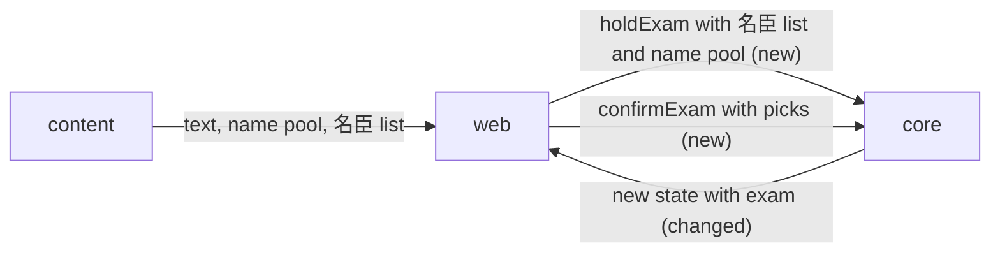

# Brief: 開科取士

## Changes since last review
- The next-exam tag now counts the years left instead of naming the next exam year: 「下次開科：二年後」 in 二年 and 「下次開科：一年後」 in 三年 (was 「下次開科：四年」). `nextExamSuffix` is now 「年後」, and the number is `nextExamYear` minus the current reign year. UC-WEB-007 is updated to match.

## Summary
Turns on 吏部 → 開科取士. In 元年 and every third year after it, at one 早朝, the player holds an exam. Thirty candidates, mostly civil-leaning ordinary officials with an occasional 文 or 文武 名臣, are listed in a sortable checklist. The ticked ones join as 賦閑 and the rest are discarded.

## Features
- 開科取士 can be clicked at one 早朝 in each exam year: years 1, 4, 7 and so on, starting with 元年.
- Opening it lists 30 candidates with a checkbox, name and four stats. 名臣 carry the 名臣 mark. Any stat column can be sorted, highest first.
- 確定 adds every ticked candidate as 賦閑 and returns to 宣政殿 with 吏部 open. Confirming with nothing ticked is allowed and still uses up the exam.
- For the rest of an exam year after the exam, the option is disabled and tagged 已開科. In other years it is disabled with a tag counting the years until the next exam: 「下次開科：二年後」 or 「下次開科：一年後」.
- Ordinary candidates lean civil (文治 50–75, 武功 20–55). They still get the usual outlier roll.
- Each slot has the 舉薦 名臣 chance. Only 文 and 文武 名臣 can appear, at most once per exam, and never one already at court. A declined 名臣 can come back later.

## Risk
`high`: `GameState` gains `exam` (`SCHEMA_VERSION` 5 → 6) and the `content` schema `UiText` gains keys.

## Decisions to review
- When a 名臣 is picked, the weights are the 舉薦 ones (文 = 2 × 學識, 文武 = 學識 + 魄力). The issue gave the chance but not the weights.
- 野心 and 忠誠 ranges for exam candidates point at the ordinary-official ranges in `BALANCE`, so they stay equal if those change. 文治 and 武功 get their own exam ranges.
- The exam is stored in `GameState.exam` with the turn it was held. 「Held this year」 is worked out from that turn's reign year, so nothing resets at year end. This matches how 舉薦 works.
- Candidates are picked by their position in the list. Repeated positions count once, and accepted ones join in list order.
- The exam screen has no back button. The player must confirm, as with 舉薦's accept or decline. If there are somehow no candidates, only 返回宣政殿 is shown.
- New text: button 確定錄取, used tag 已開科, next-exam tag 「下次開科：」 + years remaining in Chinese numerals + 「年後」 (the colon is the full-width 「：」 used elsewhere in the UI, not the 「︰」 typed in the review comment), a 錄取 column, a 「已選」 ticked count, and an empty line 此科已無應試者.
- The ticked count is shown above the list. The issue didn't ask for it, but it helps on a 30-row list.
- The non-exam-year screenshot reaches 二年 by resting through all 32 action points of 元年. This needs no particular seed.

## What you'll see
- `exam-checklist`: the 開科取士 screen with a header bar, a 「已選：0」 line, a 30-row checklist (checkbox, name, 文治, 武功, 野心, 忠誠, with sortable stat headers), and 確定錄取.
- `personnel-non-exam-year`: 宣政殿 in 二年 with 吏部 open. 開科取士 is disabled and tagged 「下次開科：二年後」.
- `palace-xuanzheng-personnel` (changed): all three 吏部 options are live in 元年. Nothing is tagged 尚未開放 any more.

## Use cases
**Added `UC-CORE-018` 開科取士**
- An exam year is 元年 and every `BALANCE.exam.intervalYears` years after it. `canHoldExam` is true during 早朝 in an exam year if no exam has been held this reign year.
- `holdExam` is rejected, with the state unchanged, as `not-in-court` (also when dead), `not-exam-year` or `already-held`, checked in that order. Otherwise it draws `BALANCE.exam.candidates` slots from the seeded stream and stores them with the turn. It uses no action point.
- Each slot is drawn like a 舉薦 candidate. It uses the same 名臣 chance, but only 文 or 文武 名臣 can be picked, and only ones that are eligible and not already in this exam. On a miss, the candidate is ordinary: the outlier roll as for starting officials, otherwise the civil-leaning `BALANCE.exam.ordinary` ranges. The name is unique across the officials and this exam, and never reserved.
- `confirmExam(picks)` adds the picked candidates as 賦閑 with new IDs, in list order. Empty picks are fine and duplicates count once. It is rejected as `not-in-court`, `no-candidates` (none from this half-season) or `unknown-candidate` (a bad position). The exam stays used for the year. Unpicked 名臣 stay eligible.

**Added `UC-WEB-010` 開科取士 screen**
- Opening it calls `holdExam`. The screen shows a header bar, a ticked count, and the checklist. Clicking a checkbox ticks or unticks it. A stat header sorts the list highest first, with ties in list order, and ticks are kept. Confirm calls `confirmExam` and returns to 宣政殿 with 吏部 open. There is no other way out unless there are no candidates.

**Changed `UC-WEB-007` 宣政殿**
- 開科取士 was tagged 尚未開放 → it is enabled when `canHoldExam`. Otherwise it is disabled and tagged 已開科 in an exam year, or in other years with the years left until the next exam (「下次開科：二年後」 / 「一年後」).
- `chooseCourtOption` for 開科取士 needs `canHoldExam`.

**Changed `UC-WEB-004` Game screens**
- The 開科取士 screen joins the screens with a header bar.

**Changed `UC-CORE-004` Officials**
- 名臣 joined only through 舉薦 → they also join through 開科取士.

## Architecture

Legend: green = new, amber = changed, red dashed = removed.

`Exam` reuses 舉薦's `Candidate`. `recommend` and `holdExam` share one candidate-drawing helper, so the two can't drift apart. Module dependencies do not change.

## Data flow

Legend: green = new, amber = changed, red dashed = removed.

## Schema and interface changes
- `GameState.exam` (new) holds the last exam's turn and its unconfirmed candidates. It records whether the exam has been held this reign year.
- `SCHEMA_VERSION` goes from 5 to 6.
- New `core` type `Exam`, plus `HoldExamRejection`, `ConfirmExamRejection`, `HoldExamOutcome` and `ConfirmExamOutcome`.
- New `core` functions `isExamYear`, `nextExamYear`, `canHoldExam`, `holdExam` and `confirmExam`. `BALANCE.exam` is new.
- The internal `drawOfficial` takes an optional ordinary stat table. 舉薦's drawing moves into a shared helper with the same results.
- `content` `UiText` gains eight keys for the exam screen and tags.
- `web` `Screen` gains `exam`. `toggleExamPick`, `sortExam`, `confirmExamPicks` and `examCandidates` are new, and `backToCourt` also accepts `exam`. `OPEN_COURT_OPTIONS` adds `hold-exams`.

Migration: there are no saves, so nothing migrates.

<details><summary>Full diff</summary>

```diff
 interface GameState { …; recommendation: Recommendation | null;
+  exam: Exam | null; dead: boolean }
-SCHEMA_VERSION = 5
+SCHEMA_VERSION = 6
+interface Exam { turn: number; candidates: Candidate[] | null }
+function isExamYear(state): boolean;
+function nextExamYear(state): number;
+function canHoldExam(state): boolean;
+function holdExam(state, notables, names): HoldExamOutcome;
+function confirmExam(state, picks: readonly number[]): ConfirmExamOutcome;
+  examHeading, examPickColumn, examPicked, confirmExamButton, examHeld,
+  nextExamPrefix, nextExamSuffix, noExamCandidates: string   // content UiText
+  | { screen: 'exam'; state; picks: number[]; sort?: OfficialStatId } // web Screen
```
</details>

## Out of scope
- Military exams, exam ranks (such as 狀元), and any effect of exam results on play.
- Changing the exam interval or count from the UI.
- Showing a 名臣's type or era.

## Rejected alternatives
- Keeping the candidates only in `web` screen state: `core` could not check the picks, and a later save would lose them.
- A separate "exam held" flag reset at year end: the turn stamp gives the same result without touching the turn loop.
- Copying 舉薦's drawing code into the exam rule: the two would drift apart. A shared helper keeps one copy.

<details><summary>Core paths</summary>

## Core paths
- `docs/architecture.md`
- `packages/core/ARCHITECTURE.md`
- `packages/content/ARCHITECTURE.md`
- `packages/web/ARCHITECTURE.md`
- `packages/core/src/model/exam.ts`
- `packages/core/src/model/state.ts`
- `packages/core/src/model/balance.ts`
- `packages/core/src/index.ts`
- `packages/content/src/schema.ts`

</details>
