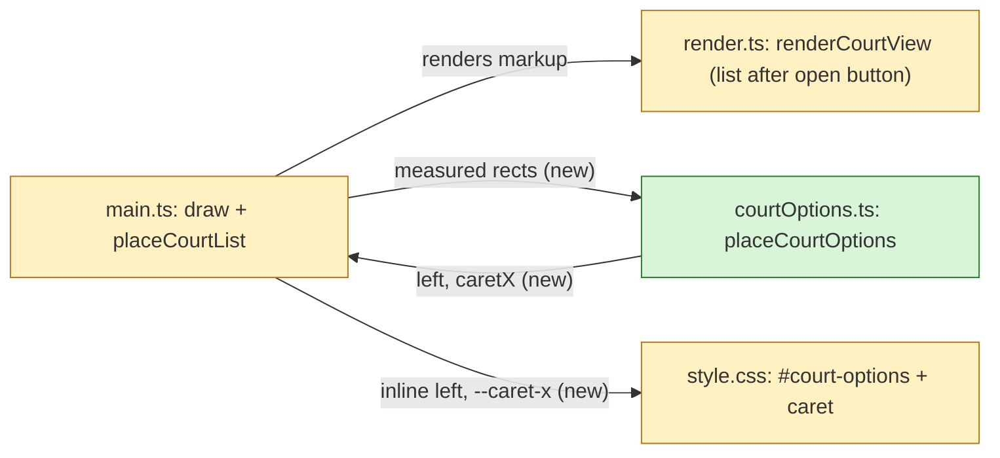

# Brief: 宣政殿 options open above their own department

## Summary
In 宣政殿, a department's option list now opens directly above the department that was clicked, instead of always sitting above 工. It is kept inside the image, a small caret points at the clicked button, and the list follows its button in the markup so keyboard and screen-reader order makes sense. Only `web` changes.

## Features
- The option list sits right above the clicked department, its right edge lined up with that button's right edge.
- If the list would spill past the image's left edge (內閣 on a narrow screen), it slides right just enough to stay on the image.
- A small downward caret under the list points at the centre of the clicked button, and stays on the button even when the list has slid.
- Tab and screen-reader order now goes 吏 → 吏's options → 戶, instead of all seven buttons first.
- Opening, switching and closing a department work exactly as before.

## Risk
`medium`: it touches a core path (`packages/web/ARCHITECTURE.md`, to record the new "measure in `main.ts`, compute in a pure function" placement pattern). One module, no `GameState` or schema change.

## Decisions to review
- Clamping needs measured sizes, which CSS cannot do: a pure `placeCourtOptions` function computes the position and `main.ts` measures and applies it. This keeps the rule unit-tested.
- The list is placed again on window resize and when the 宣政殿 image finishes loading, since button sizes scale with the viewport.
- The list may touch the image's left edge exactly (no extra margin), following the issue's "just enough".
- The caret is a CSS triangle in the list's gold border colour, not a ▼ text glyph, so screen readers don't read it out.
- Only the left edge is clamped. The right edge is the button's, which is already inside the image.
- New screenshot names: `palace-xuanzheng-cabinet` and `palace-xuanzheng-works`.

## What you'll see
- `palace-xuanzheng-personnel` (kept): 吏部's list now sits above 吏, with the caret on 吏.
- `palace-xuanzheng-cabinet` (new): 內閣's list above 內閣, kept inside the image's left edge, caret on 內閣.
- `palace-xuanzheng-works` (new): 工部's list above 工, right edges aligned, caret on 工.

## Use cases
**Changed `UC-WEB-007` 宣政殿**
- List position: always right-aligned with the 工 button, whichever department was clicked → directly above the clicked department, right edges aligned.
- Edge handling: none → if the list would pass the image's left edge, it shifts right just enough to stay inside.
- Caret: none → a small downward caret under the list points at the clicked button's centre, even after a shift.
- Markup order: list after all seven department buttons → list right after its own department button.

## Architecture

Legend: green = new, amber = changed, red dashed = removed.

A new pure function computes the list's placement from measured rectangles; `main.ts` stays the only DOM code. `packages/web/ARCHITECTURE.md` records this as the pattern for size-dependent placement.

## Data flow
No change. Player input → `core` action → render with `content` text is untouched; the new step is a layout pass after rendering.

## Schema and interface changes
- `placeCourtOptions(row, button, image, listWidth)` (new, `packages/web/src/courtOptions.ts`, internal to `web`): takes viewport rectangles and the list width, returns the list's left offset within the department row and the caret's offset within the list.

No `GameState` or content schema change; nothing to migrate.

<details><summary>Full diff</summary>

```diff
diff --git a/packages/web/ARCHITECTURE.md b/packages/web/ARCHITECTURE.md
index 2ae9297..c5b0ac1 100644
--- a/packages/web/ARCHITECTURE.md
+++ b/packages/web/ARCHITECTURE.md
@@ -15,6 +15,8 @@ Purely decorative images use `alt=""` and get no text from `content`.
 
 Positions on an image that tests must check live in TypeScript, not `src/style.css`. The palace anchors on the map are `PALACE_ANCHORS` in `src/palaceMap.ts`, a `Record<PalaceId, { x: number; y: number }>` in percent of the image, so the type check catches a palace without an anchor. The render code writes each anchor as inline `left` and `top` styles.
 
+Placement that depends on rendered sizes, which CSS alone cannot express, is split the same way: a pure function in TypeScript computes it from measured rectangles, and `main.ts`, the only DOM code, measures after each draw (and when the window resizes or the image loads) and writes the result as inline styles. The 宣政殿 options list uses this: `placeCourtOptions` in `src/courtOptions.ts` takes the clicked department button, the image and the list width, and returns the list's left offset and the caret's position, so the "kept inside the image" rule is tested without a browser.
+
 ## Screen state
 `web` tracks the current screen. `core` tracks map or palace in `GameState.location`. `src/screen.ts` holds the pure transitions.
 
diff --git a/packages/web/USE_CASES.md b/packages/web/USE_CASES.md
index 184b877..2081d14 100644
--- a/packages/web/USE_CASES.md
+++ b/packages/web/USE_CASES.md
@@ -45,7 +45,7 @@ Entered from its button on the palace map, only at 朝 (UC-CORE-003); at other a
 
 - Over the lower right of the image sits one horizontal row of buttons that scales with the image: 內閣 and the six 部 in `core` registry order (`DEPARTMENT_IDS`), then 退. Each department button shows its short name and is announced by its full name, both from `content`. 退 is set apart from the departments by a gap and a different style.
 - 退 returns to the map, and the 朝 action point is now spent: the map shows 午.
-- Clicking a department highlights it and opens its options, in registry order, as a vertical list that is always right-aligned with the 工 button and sits directly above it, whichever department was clicked. Clicking another department switches the list to that department. Clicking the open department closes the list. Leaving 宣政殿 closes it, so it is closed on the next visit.
+- Clicking a department highlights it and opens its options, in registry order, as a vertical list directly above the clicked department, with the list's right edge lined up with that button's right edge. If that would push the list past the image's left edge (such as 內閣 on a narrow viewport), the list shifts right just enough to stay inside the image. A small downward caret under the list points at the centre of the clicked button, and stays on the button even when the list has shifted. The list follows its department button in the markup, so keyboard and screen-reader order goes from a department to its options to the next department. Clicking another department switches the list to that department. Clicking the open department closes the list. Leaving 宣政殿 closes it, so it is closed on the next visit.
 - Open options (`OPEN_COURT_OPTIONS` in `src/screen.ts`; for now 吏部's 舉薦人選, 官員任命 and 開科取士) are enabled buttons with their name and no tag. Clicking one opens its screen (UC-WEB-009, UC-WEB-008, UC-WEB-010). Once 舉薦 has been used this 早朝 (`canRecommend` is false), 舉薦人選 is a disabled button with its name and a small "already recommended" tag, styled like the "not yet open" tag, until the next 早朝. 開科取士 is enabled only when `canHoldExam` is true. In an exam year after the exam is held, it is a disabled button with an "already held" tag. In any other year it is a disabled button with a tag saying how many years remain until the next exam (`nextExamYear` minus the current reign year), in Chinese numerals, such as "in two years". Both tags are styled like the "not yet open" tag. Every other option is a disabled button with its name and a small "not yet open" tag; clicking a disabled option does nothing.
 - Which department is open is `web` screen state only. Opening, switching and closing keep the same `GameState` object and use no action point.
```
</details>

## Out of scope
- Keeping keyboard focus on the department button after a redraw (redraw behaviour is unchanged).
- Any change to which options are open or their tags.
- Repositioning the department row or 退.

## Rejected alternatives
- Pure CSS (wrap each button in a positioned slot): aligns right edges but cannot keep the list inside the image.
- Computing the offset from fixed per-department percentages: button widths depend on font and viewport, so it would drift.
- Clamping inside the render function: render has no access to sizes, and must stay DOM-free.

<details><summary>Core paths</summary>

## Core paths
- `packages/web/ARCHITECTURE.md`

</details>
