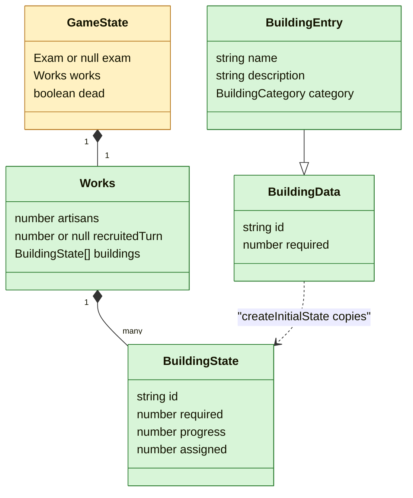
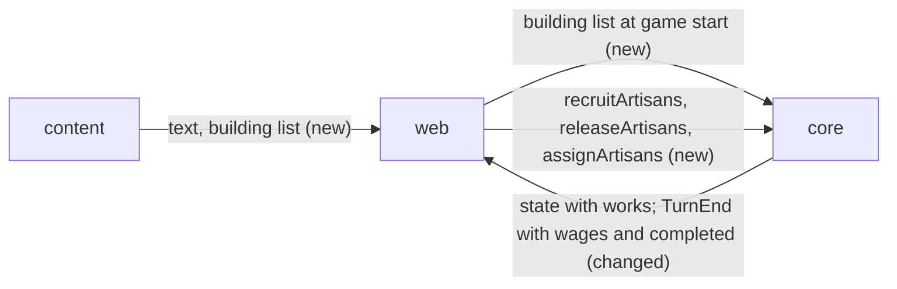

# Brief: 工部: 徵召工匠, 遣散工匠 and 營建工程

## Summary
This turns on 工部 in 早朝. The player recruits 工匠 once per 早朝, releases idle ones at will, and assigns them to 25 historical national works. 國庫 pays every 工匠 a wage each half-season, and a building is finished once enough 工匠·半季 have gone into it.

## Features
- 工部 lists 徵召工匠, 遣散工匠, 營建工程 (renamed from 建造) and 打造兵器 (still not open). None uses an action point.
- 徵召工匠: once per 早朝, pick a count in steps of 10,000 up to 1% of the free population, rounded.
- 遣散工匠: release idle 工匠, 10,000 at a time or all of them, as often as wanted, free.
- 營建工程: a table of every building with its status, and −/＋ buttons that move 10,000 工匠 between idle and that building.
- Each half-season end pays wages with court upkeep (before taxes and bankruptcy), then adds each building's 工匠 to its progress. The summary shows a wages line and any completions.

## Risk
`medium`: core paths change across all three modules (`GameState` gains `works`, the `core` interface and `content` schema grow). Every change is additive.

## Decisions to review
- **Building list**: 25 works in `packages/content/src/buildings.ts`, from 觀星臺 (100,000) to 長城 (2,000,000). I added a 交通 category for 直道 and 馳道.
- **Rounding**: the 徵召 maximum rounds halves up, matching the issue's example. Progress is capped at the required amount.
- **Estimate**: half-seasons left are rounded up; a paused building shows 停工 instead.
- **Assignments apply on each click**, with no confirm step. 遣散工匠 is disabled when nothing is idle.
- **Wages line** appears only when wages are above 0, so a new game's summary is unchanged.

<details><summary>Smaller decisions</summary>

- Categories live only in `content`, as English IDs; `core` gets just the ID and required manpower.
- Wages round down (never matters at whole-10,000 counts).
- A building with 工匠 but no progress yet counts as 營建中.
- Pickers start at 10,000. Confirm or back returns to 宣政殿 with 工部 open; back changes nothing.
- Free population never goes below 0.
- All new text strings and element IDs are listed in `tasks.md`.

</details>

## What you'll see
- `palace-xuanzheng-works` (changed): 工部 open with its four options and their tags.
- `recruit-artisans`: 徵召工匠 with totals, the maximum and the picker.
- `release-artisans`: 遣散工匠 after one recruitment, with the release-all button.
- `build-in-progress`: 營建工程 with 天壇 in progress and the rest not started.
- `turn-summary-works`: a half-season summary with the wages line and 觀星臺 completed.

## Use cases
**Added `UC-CORE-019` 工匠**
- Starts at 0; each is idle or on one building. Free population = player regions' 人口 − 工匠.
- 徵召: during 早朝, once per half-season, a step multiple up to `maxRecruit` (free population × `BALANCE.works.recruitPercent`, rounded to a step). 遣散: idle only, any number of times.
- Bad calls are rejected with the state unchanged. No action point, no randomness.

**Added `UC-CORE-020` 營建工程**
- Buildings are copied from `content` at game start. `assignArtisans` sets a building's 工匠: raising draws from idle, 0 pauses and keeps progress; it is rejected for completed buildings or too few idle.
- After the economy each half-season, progress grows by the assignment. A finished building frees its 工匠 and is reported in `TurnEnd.completed`.

**Changed `UC-CORE-015` Economy**
- upkeep only → upkeep plus wages (`BALANCE.works.wagePerArtisan` per 工匠), both before taxes and bankruptcy.

**Changed `UC-CORE-012` Turn loop**
- aging, economy → aging, economy, building progress.

**Added `UC-CONTENT-004` 營建工程名錄**
- About 25 national works, one row each: ID, name, description, category, required manpower. No prerequisites.

**Changed content Formatting**
- no wages or person formatting → new `formatWages` and `formatArtisans`.

**Added `UC-WEB-011` 徵召工匠, `UC-WEB-012` 遣散工匠, `UC-WEB-013` 營建工程**
- The screens under Features, opened from 工部 in 早朝, each returning to 宣政殿 with 工部 open.

**Changed `UC-WEB-007` 宣政殿**
- 工部: 建造 and 打造兵器, both not open → the four options above, with used/empty tags.

**Changed `UC-WEB-004` Game screens**
- summary with treasury and region lines → plus a wages line and a completions line when they apply.

**Changed `UC-WEB-003` 年號**
- `chooseEraName` also passes the building list to `createInitialState`.

## Architecture

Legend: green = new, amber = changed, red dashed = removed.

Buildings follow the region pattern: `content` owns the list, and `core` copies the ID and required amount into the state at game start, so the turn loop needs no content. Rules go in `core/src/rules/works.ts`, status helpers in `core/src/model/works.ts`.

## Data flow

Legend: green = new, amber = changed, red dashed = removed.

## Schema and interface changes
- `GameState.works` (new): total 工匠, turn of the last 徵召, and one `BuildingState` per building. `SCHEMA_VERSION` 6 → 7.
- New `core` types: `BuildingData`, `BuildingState`, `Works`, `BuildingStatus`, `WorksRejection`, `WorksOutcome`; new `BALANCE.works`.
- New `core` functions: `freePopulation`, `maxRecruit`, `idleArtisans`, `canRecruit`, `recruitArtisans`, `releaseArtisans`, `assignArtisans`, `buildingStatus`, `halfSeasonsToFinish`.
- `createInitialState` gains optional `buildings` (default `[]`); `settleEconomy` gains optional `artisans` (default 0).
- `EconomyReport` gains `wages`; `TurnEnd` gains `completed`.
- `COURT_OPTION_IDS` gains `recruit-artisans` and `release-artisans`; `DEPARTMENTS.works` lists four options; `build` keeps its ID.
- `content` schema: new `BuildingCategory`, `BuildingEntry`, `GameText.buildings`, new `UiText` keys, `formatWages`, `formatArtisans`.
- `web` `Screen` gains `recruit`, `release`, `build`; `summary` gains `completed`; `chooseEraName` takes the building list; new transitions `stepCount`, `maxCount`, `confirmRecruit`, `confirmRelease`, `changeAssignment`.

Migration: there are no saves, so nothing migrates.

<details><summary>Full diff</summary>

```diff
 interface GameState { …; exam: Exam | null;
+  works: Works; dead: boolean }
-SCHEMA_VERSION = 6
+SCHEMA_VERSION = 7
+interface BuildingData { id: string; required: number }
+interface BuildingState { id: string; required: number; progress: number; assigned: number }
+interface Works { artisans: number; recruitedTurn: number | null; buildings: BuildingState[] }
+type BuildingStatus = 'not-started' | 'in-progress' | 'completed';
+type WorksRejection = 'not-in-court' | 'already-used' | 'invalid-count' | 'unknown-building' | 'completed' | 'not-enough-idle';
-interface EconomyReport { taxIncome; upkeep; regionChanges }
+interface EconomyReport { taxIncome; upkeep; wages: number; regionChanges }
-interface TurnEnd { aging; totals; economy }
+interface TurnEnd { aging; totals; economy; completed: string[] }
-createInitialState(seed, eraName, regions, names)
+createInitialState(seed, eraName, regions, names, buildings = [])
-settleEconomy(nation, regions, nextHalfSeason)
+settleEconomy(nation, regions, nextHalfSeason, artisans = 0)
+freePopulation, maxRecruit, idleArtisans, canRecruit(state)
+recruitArtisans(state, count), releaseArtisans(state, count), assignArtisans(state, id, count): WorksOutcome
+buildingStatus(b), halfSeasonsToFinish(b)
 COURT_OPTION_IDS: …, 'try-major-case',
+  'recruit-artisans', 'release-artisans',
   'build', 'forge-weapons'
-works: { options: ['build', 'forge-weapons'] }
+works: { options: ['recruit-artisans', 'release-artisans', 'build', 'forge-weapons'] }
+type BuildingCategory = 'palace' | 'ritual' | 'education' | 'garden' | 'water' | 'defense' | 'transport'  // content
+interface BuildingEntry extends BuildingData { name; description; category }                        // content
+GameText.buildings: readonly BuildingEntry[]                                                           // content
+  | { screen: 'recruit'; state; count } | { screen: 'release'; state; count } | { screen: 'build'; state } // web
```
</details>

## Out of scope
- Effects of finished buildings (later issue).
- Regional buildings, material costs, prerequisites.
- 工匠 affecting 人口, 民心 or taxes; the 士兵 term (waits for 兵部).
- 打造兵器; showing 工匠 in the header or 輿圖.

## Rejected alternatives
- Passing the building list to `takeAction` each turn: changes a widely used signature.
- Storing idle count or building status: both derivable, copies could drift.
- Paying wages after `settleEconomy`: the bankruptcy check lives inside it.
- A typed number input: screenshot steps can only click.

<details><summary>Core paths</summary>

## Core paths
- `docs/architecture.md`
- `packages/core/ARCHITECTURE.md`
- `packages/content/ARCHITECTURE.md`
- `packages/web/ARCHITECTURE.md`
- `packages/core/src/model/works.ts`
- `packages/core/src/model/state.ts`
- `packages/core/src/model/state.test.ts`
- `packages/core/src/model/balance.ts`
- `packages/core/src/model/court.ts`
- `packages/core/src/model/court.test.ts`
- `packages/core/src/index.ts`
- `packages/content/src/schema.ts`

</details>
