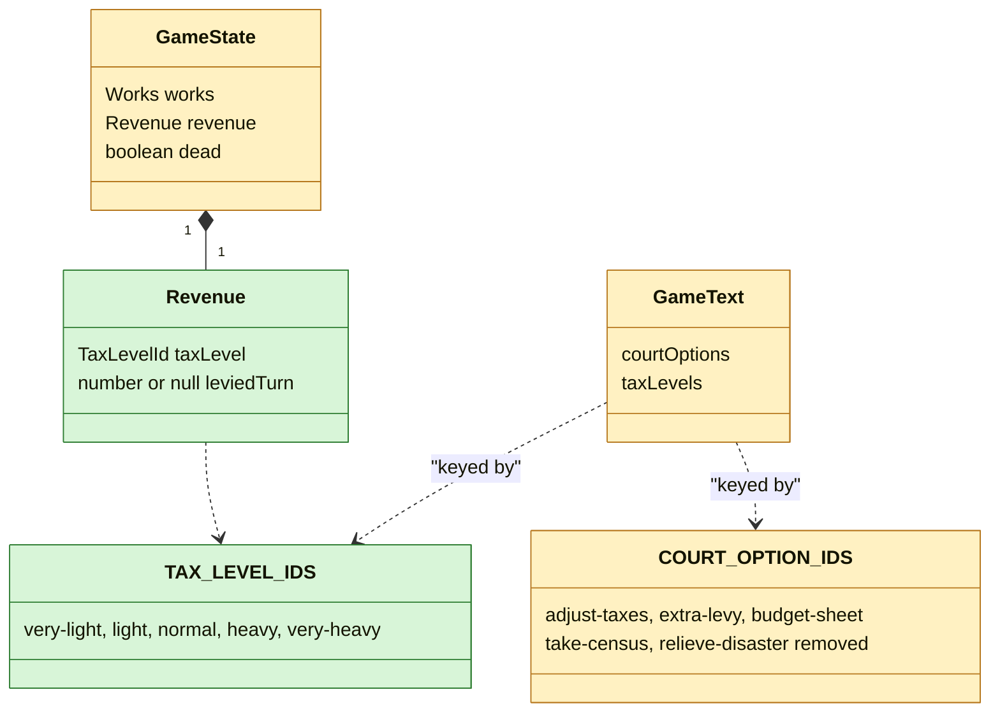
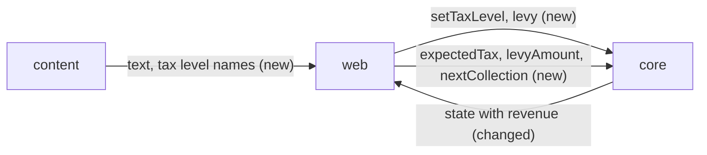

# Brief: 戶部: 調整賦稅, 額外徵稅 and 收支表

## Changes since last review
- The tax level's 民心 change now applies at every turn end (every half-season), not only at the 春上/秋上 collections, as the review and the updated issue ask. Tax income is still collected only at 春上 and 秋上.
- It becomes its own step in `settleEconomy`, after taxes and before bankruptcy. At a collection the tax is still worked out from 民心 before the change.
- Tests changed to match: "no 民心 change outside collections" now expects the change, and there are new bankruptcy and turn-loop tests for half-seasons with no collection.

## Summary
This turns on 戶部 in 早朝 with three options. The player sets a national tax rate in five levels. The rate scales income at each collection and moves 民心 every half-season. They can levy an extra tax once per 早朝 at a heavy cost in 民心, and read a budget sheet. 戶口普查 and 賑濟災民 are removed.

## Features
- 戶部 lists exactly 調整賦稅, 額外徵稅, 收支表, all enabled. None uses an action point.
- 調整賦稅: a five-notch slider (極輕 → 極重). While dragging it shows the level name and the expected tax at the next collection. Releasing it saves the level. It shows no 民心 numbers.
- At each 春上/秋上 collection, every region's tax is multiplied by the level's factor.
- At every turn end, collection or not, every player region's 民心 moves by the amount for the level set at that moment: up when light, down when heavy, unchanged at 平.
- 額外徵稅: once per 早朝, adds half a collection at the current level to 國庫 at once, and every player region loses a lot of 民心. Once used, the option shows 已徵 until the next 早朝.
- 收支表: 國庫, current level, each region's expected tax and the total, upkeep per half a year, and when the next collection falls.

## Risk
`high`: removing the `take-census` and `relieve-disaster` court option IDs counts as a breaking registry change, because `content`'s `courtOptions` text, which is keyed by those IDs, has to change with it. The `GameState` change (new `revenue`) is additive. There are no saves yet, so nothing breaks for players. Core paths change in all three modules.

## Decisions to review
- **Tax multipliers** in `BALANCE.tax.levels`: 極輕 0.5, 輕 0.75, 平 1, 重 1.25, 極重 1.5.
- **民心 per half-season**: +2, +1, 0, −1, −2, as the issue sets. This adds up to at most ±16 a year over 8 half-seasons, against the existing −3 per half-season for bankruptcy. 極重 for a whole year takes a region from 60 to 44 民心 and cuts its tax by about a quarter.
- **Levy**: `levyFraction` 0.5, `levyMoraleLoss` 10 民心 per player region.
- **Order at turn end**: upkeep, population, taxes (at collections only), then the level's 民心 change, then bankruptcy. At a collection the tax is worked out from 民心 *before* that half-season's change. Bankruptcy's −3 comes on top.
- **Forecasts** (slider, 收支表, levy hint) use today's stats. They don't project 春上 population growth or bankruptcy.
- **Levy result**: after 徵收, the levy screen swaps its hint and buttons for a result line and one button back to 宣政殿. It doesn't jump straight back.
- **Levy with nothing to take** (no player regions) is allowed and yields 0.
- **State shape**: `GameState.revenue = { taxLevel, leviedTurn }`, the same shape as `works.recruitedTurn`.
- **New option IDs**: `extra-levy` and `budget-sheet`. `adjust-taxes` keeps its ID.
- **收支表 upkeep** = `BALANCE.upkeep` × half of `turnsPerYear`. 工匠 wages are not on the sheet, because the issue lists only upkeep.

<details><summary>Smaller decisions</summary>

- The five level names are printed under the slider's notches, using an HTML range input with a datalist.
- Text: hint 「稅賦輕重，關乎各地民心。」, levy hint 「此次加徵可得…兩，然將大幅減低民心。」, result 「加徵所得：…兩」, tag 已徵. All strings are in `tasks.md`.
- 收支表's next collection shows the half-season name only, such as 秋上, with no year.
- Setting the same level again succeeds and changes nothing.
- 民心 is kept within 0–100 after the level's change at each turn end and after the levy.
- The level's 民心 change shows in the turn summary's per-region lines like any other region change, so the summary shows 民心 numbers even though the tax screens do not.
- Added glossary entries for 稅率 and 額外徵稅.

</details>

## What you'll see
- `palace-xuanzheng-revenue`: 宣政殿 with 戶部 open: 調整賦稅, 額外徵稅, 收支表, no tags.
- `adjust-taxes`: the 民心 hint, the five-notch slider at 平 with level names, and the level and expected-tax lines.
- `extra-levy`: the hint with the amount and the 民心 warning, plus 徵收 and 返回.
- `extra-levy-result`: the amount gained, a button back to 宣政殿, and the header 國庫 raised.
- `revenue-levied`: 戶部 open with 額外徵稅 disabled and tagged 已徵.
- `budget-sheet`: 國庫, 現行稅率 平, a region table with total, 半年宮廷用度, 下次收稅 秋上.

## Use cases
**Added `UC-CORE-021` 調整賦稅**
- There are five levels in `TAX_LEVEL_IDS`, and a new game starts at 平. Each level has a multiplier and a 民心 change in `BALANCE.tax.levels`. 平 is ×1 with no change.
- `setTaxLevel` works only during 早朝 and can be repeated. It is rejected with `not-in-court` or `unknown-level`. It uses no action point and no randomness.
- A collection uses the level set at that moment. At every turn end, every player region's 民心 changes by the level set at that moment. Officials have no effect.
- `expectedTax(state, level)` gives the per-region forecast from current stats. `nextCollection(state)` gives the next collection half-season (in 春上 → 秋上, in 冬下 → 春上).

**Added `UC-CORE-022` 額外徵稅**
- `levyAmount` = Σ floor(region tax at the current level × `levyFraction`) over player regions.
- `levy` works once per half-season during 早朝 (`canLevy`). It adds the amount to 國庫, takes `levyMoraleLoss` 民心 from every player region (floor 0), and stamps `leviedTurn`.
- It is rejected with `not-in-court` or `already-used`. The levy does not apply the tax level's 民心 change, which comes only at turn end.

**Changed `UC-CORE-015` Economy**
- Tax = plain formula → plain formula × the level's multiplier (`settleEconomy` gains `taxLevel`, default 平).
- 民心 changes only on bankruptcy → also by the level's change at every turn end, collection or not. This is a new step after taxes and before bankruptcy. At a collection the tax uses 民心 from before the change.

**Changed content Text rules**
- no tax level text → every tax level has a name (極輕, 輕, 平, 重, 極重).

**Changed `UC-WEB-007` 宣政殿**
- 戶部: 戶口普查, 調整賦稅, 賑濟災民, all "not yet open" → 調整賦稅, 額外徵稅, 收支表, all enabled. 額外徵稅 is disabled with an "already levied" tag after use.

**Changed `UC-WEB-004` Game screens**
- The three new screens use the header bar, like the other image-less screens.

**Added `UC-WEB-014` 調整賦稅**
- The hint line and the slider start at the current level. Dragging updates the level name and the expected total without touching state. Release calls `setTaxLevel`. There is no confirm button and no 民心 numbers. The back button returns to 宣政殿 with 戶部 open.

**Added `UC-WEB-015` 額外徵稅**
- The hint shows `levyAmount` and the 民心 warning (no numbers). 徵收 calls `levy`, then shows the result line and the back button. 返回 leaves without levying. Both return to 宣政殿 with 戶部 open.

**Added `UC-WEB-016` 收支表**
- Read-only. It shows 國庫, the level, the per-region forecast with a total, upkeep per half year, the next collection half-season, and a back button.

## Architecture

Legend: green = new, amber = changed, red dashed = removed.

The tax level and the levy stamp live in `GameState`, so `takeAction` can pass the level to `settleEconomy` without needing content. Rules go in a new `core/src/rules/revenue.ts`. In `web`, the slider is the one place `main.ts` writes into the page without a full redraw. While dragging it calls the pure `renderTaxPreview`, and on release it calls a transition and redraws as usual.

## Data flow

Legend: green = new, amber = changed, red dashed = removed.

## Schema and interface changes
- `GameState.revenue` (new): `{ taxLevel: TaxLevelId; leviedTurn: number | null }`. It holds the tax level and the once-per-早朝 levy stamp. `SCHEMA_VERSION` goes from 7 to 8.
- `TAX_LEVEL_IDS`, `TaxLevelId` and `Revenue` (new, `core/src/model/revenue.ts`): the tax level registry.
- `BALANCE.tax` gains `levels`, `levyFraction` and `levyMoraleLoss`. These are the new tunables.
- `COURT_OPTION_IDS` loses `take-census` and `relieve-disaster` and gains `extra-levy` and `budget-sheet`. `DEPARTMENTS.revenue` becomes those three in order. This matches the issue's option list and is the breaking part.
- `regionTax` gains an optional `level` (default 平), and `settleEconomy` gains an optional `taxLevel` (default 平). Existing callers keep today's behaviour.
- New `core` functions: `expectedTax`, `nextCollection`, `setTaxLevel`, `levyAmount`, `canLevy`, `levy`. New types: `RevenueRejection` and `RevenueOutcome`.
- The `content` schema gains `GameText.taxLevels` (`Record<TaxLevelId, { name }>`) and new `UiText` keys for the three screens. `courtOptions` follows the new ID set.
- `web`'s `Screen` gains `taxes`, `levy` (with optional `gained`) and `budget`. There are new transitions `setTax` and `confirmLevy`, a new `renderTaxPreview`, and `main.ts` listens for slider `input`/`change` events.

Migration: there are no saves, so nothing migrates.

<details><summary>Full diff</summary>

```diff
 interface GameState { …; works: Works;
+  revenue: Revenue;
   dead: boolean }
-SCHEMA_VERSION = 7
+SCHEMA_VERSION = 8
+const TAX_LEVEL_IDS = ['very-light', 'light', 'normal', 'heavy', 'very-heavy'] as const
+interface Revenue { taxLevel: TaxLevelId; leviedTurn: number | null }
+BALANCE.tax.levels: Record<TaxLevelId, { multiplier; morale }>, levyFraction, levyMoraleLoss
+type RevenueRejection = 'not-in-court' | 'unknown-level' | 'already-used'
+type RevenueOutcome = { ok: false; reason; state } | { ok: true; state; amount: number }
-regionTax(stats)
+regionTax(stats, level = 'normal')
-settleEconomy(nation, regions, nextHalfSeason, artisans = 0)
+settleEconomy(nation, regions, nextHalfSeason, artisans = 0, taxLevel = 'normal')
+expectedTax(state, level?), nextCollection(state), setTaxLevel(state, level)
+levyAmount(state), canLevy(state), levy(state)
 COURT_OPTION_IDS: …, 'hold-exams',
-  'take-census', 'adjust-taxes', 'relieve-disaster',
+  'adjust-taxes', 'extra-levy', 'budget-sheet',
   'hold-sacrifice', …
-revenue: { options: ['take-census', 'adjust-taxes', 'relieve-disaster'] }
+revenue: { options: ['adjust-taxes', 'extra-levy', 'budget-sheet'] }
+GameText.taxLevels: Record<TaxLevelId, { name: string }>                                   // content
+  | { screen: 'taxes'; state } | { screen: 'levy'; state; gained?: number } | { screen: 'budget'; state } // web
+setTax(screen, level), confirmLevy(screen), renderTaxPreview(state, level, text, game)       // web
```
</details>

## Out of scope
- Officials (such as 戶部尚書) affecting tax.
- Per-region tax rates; a census or disaster relief feature.
- Showing 工匠 wages or a full income/expense forecast on 收支表.
- Projecting population growth or bankruptcy in the forecasts.

## Rejected alternatives
- A confirm button on the slider: the issue says release saves.
- Redrawing the whole screen on every slider `input` event: replacing the markup during a drag drops the slider.
- Storing the levy flag as a boolean reset at turn end: a turn stamp matches 徵召 and 舉薦 and needs no reset code.
- Applying the level's 民心 change before computing the tax at a collection: then a heavy rate would cut its own income in the same collection, so the forecasts on the slider and 收支表 would be wrong.
- Applying the level's 民心 change at turn start or inside `takeAction`: turn end already settles every per-half-season effect in `settleEconomy`, and its report already lists region changes for the summary.

<details><summary>Core paths</summary>

## Core paths
- `packages/core/ARCHITECTURE.md`
- `packages/content/ARCHITECTURE.md`
- `packages/web/ARCHITECTURE.md`
- `packages/core/src/model/revenue.ts`
- `packages/core/src/model/state.ts`
- `packages/core/src/model/balance.ts`
- `packages/core/src/model/court.ts`
- `packages/core/src/index.ts`
- `packages/content/src/schema.ts`

</details>
