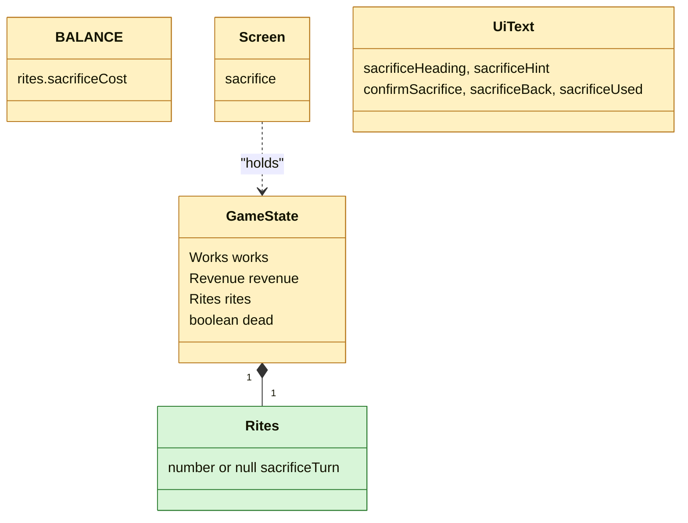
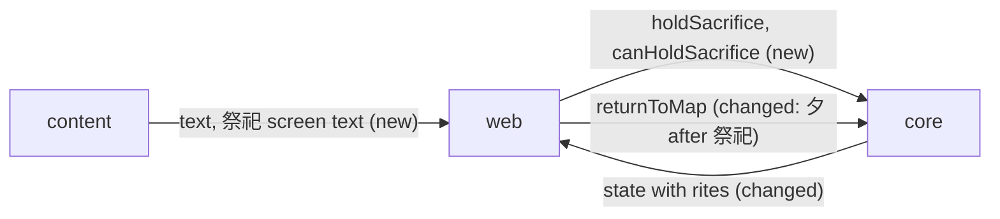

# Brief: 禮部: 祭祀

## Summary
This turns on 禮部 → 祭祀 in 早朝, once per reign year. It costs 國庫 and uses up the 午 slot, so leaving 早朝 lands on 夕. The year's sacrifice is recorded for a later disaster system; 外交 stays "not yet open".

## Features
- 祭祀 opens a confirm screen. 舉行 pays from 國庫 (it may go below 0) and returns to 宣政殿; the player can keep using other departments.
- On 退 the map shows 夕 instead of 午. 祭祀 then stays disabled, tagged 本年已祭, until the next 春上.

## Risk
`medium`: core paths change, and `GameState` gains a `rites` field (additive, `SCHEMA_VERSION` 8 → 9, no saves exist).

## Decisions to review
- Cost `BALANCE.rites.sacrificeCost` = 50,000 taels, under half a half-season's upkeep.
- 午 is spent on 退, not on 舉行, so the header keeps showing 朝 in 早朝.
- State is a turn stamp `rites.sacrificeTurn`, like `exam.turn`, so nothing resets at 春上.
- The disaster system will read `sacrificedThisYear(state)`.
- Hint text: 「舉行祭祀須耗國庫，並佔用午時，可減低本年天災之虞。」

## What you'll see
- `palace-xuanzheng-rites`: 禮部 open, 祭祀 enabled, 外交 tagged 尚未開放.
- `hold-sacrifice`: the confirm screen with heading, hint, 舉行 and 返回.
- `rites-sacrificed`: 宣政殿 after 舉行, 祭祀 tagged 本年已祭, header still 朝.
- `palace-map-dusk`: the map after 退, header 夕, 宣政殿 disabled.

## Use cases
**Added `UC-CORE-023` 祭祀**
- `sacrificedThisYear(state)` is true when `rites.sacrificeTurn` falls in the current reign year (春上 through 冬下). It turns false at the next 春上 without any reset.
- `canHoldSacrifice(state)` is true during 早朝 when it has not been held this reign year. It can be held at any 早朝 of the year, in any half-season.
- `holdSacrifice(state)` takes `BALANCE.rites.sacrificeCost` from 國庫 (it may go below 0) and stamps the turn. It changes no 民心, no emperor stat, and officials have no effect. It draws no random numbers and does not move the clock.
- It is rejected with the state unchanged when it is not 早朝 or the emperor is dead (`not-in-court`), or when it was already held this reign year (`already-held`), checked in that order.
- Bankruptcy at turn end applies as usual if 國庫 is still below 0.

**Changed `UC-CORE-003` 早朝**
- Leaving 早朝 always lands on 午 → it lands on 午, or on 夕 when 祭祀 was held during this 早朝.
- Nothing inside 宣政殿 uses another action point → 祭祀 is the only thing that does, and it uses 午. Leaving still never ends the turn.

**Changed `UC-WEB-007` 宣政殿**
- 禮部: 祭祀 and 外交 both "not yet open" → 祭祀 is enabled while `canHoldSacrifice` is true, and otherwise disabled with the 本年已祭 tag. 外交 is unchanged.
- 退 always shows 午 → it shows 夕 after a sacrifice this 早朝.

**Changed `UC-WEB-004` Game screens**
- The 祭祀 screen joins the image-less screens that show the header as a bar.

**Added `UC-WEB-017` 祭祀**
- Opened from 禮部 → 祭祀 only while `canHoldSacrifice` is true. It shows a header bar, a heading and one hint line that names the cost to 國庫, the 午 slot and the lower disaster risk, with no numbers.
- 舉行 calls `holdSacrifice` and returns to 宣政殿 with 禮部 open. 返回 returns there without holding it. A rejection, or a call from another screen, changes nothing.

## Architecture

Legend: green = new, amber = changed, red dashed = removed.

`core` gets a new `src/model/rites.ts` (the `Rites` type) and `src/rules/rites.ts` (the rules). `returnToMap` in `src/rules/turn.ts` reads `rites.sacrificeTurn` to decide whether the clock goes to 午 or to 夕. `web` adds one screen, `sacrifice`, and `content` adds its text.

## Data flow

Legend: green = new, amber = changed, red dashed = removed.

## Schema and interface changes
- `GameState.rites` (new): `{ sacrificeTurn: number | null }`, starting at `null`. It records when 祭祀 was last held. `SCHEMA_VERSION` goes from 8 to 9.
- `Rites` (new type, `core/src/model/rites.ts`).
- `BALANCE.rites.sacrificeCost` (new tunable).
- New `core` functions: `sacrificedThisYear`, `canHoldSacrifice` and `holdSacrifice`. New types: `RitesRejection = 'not-in-court' | 'already-held'` and `RitesOutcome`.
- `returnToMap` (behaviour): leaving 宣政殿 sets the action point to 夕 when `rites.sacrificeTurn === turn`. Otherwise it sets 午, as before.
- `content` `UiText` gains `sacrificeHeading`, `sacrificeHint`, `confirmSacrifice`, `sacrificeBack` and `sacrificeUsed`.
- `web` `Screen` gains `{ screen: 'sacrifice'; state }`. `OPEN_COURT_OPTIONS` gains `'hold-sacrifice'`. There is a new transition `confirmSacrifice`, and `backToCourt` handles `sacrifice`.

Migration: there are no saves, so nothing migrates.

<details><summary>Full diff</summary>

```diff
 interface GameState { …; revenue: Revenue;
+  rites: Rites;
   dead: boolean }
-SCHEMA_VERSION = 8
+SCHEMA_VERSION = 9
+interface Rites { sacrificeTurn: number | null }                        // core/src/model/rites.ts
+BALANCE.rites = { sacrificeCost }
+type RitesRejection = 'not-in-court' | 'already-held'
+type RitesOutcome = { ok: false; reason: RitesRejection; state } | { ok: true; state }
+sacrificedThisYear(state: Pick<GameState, 'turn' | 'rites'>): boolean
+canHoldSacrifice(state): boolean
+holdSacrifice(state): RitesOutcome
 returnToMap(state)  // from 宣政殿: actionPoint = 午, or 夕 when rites.sacrificeTurn === turn
+UiText: sacrificeHeading, sacrificeHint, confirmSacrifice, sacrificeBack, sacrificeUsed   // content
+  | { screen: 'sacrifice'; state }                                                        // web
+OPEN_COURT_OPTIONS += 'hold-sacrifice'; confirmSacrifice(screen)                          // web
```
</details>

## Out of scope
- The natural-disaster system itself, and any effect of 祭祀 on disaster chance.
- 外交.
- Any effect of 禮部尚書 or other officials on 祭祀.
- Showing the cost anywhere in the UI.

## Rejected alternatives
- Moving the clock to 午 at the moment of 舉行: the issue says the player stays in 早朝, and the header should keep showing 朝 while inside.
- A boolean `sacrificedThisYear` field reset at 春上: a turn stamp matches `exam.turn` and needs no reset code in the turn loop.
- A separate "court slots used" counter: only 祭祀 uses an extra slot, so reading the stamp is enough.
- A result screen after 舉行: the issue says 舉行 returns straight to 宣政殿.

<details><summary>Core paths</summary>

## Core paths
- `packages/core/ARCHITECTURE.md`
- `packages/web/ARCHITECTURE.md`
- `packages/core/src/model/rites.ts`
- `packages/core/src/model/state.ts`
- `packages/core/src/model/balance.ts`
- `packages/core/src/index.ts`
- `packages/content/src/schema.ts`

</details>
