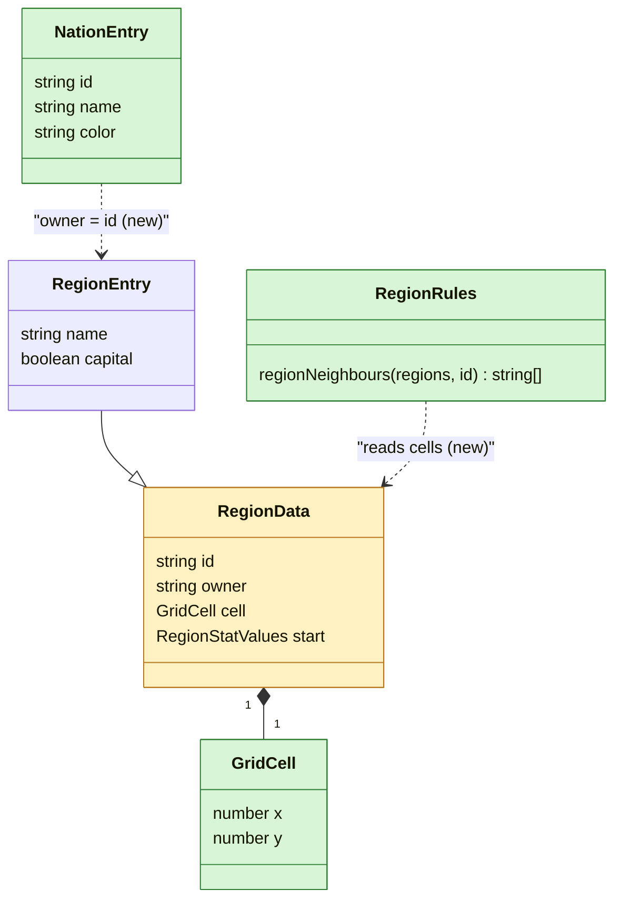
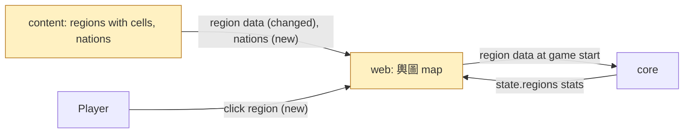

# Brief: Foreign nations on a world grid map

## Summary
Four foreign nations (契丹, 吐蕃, 高麗, 南詔) and their 19 regions join the region data. Every region now sits on one cell of a world grid, and neighbours come from shared cell edges instead of hand-written adjacency lists. The 輿圖 table becomes a read-only map of the whole world, coloured by owner, where clicking a region shows its owner and stats.

## Features
- 輿圖 becomes a world map of square cells, each named and filled with its owner's colour; 關中 is marked 京師; a legend shows nation colours.
- Clicking any region opens a panel with its name, owner, 民心, 人口 and 富庶.
- Foreign nations are passive: no stat changes, tax or posts. Everything else plays as before.
- `core` gains `regionNeighbours`: the up-to-four regions sharing a cell edge, for later issues.

## Risk
`high`: `RegionData`, the shape `content` passes to `core`, drops `adjacent` and gains a required `cell`. That is a breaking schema change. `GameState` does not change (cells are not stored), so `schemaVersion` stays put, and there are no saves to break.

## Decisions to review
- **Grid layout**: 7×6; home regions middle/east, 契丹 north rows, 吐蕃 west columns, 高麗 east behind an empty sea column, 南詔 southwest. Rough geography with every issue rule met (table under "Decision details").
- **Neighbours**: some home neighbour sets change (accepted); 關中, 河東, 河北, 巴蜀, 嶺南 now border foreign regions.
- **Names and stats**: historical seats of each power, all unique; foreign 民心/富庶 inside the home range, foreign 人口 average below home.
- **本朝 is a nation entry** (`PLAYER_OWNER`), so player cells, legend and owner line work like foreign ones.
- **Colours** sit in `content`'s nation list, not CSS. **Only the player's capital** is marked.
- **Order**: home regions first in their old order, so posts and lists don't change. **Panel** starts closed, with a hint line.

## What you'll see
- `atlas` (changed): the 輿圖 world map with all 28 regions coloured by owner, 關中 marked 京師, empty cells plain, the legend, a hint line and the 返回崇文館 button.
- `atlas-region` (new): the same map with 上京 selected and its panel open, showing 契丹 as owner and its 民心, 人口 and 富庶.

## Decision details
- **Grid layout** (7 columns × 6 rows, x grows east, y south; `·` = empty). Player regions in **bold**:

  | y\x | 0 | 1 | 2 | 3 | 4 | 5 | 6 |
  |---|---|---|---|---|---|---|---|
  | 0 | · | · | · | 祖州 | 上京 | 長春 | 黃龍 |
  | 1 | · | · | 豐州 | 中京 | 興中 | 東京 | 西京 |
  | 2 | 象雄 | 青海 | · | **河東** | **河北** | · | 開京 |
  | 3 | 蘇毗 | 邏些 | **關中** | **中原** | **山東** | · | 慶州 |
  | 4 | 雅隆 | 多康 | **巴蜀** | **荊楚** | **江南** | · | · |
  | 5 | · | 太和 | 拓東 | **嶺南** | · | · | · |

  契丹 = row 0–1 west of 西京 (8); 吐蕃 = columns 0–1, rows 2–4 (6); 高麗 = column 6, rows 1–3 (3), separated from 河北/山東 by the empty column 5 (the sea); 南詔 = 太和, 拓東 (2). Reason: rough real geography with every rule in the issue met.
- **Player neighbours change** (accepted by the issue): e.g. 中原 loses 河北 and 江南 and keeps 河東, 關中, 山東, 荊楚; 關中 now borders 吐蕃 (邏些); 河東 and 河北 border 契丹; 巴蜀 borders 吐蕃 and 南詔; 嶺南 borders 南詔.
- **Region names** are historical seats of each power (契丹: 上京, 中京, 東京 …; 吐蕃: 邏些, 象雄 …; 南詔: 太和, 拓東; 高麗: 開京, 西京, 慶州). All 28 names are unique; 慶州 is used only for 高麗.
- **Foreign stats**: 民心 55–65 and 富庶 40–60 (inside the player's 55–65 and 40–75), 人口 1.5M–3M with a foreign average of about 2.2M against the player's 3.4M.
- **The player's realm is a nation entry** with ID `PLAYER_OWNER`, named 本朝, so player cells, the legend and the owner line work the same way as for foreign nations.
- **Colours** live in `content`'s nation list, as the issue says, not in `style.css`: 本朝 vermilion, 契丹 slate blue, 吐蕃 ochre, 高麗 green, 南詔 purple; white names with a dark shadow; empty cells parchment.
- **Only the player's capital is marked.** Foreign capitals (上京, 邏些 …) get no mark; `capital` keeps meaning the player's capital.
- **Order**: home regions first in their old order (so posts and every existing list stay the same), then 契丹, 吐蕃, 高麗, 南詔.
- **Panel**: closed when the atlas opens, with a hint line in its place; it has its own close button; clicking another region switches it.

## Use cases
**Added `UC-CONTENT-005` Nations**
- `nations` lists every region owner in legend order: 本朝 (`PLAYER_OWNER`), 契丹, 吐蕃, 高麗, 南詔.
- Each has a unique ID, a Chinese name and a distinct map colour.
- Every region's owner is a listed nation, and every nation owns at least one region.
- Nations are data only: nothing in the game state, no behaviour.

**Changed `UC-CORE-014` Regions**
- before: regions are loaded with an owner and stats; adjacency is a static list → after: each region also has a grid cell; adjacency lists are gone.
- added: foreign regions are passive (no stat change, no tax, no levy, no 工匠 count, no posts), which the existing player-only rules already ensure.
- added: `regionNeighbours(regions, id)` returns the regions whose cell is one step away along x or y (never diagonal, at most four, any owner), in data order; an unknown ID gives `[]`.

**Changed `UC-CONTENT-001` Regions**
- before: the nine home regions with adjacency lists, symmetric by test → after: the nine home regions, in the same order, then 19 foreign regions grouped by nation (契丹 8, 吐蕃 6, 高麗 3, 南詔 2), each with a grid cell.
- before: adjacency follows geography → after: no two regions share a cell; each nation's regions form one edge-connected block; the layout puts the home regions middle/east, 契丹 north/northeast, 高麗 east of 契丹, 吐蕃 west, 南詔 southwest; 高麗 touches no home region.
- added: foreign 民心 and 富庶 within the home regions' range, foreign average 人口 below the home average; names unique.
- unchanged: 關中 is the only capital, and the home regions' tax per collection stays the same.

**Changed `UC-WEB-006` 輿圖**
- before: a table of every region with 民心, 人口, 富庶 → after: a grid map of the whole world, one coloured cell per region with its name, 京師 on 關中, plain empty cells, and a legend.
- added: clicking a region opens a panel (name, owner, 民心, 人口, 富庶); another click switches it; a close button clears it; a hint line shows when nothing is selected. Opening always starts with nothing selected.
- added: `selectAtlasRegion(screen, region)` sets or (with `null`) clears the selection; an unknown ID or a non-atlas screen is unchanged. `closeAtlas` drops the selection.
- unchanged: opened from 崇文館 only, uses no action point, changes no `GameState`.

## Architecture

Legend: green = new, amber = changed, red dashed = removed.

`RegionData` (core) swaps `adjacent` for `cell`; `content` adds a nation list next to the region list. Owners stay plain strings, so `core` still knows nothing about which nations exist.

## Data flow

Legend: green = new, amber = changed, red dashed = removed.

The map reads cells and names from `content`'s regions, colours and owner names from `content`'s nations, and live stats from `state.regions`.

## Schema and interface changes
- `RegionData` (core): `adjacent: readonly string[]` removed, `cell: GridCell` added. Breaking: every region entry and test fixture must change. Grid neighbours replace the lists.
- `GridCell` (core, new): `{ x: number; y: number }`, exported.
- `regionNeighbours(regions, id): string[]` (core, new): neighbours derived from shared edges.
- `NationEntry` (content, new) and `GameText.nations: readonly NationEntry[]` (new): ID, name, map colour per region owner.
- `UiText` (content): four new keys for the map (owner label, hint, panel close button, legend heading) and one for the map's screen-reader label. Additive.
- `Screen` `atlas` (web): optional `region?: string`, the selected region. Additive, UI state only.
- `selectAtlasRegion(screen, region: string | null)` (web, new) transition.

Migration: none needed. `GameState` is unchanged and there are no saves; all region data lives in `content` and is updated in this change.

<details><summary>Full diff</summary>

```diff
 // packages/core/src/model/region.ts
+export interface GridCell { x: number; y: number }
 export interface RegionData {
   id: string;
   owner: string;
-  adjacent: readonly string[];
+  cell: GridCell;
   start: RegionStatValues;
 }
+// packages/core/src/rules/regions.ts
+export function regionNeighbours(regions: readonly RegionData[], id: string): string[];

 // packages/content/src/schema.ts
+export interface NationEntry { id: string; name: string; color: string }
 export interface UiText {
+  ownerLabel: string;
+  atlasHint: string;
+  closeRegionPanel: string;
+  legendHeading: string;
+  atlasMapLabel: string;
 }
 export interface GameText {
+  nations: readonly NationEntry[];
 }

 // packages/web/src/screen.ts
-  | { screen: 'atlas'; state: GameState }
+  | { screen: 'atlas'; state: GameState; region?: string }
+export function selectAtlasRegion(screen: Screen, region: string | null): Screen;
```
</details>

## Out of scope
- 兵部 → 調兵遣將, soldiers, attacking and 外交.
- Any nation behaviour: growth, stat changes, attacks, tax.
- Marking foreign capitals, and any use of `regionNeighbours` in play.
- Nations in the save state.

## Rejected alternatives
- Keeping hand-written `adjacent` lists beside the cells: two sources of truth that could disagree; the issue replaces them.
- Storing cells or nations in `GameState`: they are static; the issue keeps nations out of the state.
- Putting nation colours in `style.css` keyed by nation ID: the issue asks for colour in the nation data, and a CSS map would let a new nation slip through without a colour.
- A free-form drawn map image: cells must match the grid that neighbours come from.

<details><summary>Core paths</summary>

## Core paths
- `docs/architecture.md`
- `packages/core/ARCHITECTURE.md`
- `packages/content/ARCHITECTURE.md`
- `packages/web/ARCHITECTURE.md`
- `packages/core/src/model/region.ts`
- `packages/core/src/model/state.test.ts` (fixtures only; `state.ts` itself is unchanged)
- `packages/core/src/index.ts`
- `packages/content/src/schema.ts`

</details>
