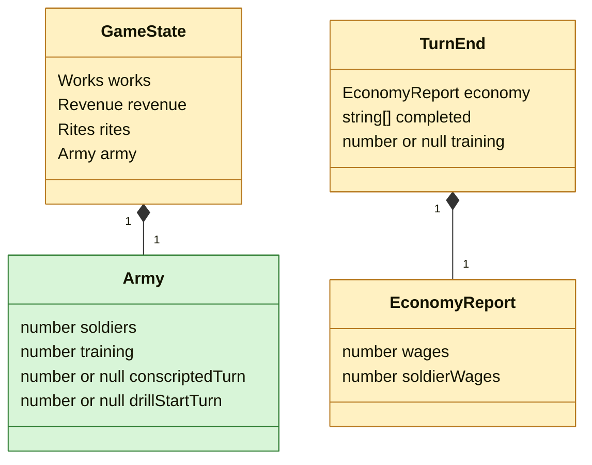
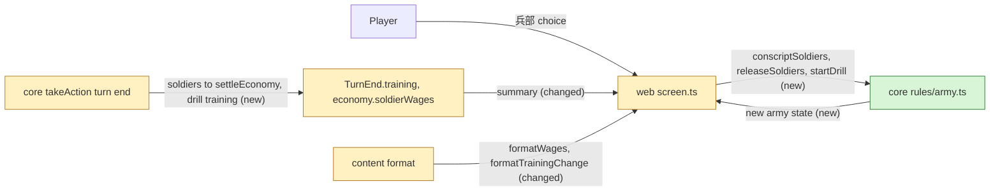

# Brief: 兵部 soldiers — 徵召士兵, 解甲歸田 and 操練軍隊

## Summary
The nation gets one soldier pool with a training value, run from 兵部. 徵召士兵 adds soldiers from the free population once per 早朝 and dilutes training. 解甲歸田 releases them for free. 操練軍隊 pays once for a year of drill that raises training each half-season. Soldiers draw a wage every half-season, and the turn summary shows soldier wages and the training gain.

## Features
- A new game starts with 20,000 soldiers at training 50 (out of 100).
- 兵部 lists 徵召士兵, 解甲歸田 (new) and 操練軍隊, all usable now.
- 徵召士兵 works like 徵召工匠: once per 早朝, in steps of 10,000, up to 1% of free population, no action point. Recruits count as training 0 in a soldier-weighted average.
- 解甲歸田 releases soldiers in steps of 10,000, or all of them, any number of times per 早朝, at no cost. Training does not change.
- Soldiers are now taken off the free population, so recruiting soldiers lowers the 工匠 maximum, and recruiting 工匠 lowers the soldier maximum.
- 國庫 pays each soldier 0.5 taels per half-season (10,000 taels for the starting army). If 國庫 runs short, the usual bankruptcy rule applies.
- 操練軍隊 costs 100,000 taels up front and runs for 8 half-seasons. Training rises by 2 at each half-season end, up to 100. A drill can't be cancelled or extended. The screen shows how many half-seasons are left, and its button is disabled while a drill runs.
- The turn summary's wages line shows 工匠 wages and 兵餉 side by side, and a 訓練 +N line appears while a drill is running.

## Risk
`medium`: it changes core paths and three modules. The `GameState` change is additive (new `army` field, schema version 9 → 10). Nothing is removed or renamed, and there are no saves yet.

## Decisions to review
- Balance in `BALANCE.army`: step 10,000 and conscript limit 1% of free population (same as 工匠), wage 0.5 taels per soldier (same as 工匠), starting training 50, drill cost 100,000 taels (twice 祭祀).
- Dilution rounds down to a whole number. Conscripting with 0 soldiers sets training to 0.
- 解甲歸田 leaves training unchanged, even when it releases every soldier.
- 操練軍隊 can start with 0 soldiers, and when 國庫 is short (it goes negative, as 祭祀 does). It uses no action point, unlike 祭祀.
- The first training gain comes at the end of the half-season the drill starts in, so a drill gives its 8 gains by the end of that year.
- After confirming, the player stays on the 操練軍隊 screen, which then shows the drill running. 祭祀 returns to 宣政殿 instead; staying here shows the result straight away.
- 操練軍隊 stays enabled in 兵部 while a drill runs, so the player can open the screen and see how long is left.
- The training line also shows at the cap, as 訓練 +0, because the issue says to show it whenever a drill is running.
- The 解甲歸田 option ID is `release-soldiers`. It sits between `conscript-soldiers` and `drill-troops`.
- The 徵召士兵 screen has a one-line hint that recruits lower training.
- The 操練軍隊 screen shows the cost in taels. 祭祀 shows no cost, but here the issue makes the up-front payment the point.
- Soldier wages are a new `EconomyReport.soldierWages` field. `wages` keeps meaning 工匠 wages, so nothing that reads it changes meaning.

## What you'll see
- `palace-xuanzheng-war`: 兵部 opened with 徵召士兵, 解甲歸田 and 操練軍隊, all enabled.
- `conscript-soldiers`: 徵召士兵 with the soldier count, free population, this 徵召's maximum, a dilution hint and the number picker.
- `release-soldiers`: 解甲歸田 with the soldier count and a picker whose maximum button releases all soldiers.
- `drill-troops`: 操練軍隊 with the soldier count, training 50, a cost and duration hint, and a 開始操練 button.
- `drill-troops-running`: the same screen after confirming, with "操練中，尚餘八半季" and the button disabled. 國庫 in the header is 100,000 lower.
- `turn-summary-army`: a turn summary after a drill half-season, with the wages line showing 兵餉 −10,000 兩 and a 訓練 +2 line.
- Changed: every turn summary (`turn-summary`, `turn-summary-tax`, `turn-summary-works`) now shows a wages line, because the starting army is always paid. `recruit-artisans` shows a free population 20,000 lower.

## Use cases

**Added `UC-CORE-024` 士兵**
- The nation has one soldier count, not split by region, starting at `BALANCE.army.startingSoldiers`. Soldiers are taken off the free population. Region 人口 and taxes are unchanged, officials have no effect, and soldiers affect nothing else yet.
- Every count is a multiple of `BALANCE.army.step`.
- 徵召士兵 (`conscriptSoldiers`) works only in 早朝, once per half-season (`army.conscriptedTurn`). It allows one step up to `maxConscript` = free population × `conscriptPercent`%, rounded to the nearest step. It uses no action point. New training = old training × old soldiers ÷ new total, rounded down. It is rejected for `not-in-court`, `already-used` or `invalid-count`, in that order.
- 解甲歸田 (`releaseSoldiers`) works only in 早朝, any number of times, at no cost, from one step up to the soldier count. Training is unchanged. It is rejected for `not-in-court` or `invalid-count`.
- Wages are paid with upkeep each half-season. No army-specific rule applies when 國庫 can't pay.

**Added `UC-CORE-025` 操練軍隊**
- Training is a whole number from 0 to `BALANCE.army.maxTraining`. It changes only through drill and dilution, and never decays.
- `drillTurnsLeft` = `drillStartTurn` + `drillTurns` − `turn`, or 0. A drill runs while it is above 0.
- `startDrill` works in 早朝 when no drill is running. It takes `drillCost` from 國庫 once (國庫 may go negative) and stamps the turn. It uses no action point and works with 0 soldiers. It is rejected for `not-in-court`, or for `already-drilling` while a drill runs. A drill can't be cancelled or extended.
- At each half-season end the emperor survives while a drill is running (after building progress), training rises by `drillGain`, capped. `TurnEnd.training` reports the gain (0 at the cap), or `null` when no drill ran or the emperor died.

**Added `UC-WEB-018` 徵召士兵, `UC-WEB-019` 解甲歸田, `UC-WEB-020` 操練軍隊**
- 徵召士兵 shows the soldier count, free population, maximum and a dilution hint, with the 工匠-style picker. Confirming returns to 宣政殿 with 兵部 open. Back changes nothing.
- 解甲歸田 shows the soldier count and a picker up to all soldiers. Confirming returns to 宣政殿 with 兵部 open.
- 操練軍隊 shows the soldier count and training. When idle, it shows a hint with the cost and one-year length, and confirming starts the drill and stays on the screen. While a drill runs, it shows the half-seasons left in Chinese numerals and disables the confirm button. Back returns to 宣政殿 with 兵部 open.

**Changed `UC-CORE-019` 工匠**
- free population = player 人口 − 工匠 → player 人口 − 工匠 − soldiers

**Changed `UC-CORE-012` Turn loop**
- after the last action point, if the emperor survives: economy settled, then building progress → economy settled, then building progress, then drill training (UC-CORE-025)

**Changed `UC-CORE-015` Economy**
- `settleEconomy(…, artisans, taxLevel)` → also takes `soldiers` and pays `soldiers × BALANCE.army.wagePerSoldier`, rounded down, reported as `soldierWages`

**Changed `UC-CORE-014` Regions**
- foreign regions are ignored by the 工匠 limit → ignored by the 工匠 and soldier limits

**Changed `UC-WEB-007` 宣政殿**
- 兵部: 徵召士兵 and 操練軍隊 "not yet open" → 徵召士兵, 解甲歸田, 操練軍隊, all open. 徵召士兵 is disabled with a tag when already used or when no one can be recruited, and 解甲歸田 is disabled with a tag when there are no soldiers.

**Changed `UC-WEB-004` Game screens**
- wages line: 工匠 wages only → 工匠 wages and 兵餉 side by side, each part only when above 0
- no training line → a 訓練 ±N line after the wages line while a drill is running
- the header-bar screen list adds the three 兵部 screens

**Changed content formatting**
- `formatWages(wages)` → `formatWages(artisanWages, soldierWages)`. New: `formatTrainingChange(amount)`.

## Architecture

Legend: green = new, amber = changed, red dashed = removed.

`core` gains `src/model/army.ts` (the `Army` type) and `src/rules/army.ts` (the 徵召士兵, 解甲歸田 and drill rules). `web`'s `Screen` gains `conscript`, `discharge` and `drill`, and `summary` gains `training`.

## Data flow

Legend: green = new, amber = changed, red dashed = removed.

## Schema and interface changes
- `GameState.army: Army` (new, `{ soldiers, training, conscriptedTurn, drillStartTurn }`): holds 兵部's state. `SCHEMA_VERSION` goes from 9 to 10.
- `BALANCE.army` (new): the starting soldiers and training, the training cap, step, conscript percent, wage, drill cost, length and gain.
- `EconomyReport.soldierWages` (new): reports soldier wages apart from 工匠 `wages`.
- `TurnEnd.training: number | null` (new): the training gained this turn end, for the summary.
- `settleEconomy` gets an optional 6th parameter, `soldiers` (default 0), so existing calls still work.
- New `core` exports: `Army`, `ArmyRejection`, `ArmyOutcome`, `maxConscript`, `canConscript`, `conscriptSoldiers`, `releaseSoldiers`, `drillTurnsLeft`, `canDrill`, `startDrill`.
- `COURT_OPTION_IDS` and `DEPARTMENTS.war` get `release-soldiers` (new registry entry).
- `freePopulation` now also subtracts soldiers (a behaviour change, not a schema change).
- `content`: `UiText` gets new keys for the 兵部 screens, `兵餉` and `訓練`. `gameText.courtOptions` gets `release-soldiers`. `formatWages` takes two amounts, and `formatTrainingChange` is new.
- `web` `Screen`: adds `conscript`, `discharge` and `drill`, and `summary` adds `training`.

Migration: there are no saves, so nothing migrates. Tests that pinned free population, the 工匠 maximum or 國庫 after a turn get the new values.

<details><summary>Full diff</summary>

```diff
 interface GameState {
   ...
   rites: Rites;
+  army: Army;
   dead: boolean;
 }
+interface Army { soldiers: number; training: number; conscriptedTurn: number | null; drillStartTurn: number | null }
-interface EconomyReport { taxIncome: number; upkeep: number; wages: number; regionChanges: RegionChange[] }
+interface EconomyReport { taxIncome: number; upkeep: number; wages: number; soldierWages: number; regionChanges: RegionChange[] }
-interface TurnEnd { aging: number; totals: StatChange[]; economy: EconomyReport; completed: string[] }
+interface TurnEnd { aging: number; totals: StatChange[]; economy: EconomyReport; completed: string[]; training: number | null }
-function settleEconomy(nation, regions, nextHalfSeason, artisans?, taxLevel?)
+function settleEconomy(nation, regions, nextHalfSeason, artisans?, taxLevel?, soldiers?)
-function formatWages(wages: number): string
+function formatWages(artisanWages: number, soldierWages: number): string
+function formatTrainingChange(amount: number): string
```
</details>

## Out of scope
- Soldier count and training affect nothing else yet. War strength comes later.
- 組建軍團 and 調兵遣將 (moving 軍團 on the map) are a separate issue.
- Official posts (總兵, 大將軍, 兵部尚書) have no army effect.
- 收支表 still leaves out wages, as it does for 工匠.

## Rejected alternatives
- Storing the half-seasons left and counting them down: they can be derived from the start turn, following the `sacrificeTurn` pattern.
- Folding soldier wages into `EconomyReport.wages`: that changes an existing field's meaning, and the summary needs the two amounts apart.
- Making training an entry in `STAT_REGISTRY`: stats there belong to the emperor, nation, regions or officials and show in places training should not, such as region changes.
- Returning to 宣政殿 after confirming 操練軍隊: the player would have to reopen the screen to see the drill running.

<details><summary>Core paths</summary>

## Core paths
- `packages/core/ARCHITECTURE.md`
- `packages/web/ARCHITECTURE.md`
- `packages/core/src/model/army.ts`
- `packages/core/src/model/balance.ts`
- `packages/core/src/model/state.ts`
- `packages/core/src/model/court.ts`
- `packages/core/src/index.ts`
- `packages/content/src/schema.ts`

</details>
