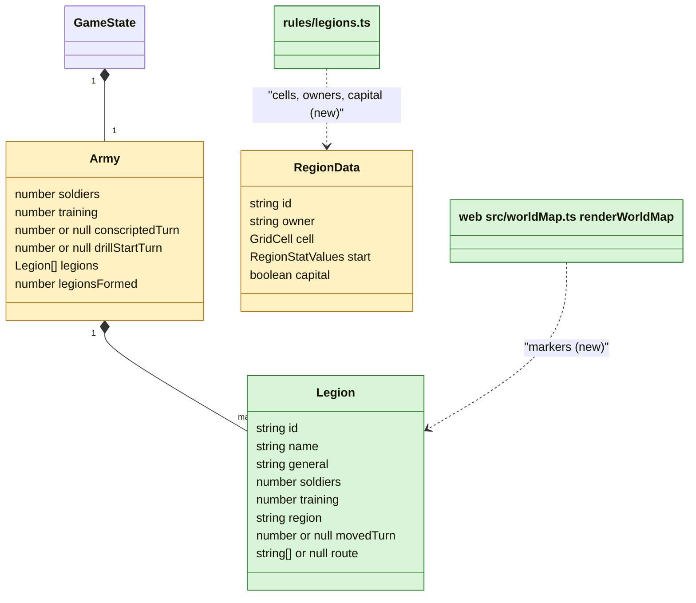
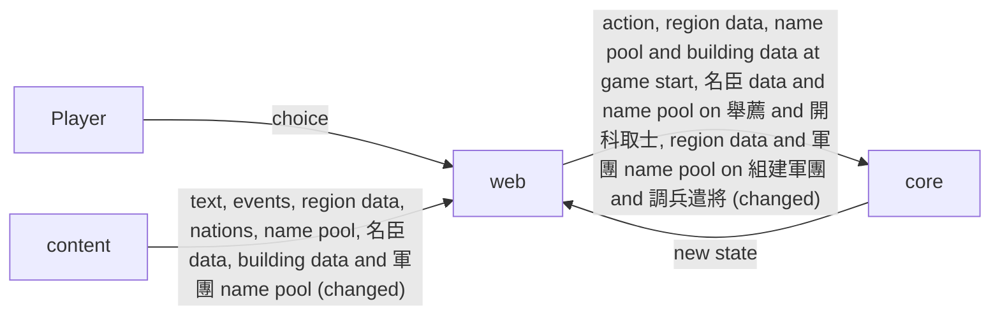

# Brief: 組建軍團 and 調兵遣將

## Summary
兵部 gets two new court options. 組建軍團 moves pool soldiers into a named 軍團 led by a 賦閑 official, stationed in 關中. 調兵遣將 shows 軍團 on the world map, where they move one region per half-season or are recalled to march home and disband. 軍團 soldiers cost double wages.

## Features
- **組建軍團:** pick a 賦閑 將軍, a size in steps of 10,000 and a two-character name (one of three suggestions, or typed). The 軍團 starts in 關中 with the pool's training.
- **Limits:** 組建軍團 is disabled with a reason tag while a stationed 軍團 holds 關中, the pool is empty, or no one is 賦閑.
- **將軍:** an official leading a 軍團 is not 賦閑 until it disbands.
- **調兵遣將:** click a marker to see a 軍團. Move it once per half-season to a neighbouring player region with no stationed 軍團, or 招回 it.
- **招回:** it marches one region per half-season by the shortest path to 關中, then disbands into the pool, with training averaged by soldiers.
- **Wages and 輿圖:** the turn summary shows a separate 軍團兵餉 part. 輿圖 shows the markers read-only.

## Risk
`medium`. Core paths change across three modules, all additively (`GameState.army`, `RegionData`, `EconomyReport`, new exports). There are no saves.

## Decisions to review
- **Finding 關中:** an optional `capital` flag on core's `RegionData`, not a hard-coded ID.
- **招回 route:** computed once when ordered and stored on the 軍團, so `takeAction` keeps its signature. #62 must revisit this.
- **Free population:** 軍團 soldiers still count against it, so forming a 軍團 can't open room for unlimited conscription.
- **Turn-end order:** wages first, so a 軍團 that disbands that turn still pays. The march comes after drill.
- **Name suggestions:** seeded from `rngState` + `legionsFormed`, without advancing `rngState`.
- **Timing:** a new 軍團 can move at once, and 招回 works in the half-season it moved.
- **Balance:** maximum 軍團 size 100,000, wage multiplier 2 (1 tael per soldier per half-season).

<details><summary>Minor decisions</summary>

- Merged training rounds down. Names are trimmed and must be two Han characters, like 年號. 軍 is shown after the input.
- The empty-pool tag reuses 「無兵可遣」. The no-idle tag is 「無賦閑官員」.
- 軍團 IDs are `legion-1`, `legion-2` and so on, never reused.
- After forming, the game returns to 宣政殿 with 兵部 open.
- A returning 軍團's panel shows the half-seasons left. In 關中, the panel warns that 招回 disbands at once.
- The 將軍 list shows the four official stats.
- The name pool (20 names) is in `tasks.md` Task 3, and all new wording in Tasks 3–6.

</details>

## What you'll see
- `palace-xuanzheng-war` (changed): 兵部 lists 徵召士兵, 解甲歸田, 操練軍隊, 組建軍團 and 調兵遣將.
- `form-legion`: 組建軍團 screen with pool soldiers and training, the maximum size, the 賦閑 list with stats, the picker, three suggested names and the name input.
- `form-legion-ready`: the same, with a 將軍 chosen (marked), a suggestion filled in, and confirm enabled.
- `form-legion-error`: confirming with an empty name shows the two-character error.
- `palace-xuanzheng-war-capital-occupied`: after forming, 組建軍團 is disabled with 「京師已有軍團駐紮」.
- `deploy-legions-empty`: 調兵遣將 with no 軍團, showing the map and a 「尚無軍團」 line.
- `deploy-legions`: a 軍團 selected in 關中, with its panel, 中原 and 巴蜀 highlighted with 移駐 buttons, and the line saying 招回 here disbands it.
- `deploy-legions-moved`: after moving to 中原, the marker is there and the panel says it has moved this half-season.
- `deploy-legions-returning`: after 招回 in 中原, the marker is styled as returning, with one half-season left.
- `atlas-legions`: 輿圖 with the 軍團 marker in 關中.
- `turn-summary-legion-wages`: the wages line shows 兵餉 and 軍團兵餉 side by side.

## Use cases
**Added `UC-CORE-026` 組建軍團**
- `formLegion(state, regions, generalId, count, name)` only works at 早朝. It takes `count` soldiers (a step multiple from one step up to min(pool, `BALANCE.army.legionMaxSoldiers`)) out of the pool and puts them in a new 軍團. The 軍團 keeps the pool's current training, has the given 賦閑 official as 將軍, and is stationed in the capital. It uses no action point and can be repeated.
- It is rejected in this order: `not-in-court`, `no-capital`, `capital-occupied` (a stationed 軍團 is in the capital), `unknown-official`, `not-idle`, `invalid-count`, `invalid-name` (not exactly two Han characters), `name-taken` (another existing 軍團 has the name).
- The name is stored without 軍. Once a 軍團 disbands, its name can be used again. `drawLegionNameSuggestions` draws up to 3 free names from content's pool and leaves `rngState` unchanged.
- 徵召士兵, 解甲歸田 and 操練軍隊 never touch a 軍團. Its soldiers and training stay fixed.
- Wages: each 軍團 soldier is paid `wagePerSoldier × legionWageMultiplier` per half-season, reported as `legionWages`.

**Added `UC-CORE-027` 調兵遣將**
- At most one *stationed* 軍團 can be in a region. *Returning* 軍團 don't count.
- `moveLegion` moves a 軍團 once per half-season into a neighbouring player region with no stationed 軍團. It has no cost. It is rejected in this order: `not-in-court`, `unknown-legion`, `returning`, `already-moved`, `not-neighbour`, `not-owned`, `occupied`. `legionMoves` lists the valid targets.
- `recallRoute` finds the shortest path through player regions to the capital, breadth-first, trying neighbours in region-data order. Stationed 軍團 don't block it. It gives `[]` in the capital and `null` when there is no path.
- `recallLegion` disbands the 軍團 at once if it is in the capital. Otherwise it stores the route and marks the 軍團 returning. It is rejected in this order: `not-in-court`, `unknown-legion`, `returning`, `no-route`. It can't be cancelled.
- At each turn end (when the emperor survives, after drill training), each returning 軍團 moves one region along its route. On reaching the capital it disbands, even if a stationed 軍團 is there.
- Disbanding: the soldiers rejoin the pool, pool training becomes the soldier-weighted average (rounded down), and the 將軍 is 賦閑 again.

**Added `UC-WEB-021` 組建軍團 screen**
- It opens from 兵部 when `canFormLegion` is true. It shows pool soldiers, pool training and the maximum size, a 賦閑 list with stats and a choose button per row, the number picker, three suggestion buttons and a name input with 軍 after it.
- Clicking a suggestion fills the input but doesn't form the 軍團. Typed text survives redraws. Confirm stays disabled until a 將軍 is chosen. Confirm and Enter trim the name and call `formLegion`.
- On success the game returns to 宣政殿 with 兵部 open. A name rejection keeps everything and shows an error alert. Back leaves without forming.

**Added `UC-WEB-022` 調兵遣將 screen**
- It shows the shared world map with 軍團 marker buttons (returning ones styled apart and tagged 回師) and the legend. Region cells are not clickable. With no 軍團 it shows a "none" line. Otherwise, with nothing selected, it shows a hint.
- Selecting a marker opens a panel with the name, 將軍, soldiers, training, region and status (returning shows the half-seasons left).
- If the selected 軍團 can move, its target cells are highlighted and each gets a 移駐 button. After moving it shows "moved this half-season". If it can't move anywhere, it shows a "nowhere to go" line.
- 招回 is disabled with 無路可返 when there's no route. In 關中 a line warns that 招回 disbands the 軍團 at once, and doing so closes the panel.

**Changed `UC-CORE-004` Officials and appointments**
- 賦閑 means post `null` → post `null` **and** not leading a 軍團 (`isIdleOfficial`). `appointOfficial` rejects a 將軍 with `not-idle`.

**Changed `UC-CORE-014` Regions**
- No capital in core → a region can be flagged `capital` in its data, and `capitalRegion(regions)` returns it.

**Changed `UC-CORE-012` Turn loop**
- Turn end: economy, buildings, drill → economy, buildings, drill, then the returning 軍團 march.

**Changed `UC-CORE-015` Economy**
- Wages are 工匠 + pool soldiers → 工匠 + pool soldiers + 軍團 soldiers at the double rate. `settleEconomy` gets a 7th argument, `legionSoldiers`, and the report gets `legionWages`.

**Changed `UC-CORE-019` 工匠**
- Free population = 人口 − 工匠 − soldiers → 人口 − 工匠 − pool soldiers − 軍團 soldiers.

**Changed `UC-CORE-024` 士兵**
- One national soldier count → a national pool, which 軍團 soldiers leave and later rejoin. All its rules act on the pool only.

**Changed `UC-CORE-025` 操練軍隊**
- Training changes through drill and dilution → also through a 軍團 disbanding. Drill never raises a 軍團's training.

**Changed `UC-WEB-004` Game screens**
- Wages line with 工匠 and soldier parts → plus a 軍團兵餉 part when it is above 0. The bar-header list now includes the two new screens.

**Changed `UC-WEB-006` 輿圖**
- No 軍團 shown → read-only 軍團 markers in their cells, with returning ones styled apart.

**Changed `UC-WEB-007` 宣政殿**
- 兵部's options: three → five, adding 組建軍團 (disabled with a tag for 京師 occupied, no soldiers or no 賦閑) and 調兵遣將 (always enabled). `chooseCourtOption` gets `regions` and `legionNames` arguments.

**Changed `UC-WEB-008` 官員任命**
- The 賦閑 list is officials with no post → officials for whom `isIdleOfficial` is true, so 將軍 are left out.

**Changed content "Text rules" and "Formatting"**
- No 軍團 names → `legionNamePool` (about twenty valid two-character names). `formatWages(a, s)` → `formatWages(a, s, legion = 0)` with a 軍團兵餉 part. New `formatLegionName(name)` → name + 軍.

## Architecture

Legend: green = new, amber = changed, red dashed = removed.

`Army` now holds the 軍團 list, and the new `src/rules/legions.ts` holds the 軍團 rules. Like `regionNeighbours`, those rules take the region data as an argument, because cells and the capital are not in the state. In `web`, the 輿圖 grid moves into a shared `renderWorldMap`, used by both 輿圖 and 調兵遣將.

## Data flow

Legend: green = new, amber = changed, red dashed = removed.

`web` passes `gameText.regions` to each 軍團 rule, and `gameText.legionNamePool` when it opens 組建軍團.

## Schema and interface changes
- `Army` (core) adds `legions: Legion[]` and `legionsFormed: number`, starting empty and 0, to hold the 軍團.
- `SCHEMA_VERSION` (core) goes from 10 to 11, because `Army` changes shape.
- New `Legion` type (core, `src/model/army.ts`): `{ id, name, general, soldiers, training, region, movedTurn, route }`.
- `RegionData` (core) adds an optional `capital?: boolean`, so core can find 關中. Content's `RegionEntry` already has a required `capital`.
- `EconomyReport` (core) adds `legionWages: number`, so the turn summary can show 軍團兵餉.
- `settleEconomy` (core) gets an optional 7th argument, `legionSoldiers = 0`, to charge the double wage.
- New core exports: `LegionRejection`, `LegionOutcome`, `capitalRegion`, `isIdleOfficial`, `legionSoldiers`, `maxLegionSoldiers`, `isValidLegionName`, `drawLegionNameSuggestions`, `stationedLegion`, `canFormLegion`, `formLegion`, `legionMoves`, `moveLegion`, `recallRoute`, `canRecall`, `recallLegion`.
- `BALANCE.army` adds `legionMaxSoldiers` and `legionWageMultiplier`.
- `COURT_OPTION_IDS` adds `'form-legion'` and `'deploy-legions'` after `'drill-troops'`. `DEPARTMENTS.war` lists both.
- Content's `UiText` gets new keys for the two screens and their tags.
- Content's `GameText` gets `legionNamePool`, the names 組建軍團 suggests from.
- Content's `formatWages` gets an optional third argument, `legionWages = 0`, adding the 軍團兵餉 part.
- New content function `formatLegionName(name)` adds 軍 after the stored name.
- Web's `Screen` adds the `legion` and `deploy` variants for the two new screens.
- Web's `chooseCourtOption` gets optional `regions` and `legionNames` arguments, which the two new 兵部 options need.

Migration: there are no saves. All of these are additions, and existing callers keep working through the defaults.

<details><summary>Full diff</summary>

```diff
 interface Army {
   soldiers: number; training: number; conscriptedTurn: number | null; drillStartTurn: number | null;
+  legions: Legion[]; legionsFormed: number;
 }
+interface Legion { id: string; name: string; general: string; soldiers: number; training: number; region: string; movedTurn: number | null; route: string[] | null }
 interface RegionData {
   id: string; owner: string; cell: GridCell; start: RegionStatValues;
+  capital?: boolean;
 }
-interface EconomyReport { taxIncome; upkeep; wages; soldierWages; regionChanges }
+interface EconomyReport { taxIncome; upkeep; wages; soldierWages; legionWages; regionChanges }
-settleEconomy(nation, regions, next, artisans?, taxLevel?, soldiers?)
+settleEconomy(nation, regions, next, artisans?, taxLevel?, soldiers?, legionSoldiers?)
 BALANCE.army = { ..., 
+  legionMaxSoldiers: 100000, legionWageMultiplier: 2 }
-SCHEMA_VERSION = 10
+SCHEMA_VERSION = 11
 COURT_OPTION_IDS = [..., 'drill-troops',
+  'form-legion', 'deploy-legions',
   ...]
-formatWages(artisanWages, soldierWages)
+formatWages(artisanWages, soldierWages, legionWages = 0)
+formatLegionName(name)
+gameText.legionNamePool
 type Screen = ...
+  | { screen: 'legion'; state; general?; count; suggestions; draft; error? }
+  | { screen: 'deploy'; state; legion? }
-chooseCourtOption(screen, optionId, notables, names)
+chooseCourtOption(screen, optionId, notables, names, regions = [], legionNames = [])
```
</details>

## Out of scope
- Entering foreign regions, attacking, and 招回 routes changing as borders move: #62.
- Weapons and gear.
- Any effect of the 將軍's stats, 總兵 or 大將軍.
- A turn-summary line for a 軍團 that disbanded on arrival. The marker just disappears and the pool grows.
- Merging, splitting or resizing an existing 軍團, or renaming it.

## Rejected alternatives
- **Storing the capital or cells in `GameState`:** that would duplicate static content data. Passing region data matches `regionNeighbours`.
- **Recomputing the route at each turn end:** that would mean passing region data to `takeAction`, a wider interface change for no gain while owners can't change.
- **Hard-coding `'guanzhong'` in core:** core would then know about content data.
- **Clicking a suggestion forms the 軍團 at once:** a 將軍 and a size must be chosen first. The issue only says the player can click one.
- **Region cells as move targets on 調兵遣將:** this would nest buttons when markers are buttons. A separate 移駐 button per target cell keeps the markup valid and gives screenshots a stable selector.

<details><summary>Core paths</summary>

## Core paths
- `docs/architecture.md`
- `packages/core/ARCHITECTURE.md`
- `packages/content/ARCHITECTURE.md`
- `packages/web/ARCHITECTURE.md`
- `packages/core/src/model/army.ts`
- `packages/core/src/model/balance.ts`
- `packages/core/src/model/court.ts`
- `packages/core/src/model/region.ts`
- `packages/core/src/model/state.ts`
- `packages/core/src/index.ts`
- `packages/content/src/schema.ts`

</details>
