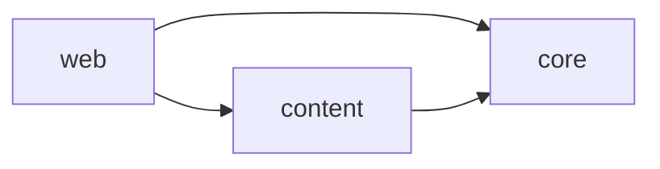
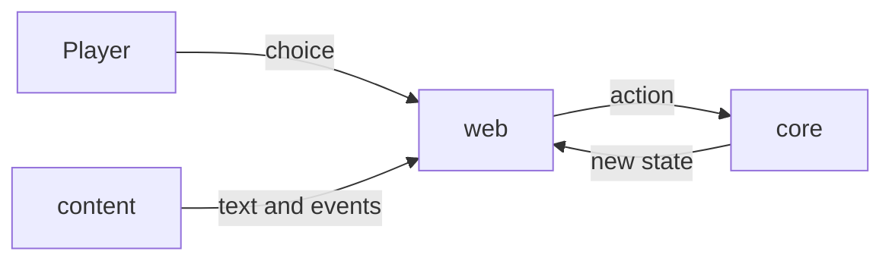

# Architecture

## Module dependencies

## Data flow

## Use cases
Status is `planned` or `implemented`. An `implemented` use case must be referenced by a test.

Issue #17, the first playable loop, covers UC-CORE-001, UC-CORE-011 to UC-CORE-013 and UC-WEB-003 to UC-WEB-005, and changes UC-WEB-002. Each use case moves to `implemented` in the task that adds its tests.

| ID | Use case | Status |
|---|---|---|
| UC-CORE-001 | 皇帝培養個人屬性：健康、學識、才藝、魄力 | implemented |
| UC-CORE-002 | 與皇后互動 | planned |
| UC-CORE-003 | 舉行早朝 | planned |
| UC-CORE-004 | 任命官員 | planned |
| UC-CORE-005 | 處理政事 | planned |
| UC-CORE-006 | 發生並處理戰爭 | planned |
| UC-CORE-007 | 觸發特殊事件 | planned |
| UC-CORE-008 | 選妃，或經由事件納妃 | planned |
| UC-CORE-009 | 誕育子嗣 | planned |
| UC-CORE-010 | 教導皇子女 | planned |
| UC-CORE-011 | 選定年號：候選年號與自訂年號驗證 | implemented |
| UC-CORE-012 | 半季回合：在宮殿以行動點執行行動 | planned |
| UC-CORE-013 | 年老衰弱與駕崩 | planned |
| UC-WEB-001 | 顯示標題畫面 | implemented |
| UC-WEB-002 | 開始遊戲：登基後進入年號畫面 | implemented |
| UC-WEB-003 | 年號畫面 | planned |
| UC-WEB-004 | 宮殿地圖、宮殿、行動結果與半季總結畫面 | planned |
| UC-WEB-005 | 駕崩結局與再開新局 | planned |
