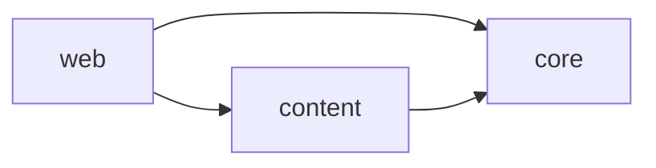
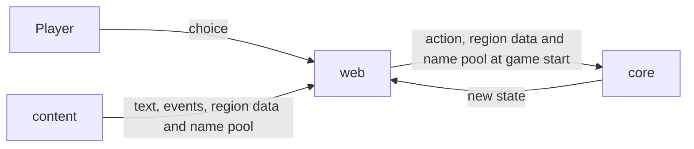

# Architecture

## Module dependencies

## Data flow

## Use cases
Each module lists its use cases in its own `USE_CASES.md`: `packages/core/USE_CASES.md`, `packages/content/USE_CASES.md` and `packages/web/USE_CASES.md`.

## What goes where
| File | Holds | Changes |
|---|---|---|
| `docs/architecture.md`, `packages/*/ARCHITECTURE.md` | Structure: module boundaries, dependencies, data flow, state shape, public interfaces, shared patterns | Rarely. These are core paths. |
| `packages/*/USE_CASES.md` | Behaviour: what each use case does, as a player or caller sees it, with its ID and status | With most issues |
| Code | Exact values: numbers, balance, colours, sizes, wording, element IDs | Freely |

Docs never repeat a value that lives in code. They name where it lives instead, such as `BALANCE.upkeep`.
