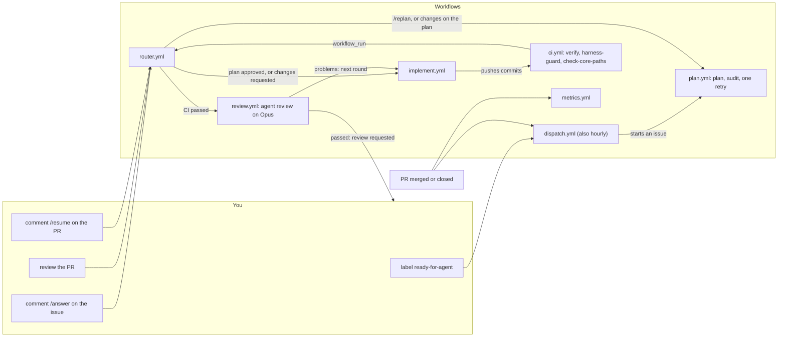
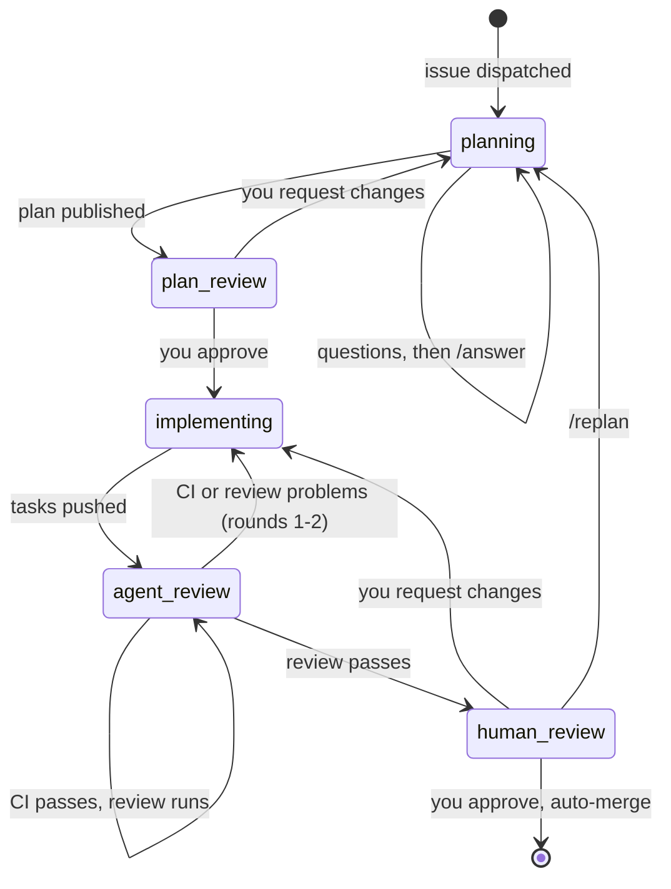

# Pipeline architecture

How the pipeline is wired. For what you do day to day, see `operations.md`. When something is stuck, see `troubleshooting.md`.

## Parts
- **GitHub Actions workflows** in `.github/workflows/`. Each agent run happens in one of them.
- **Scripts** in `.agent/scripts/`. They decide the next step and change labels, comments and branches. The decision logic is pure and tested (`lib/decide.mjs`, `lib/rules.mjs`).
- **Skills** in `.claude/skills/`. These are the instructions the agents follow: `plan-issue`, `audit-plan`, `implement-plan`, `review-code` and `review-against-docs`.
- **A GitHub App**, which every workflow acts as. It is why the pipeline's comments and review requests reach you as notifications.
- **State**, all kept on GitHub: labels, one bookkeeping comment per PR (`<!-- agent-state: … -->`), and the `agent-metrics` and `agent-screenshots` branches.

Every run copies `.agent/` from `main` and merges `main` into the issue branch first (`.github/actions/prepare-branch`). So agents always use `main`'s harness, and a harness change takes effect for the next run once merged.

## Events and workflows

- **`dispatch.yml`** (`dispatch.mjs`) starts queued issues within `MAX_ACTIVE_ISSUES` and respects "blocked by" links. When a PR closes, it frees the issue's slot.
- **`router.yml`** (`route.mjs` → `routeEvent` in `lib/decide.mjs`) turns your reviews, labels, `/answer` and `/resume` comments, and finished CI runs into the next step. It ignores people outside `AGENT_REVIEWERS`.
- **`plan.yml`**: the planner writes `brief.md`, `tasks.md` and doc changes, and a fresh auditor checks them. On an audit failure the planner retries once. `after-plan.mjs` opens or updates the draft PR, or posts the questions.
- **`implement.yml`**: the implementer works task by task, with helper agents. `after-implement.mjs` pushes what passed review and moves the PR to agent review.
- **`review.yml`**: screenshots, then the agent review. `after-review.mjs` posts findings and starts another round, or moves the PR to your final review.
- **`ci.yml`**: `npm run verify` plus two guards. `harness-guard` fails an agent PR that touches the harness. `check-core-paths` fails one that changes a core path its brief didn't declare.
- **`metrics.yml`** (`record-pr.mjs`) records each closed PR on the `agent-metrics` branch.

## PR stages
Each agent PR carries exactly one `stage:` label. `needs-human` is added on top of a stage and pauses it.

States are the labels `stage:planning`, `stage:plan-review`, `stage:implementing`, `stage:agent-review` and `stage:human-review`.

**What pauses a PR with `needs-human`:**
- a guard check fails
- the third failed round
- an agent run fails or returns no verdict
- too few helper agents ran
- the plan audit fails twice. This one pauses the issue, because no PR exists yet.

While `needs-human` is on, the router ignores CI results.

## Labels
- **On issues:** `ready-for-agent` (queue it), `agent:in-progress` (running), `needs-clarification` (waiting for `/answer`), `needs-human`.
- **On PRs:**
  - `stage:*`, `needs-human`, `risk:low|medium|high`
  - `review-round:N`, the failed rounds so far
  - `plan-approved`, which you add to approve a plan without a review
  - `plan-revised` and `code-revised`, which count revisions for metrics
  - `escape`, which you add when an important change got past review
