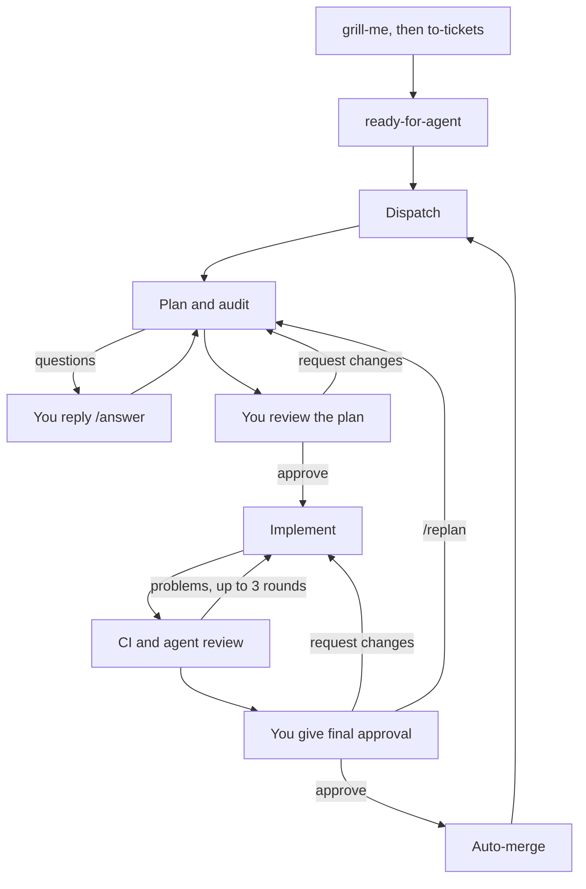

# Operating the pipeline

## Flow

## What you do
| When | Do this |
|---|---|
| Planner has questions (`needs-clarification`) | Comment on the issue, starting with `/answer` |
| Plan is ready (`stage:plan-review`) | Read the PR description and doc diff. Approve, or add `plan-approved`, or request changes |
| Code is ready (`stage:human-review`) | Approve to merge automatically, or request changes |
| You want a new plan | Put `/replan` on its own line in your review summary |
| `needs-human` | Read the latest comment. Request changes to send the code back, or fix the cause |
| You fixed the cause of a `needs-human` pause in `stage:agent-review`, such as a guard check | Comment `/resume` on the PR. If CI passes on the latest commit, the agent review starts. If CI fails, the PR stays paused |
| You first noticed an important change at merge | Add `escape` to the PR |
| A risk rating is wrong | Change the `risk:` label |

Plan approval never merges. Coding commits dismiss it, so the merge always needs your final approval.

## Failed plan audits
When the audit rejects a plan, the planner automatically gets one retry with the audit's problems, and a fresh audit checks the result. If that also fails, nothing is published and the issue gets `needs-human` with the last problems. To retry, edit the issue text to clear up the problem (plain comments don't reach the planner), remove `needs-human` and `agent:in-progress`, then add `ready-for-agent`.

## Settings
- `MAX_ACTIVE_ISSUES`: how many issues run at once. Keep it at 1; the rest of the pipeline is designed for one at a time.
- `AGENT_REVIEWERS`: accounts whose issues, labels, reviews and answers count.
- `CLAUDE_AUTH`: see `auth.md`.

## Blocked issues
Add GitHub's "blocked by" link. An issue starts only when all its blockers are closed as completed. A blocker closed as not planned or duplicate keeps it waiting until you remove the link.

## Screenshots
When an agent PR changes `packages/web` or `packages/content`, agent review photographs every screen listed in `packages/web/screenshots.json`, on the PR and on `main`, and compares them pixel by pixel. One PR comment shows only what you need to see: changed screens before and after, new screens, and failed captures. Unchanged screens are listed by name. The comment is updated each round, and the agent reviewer checks the same screens.

Randomness and time are fixed while photographing, so an unchanged screen looks identical on both sides. The images are stored on the public `agent-screenshots` branch.

## Enforced method
The implementer must use a fresh helper agent for each task, and a reviewer helper. The code reviewer must use two parallel helpers, one for standards and one for spec. A script counts helpers after each run. If there are too few, the result is not accepted and the PR gets `needs-human`. To retry, request changes on the PR.

## Stopped implementations
When an implementation stops early, for any reason, the tasks that already passed review are still pushed. The script reads the task reviewer helpers' reports from the run log and finds the first task whose latest review did not pass. It then pushes the commit the reviewer of the task before it saw. Anything after that commit is dropped. Before pushing, it checks that the commit is new work on this branch, that it doesn't touch harness files, and that enough helpers ran. It does not run `npm run verify`, because a failing check is often why the run stopped. The PR comment says which tasks are on the branch.

Progress is kept in the PR's bookkeeping comment. Requesting changes then picks the right kind of run:
- Some tasks are saved: `resume` continues from the next task. It skips the saved tasks and still ends with a whole-branch review.
- No tasks are saved: `plan` starts the plan again.
- All tasks are done: `human` revises the code from your review.

A run killed by the job's time limit saves nothing, because the script never runs.

## Your own PRs
Harness changes are made by you, and GitHub won't let you approve your own PR. Use the admin merge option. `agent-review` does not run on them.

## Limits of the safeguards
The implementer can run project commands, so its tool list is a guardrail and not a sandbox. The hard protections are required checks, branch protection, your approvals, and the App having no `workflows` permission.

## Metrics
The `agent-metrics` branch holds `runs.jsonl`, `prs.jsonl` and `scorecard.md`. It is public, so it holds only numbers and short labels, never prompts, transcripts, code, issue text, comments or secrets.
