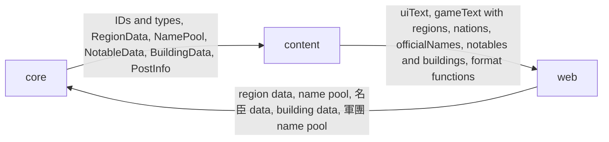

# content

Owns Traditional Chinese text and event data. `src/schema.ts` defines the shapes other modules rely on.

Behaviour is described in `USE_CASES.md`. The text itself, and all data values, live in the source files and are not repeated in docs.

Data flow: content is plain data and text formatting, read by `web`. Text for `core` registries is keyed by the `core` IDs (`StatId`, `PalaceId`, `ActionId`, `ActionPointId`, `HalfSeasonId`, `DepartmentId`, `CourtOptionId`, `TaxLevelId`), with `Record<Id, …>` types, so a new registry entry without text fails the type check. Region data is typed with `core`'s `RegionData`, and the official name pool with `core`'s `NamePool`; `web` passes both to `createInitialState`. The 名臣 list is typed with `core`'s `NotableData`; `web` passes it, with the name pool, to `core`'s `recommend` and `holdExam`. The building list is typed as `BuildingEntry`, which extends `core`'s `BuildingData`; `web` passes it to `createInitialState`. Post text is keyed by `core`'s post registry IDs (`CentralPostId`, `MinistryRankId`, `RegionOfficeId`).



## Exports
- `uiText`: screen labels and fixed lines, keyed by name.
- `gameText`: text for `core` registries (`statLabels`, `actionPointLabels`, `halfSeasonLabels`, `palaces` with a name, a description (required for every palace except 宣政殿, enforced by the type) and the alt text of the palace's background image (`imageAlt`), `actions` with a name, `departments` with a short `label` for its button and its full `name`, `courtOptions` with a name, `taxLevels` with a name, `centralPosts`, `ministryRanks` and `regionOffices` with a name), the 年號 pool (`eraNamePool`), the 軍團 name pool (`legionNamePool`, two-character names without 軍), the regions (`regions`, `readonly RegionEntry[]`), the nations (`nations`, `readonly NationEntry[]`, in `src/nations.ts`), the official name pool (`officialNames`, a `NamePool`, in `src/officialNames.ts`), the 名臣 list (`notables`, `readonly NotableData[]`, in `src/notables.ts`), and the building list (`buildings`, `readonly BuildingEntry[]`, in `src/buildings.ts`).
- `formatPostName(post: PostInfo)` in `src/format.ts` builds a post's full name from that text.
- Format functions in `src/format.ts`. They are pure.

## Regions
`src/regions.ts` holds the region list. Each entry is a `RegionEntry`: `core`'s `RegionData` plus text.

```ts
interface RegionEntry extends RegionData {
  name: string;      // Chinese name
  capital: boolean;  // true only for the player's capital region; required here, optional in core's RegionData
}
```

`capital` is declared by `core`'s `RegionData`, so `core` can find the capital in the same region list `web` passes it.

Each entry's `cell` (from `RegionData`) places it on the world grid; see `core`'s "Region data". The list holds the player's regions first, then each foreign nation's regions in `nations` order. Adding a region means adding one entry. Region IDs must not equal a 部 ID or a central post ID (see `core`'s "Posts").

## Nations
`src/nations.ts` holds the nation list, one entry per line. A nation is any region owner: the player's own realm (ID `PLAYER_OWNER`) and each foreign power. Nations are content data only; `core` sees nothing but the owner ID on each region.

```ts
interface NationEntry {
  id: string;    // a region owner: PLAYER_OWNER or a foreign nation ID
  name: string;  // Chinese name
  color: string; // map fill colour, a CSS hex colour
}
```

The map colour is the one colour kept in `content` rather than `web`'s `src/style.css`, because it belongs to the nation's data: `web` writes it as an inline style. List order is the legend order. Adding a nation means adding one entry and its regions.

## 名臣
`src/notables.ts` holds the 名臣 list, one entry per line so it reads as a table. Each entry is a `core` `NotableData` as it is. The name is already Chinese, so no extra text is added.

`src/officialNames.ts` builds `officialNames.reserved` from this list's names, so adding a 名臣 also reserves the name.

## Buildings
`src/buildings.ts` holds the building list, one entry per line so it reads as a table. Each entry is a `BuildingEntry`: `core`'s `BuildingData` plus text and a category tag.

```ts
type BuildingCategory = 'palace' | 'ritual' | 'education' | 'garden' | 'water' | 'defense' | 'transport'; // 宮室, 祭祀, 文教, 園林, 水利, 防務, 交通
interface BuildingEntry extends BuildingData {
  name: string;        // Chinese name
  description: string; // one line
  category: BuildingCategory;
}
```

The category is not used yet; a later slice gives completed buildings effects by category. Adding a building means adding one entry.
