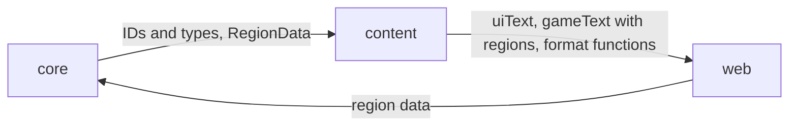

# content

Owns Traditional Chinese text and event data. `src/schema.ts` defines the shapes other modules rely on.

Behaviour is described in `USE_CASES.md`. The text itself, and all data values, live in the source files and are not repeated in docs.

Data flow: content is plain data and text formatting, read by `web`. Text for `core` registries is keyed by the `core` IDs (`StatId`, `PalaceId`, `ActionId`, `ActionPointId`, `HalfSeasonId`, `DepartmentId`, `CourtOptionId`), with `Record<Id, …>` types, so a new registry entry without text fails the type check. Region data is typed with `core`'s `RegionData`, and `web` passes it to `createInitialState`.



## Exports
- `uiText`: screen labels and fixed lines, keyed by name.
- `gameText`: text for `core` registries (`statLabels`, `actionPointLabels`, `halfSeasonLabels`, `palaces` with a name, an optional description and the alt text of the palace's background image (`imageAlt`), `actions` with a name, `departments` with a short `label` for its button and its full `name`, `courtOptions` with a name), the 年號 pool (`eraNamePool`), and the regions (`regions`, `readonly RegionEntry[]`).
- Format functions in `src/format.ts`. They are pure.

## Regions
`src/regions.ts` holds the region list. Each entry is a `RegionEntry`: `core`'s `RegionData` plus text.

```ts
interface RegionEntry extends RegionData {
  name: string;      // Chinese name
  capital: boolean;  // true only for the capital region
}
```

Adding a region means adding one entry.
