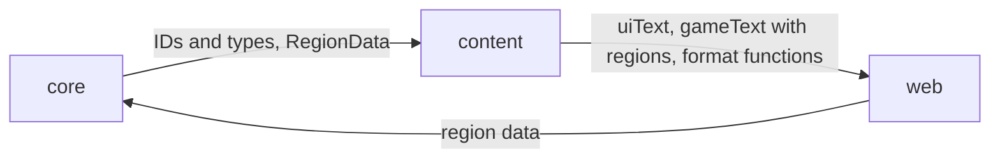

# content

Owns Traditional Chinese text and event data. `src/schema.ts` defines the shapes other modules rely on.

Data flow: content is plain data and text formatting, read by `web`. Text for `core` registries is keyed by the `core` IDs (`StatId`, `PalaceId`, `ActionId`, `ActionPointId`, `HalfSeasonId`), with `Record<Id, …>` types, so a new registry entry without text fails the type check. Region data is typed with `core`'s `RegionData`, and `web` passes it to `createInitialState`.



## UiText
Screen labels and fixed lines:

| Key | Text |
|---|---|
| `gameTitle`, `titleImageAlt`, `startButton` | unchanged (`startButton` is 登基) |
| `eraHeading` | 擬定年號 |
| `eraPrompt` | 請擇一年號，或自擬兩字年號。 |
| `eraInputLabel` | 自擬年號 |
| `eraConfirm` | 定年號 |
| `eraError` | 年號須為兩個漢字。 |
| `mapHeading` | 宮城 |
| `backToMap` | 返回 |
| `continueButton` | 繼續 |
| `summarySuffix` | 總結 (the summary heading is the half-season plus this, such as 春上總結) |
| `nextTurnPrefix` | 進入 (the button reads 進入春下) |
| `noChange` | 諸項無變化 |
| `endingHeading` | 駕崩 |
| `eraLabel` | 年號 |
| `restartButton` | 再開新局 |
| `atlasButton` | 輿圖 (the palace map entry) |
| `atlasHeading` | 輿圖 |
| `regionColumn` | 地域 (the first column of the 輿圖 table) |
| `capitalMark` | 京師 (shown after the capital's name: 「關中（京師）」) |
| `taelUnit` | 兩 |
| `taxIncomeLabel` | 稅入 |
| `upkeepLabel` | 宮廷用度 |

## GameText
`gameText` holds text for `core` registries, the 年號 pool and the regions:
- `statLabels`: 健康, 學識, 才藝, 魄力, 國庫, 民心, 人口, 富庶 (`health`, `learning`, `arts`, `resolve`, `treasury`, `morale`, `population`, `prosperity`)
- `actionPointLabels`: 朝, 午, 夕, 夜
- `halfSeasonLabels`: 春上, 春下, 夏上, 夏下, 秋上, 秋下, 冬上, 冬下
- `palaces`: a `name` and a one-line `description` for 崇文館, 翰墨軒, 演武場 and 寢宮
- `actions`: a `name` for 讀經史, 習書畫琴棋, 騎射 and 靜養
- `eraNamePool`: 20 original two-character 年號, each passing `isValidEraName`
- `regions`: the region list below, `readonly RegionEntry[]`

## Regions
UC-CONTENT-001. `src/regions.ts` holds the region list. Each entry is a `RegionEntry`: `core`'s `RegionData` plus text.

```ts
interface RegionEntry extends RegionData {
  name: string;      // Chinese name
  capital: boolean;  // true only for 關中
}
```

Adding a region means adding one entry. Adjacency follows real geography and is symmetric: if A lists B, B lists A. Every `adjacent` ID is a region in the list, and no region lists itself. All 9 home regions have owner `PLAYER_OWNER`. Later slices add foreign regions with other owners.

| ID | Name | Adjacent | 民心 | 人口 | 富庶 |
|---|---|---|---|---|---|
| `guanzhong` | 關中 (capital) | hedong, zhongyuan, jingchu, bashu | 65 | 3000000 | 60 |
| `hedong` | 河東 | guanzhong, hebei, zhongyuan | 60 | 2000000 | 50 |
| `hebei` | 河北 | hedong, zhongyuan, shandong | 55 | 4000000 | 55 |
| `zhongyuan` | 中原 | guanzhong, hedong, hebei, shandong, jiangnan, jingchu | 60 | 5000000 | 60 |
| `shandong` | 山東 | hebei, zhongyuan, jiangnan | 60 | 4000000 | 55 |
| `jiangnan` | 江南 | zhongyuan, shandong, jingchu, lingnan | 65 | 4500000 | 75 |
| `jingchu` | 荊楚 | guanzhong, zhongyuan, jiangnan, bashu, lingnan | 60 | 3500000 | 55 |
| `bashu` | 巴蜀 | guanzhong, jingchu | 65 | 3000000 | 60 |
| `lingnan` | 嶺南 | jiangnan, jingchu | 55 | 1500000 | 40 |

## Format functions
`src/format.ts`, pure:
- `formatChineseNumber(n)` for 1 to 199: 一, 十, 十六, 二十, 六十八, 一百, 一百零五, 一百一十.
- `formatDate(eraName, reignYear, halfSeason)`: 「承平元年 春上」, 「承平二年 夏下」. Year 1 is 元.
- `formatAge(age)`: 「十六歲」.
- `formatAmount(n)`: Arabic digits with `,` every three digits, and `−` (U+2212) for negatives: 「0」, 「999」, 「1,000」, 「3,000,000」, 「−20,000」.
- `formatChanges(changes)`: 「學識 +3，健康 −1」, 「民心 −3，人口 +60,000」. Uses the stat labels, `+` and `−` (U+2212), `formatAmount` for the size, and `，` between items, in the given order. An empty list gives `noChange`.
- `formatTaels(n)`: `formatAmount(n)`, a space, and `taelUnit`: 「500,000 兩」, 「−20,000 兩」.
- `formatEconomy(report)`: 「稅入 +547,437 兩，宮廷用度 −120,000 兩」. The 稅入 part appears only when `taxIncome` is above 0: 「宮廷用度 −120,000 兩」.
- `formatReign(years)`: 「在位十二年」. `formatLifespan(age)`: 「享年五十八歲」.
