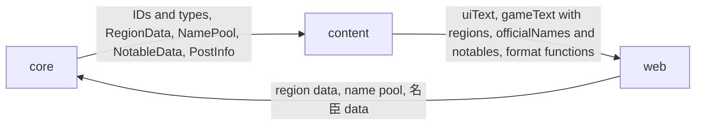

# content

Owns Traditional Chinese text and event data. `src/schema.ts` defines the shapes other modules rely on.

Behaviour is described in `USE_CASES.md`. The text itself, and all data values, live in the source files and are not repeated in docs.

Data flow: content is plain data and text formatting, read by `web`. Text for `core` registries is keyed by the `core` IDs (`StatId`, `PalaceId`, `ActionId`, `ActionPointId`, `HalfSeasonId`, `DepartmentId`, `CourtOptionId`), with `Record<Id, …>` types, so a new registry entry without text fails the type check. Region data is typed with `core`'s `RegionData`, and the official name pool with `core`'s `NamePool`; `web` passes both to `createInitialState`. The 名臣 list is typed with `core`'s `NotableData`; `web` passes it, with the name pool, to `core`'s `recommend` and `holdExam`. Post text is keyed by `core`'s post registry IDs (`CentralPostId`, `MinistryRankId`, `RegionOfficeId`).



## Exports
- `uiText`: screen labels and fixed lines, keyed by name.
- `gameText`: text for `core` registries (`statLabels`, `actionPointLabels`, `halfSeasonLabels`, `palaces` with a name, a description (required for every palace except 宣政殿, enforced by the type) and the alt text of the palace's background image (`imageAlt`), `actions` with a name, `departments` with a short `label` for its button and its full `name`, `courtOptions` with a name, `centralPosts`, `ministryRanks` and `regionOffices` with a name), the 年號 pool (`eraNamePool`), the regions (`regions`, `readonly RegionEntry[]`), the official name pool (`officialNames`, a `NamePool`, in `src/officialNames.ts`), and the 名臣 list (`notables`, `readonly NotableData[]`, in `src/notables.ts`).
- `formatPostName(post: PostInfo)` in `src/format.ts` builds a post's full name from that text.
- Format functions in `src/format.ts`. They are pure.

## Regions
`src/regions.ts` holds the region list. Each entry is a `RegionEntry`: `core`'s `RegionData` plus text.

```ts
interface RegionEntry extends RegionData {
  name: string;      // Chinese name
  capital: boolean;  // true only for the capital region
}
```

Adding a region means adding one entry. Region IDs must not equal a 部 ID or a central post ID (see `core`'s "Posts").

## 名臣
`src/notables.ts` holds the 名臣 list, one entry per line so it reads as a table. Each entry is a `core` `NotableData` as it is. The name is already Chinese, so no extra text is added.

`src/officialNames.ts` builds `officialNames.reserved` from this list's names, so adding a 名臣 also reserves the name.
