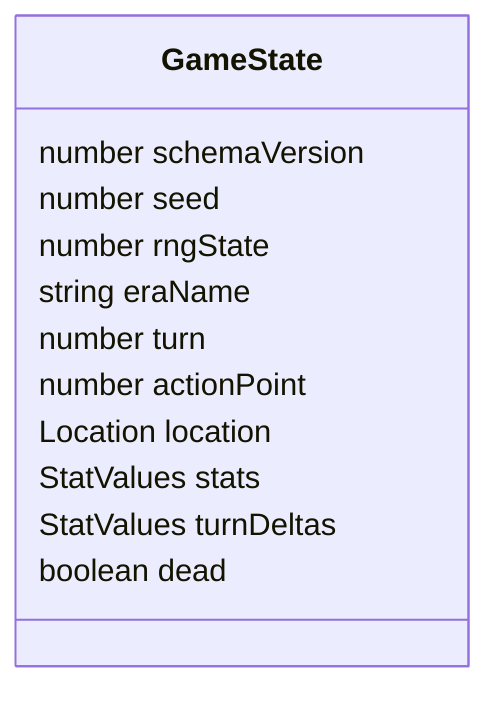
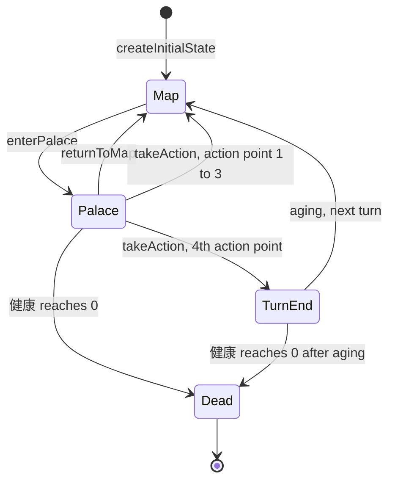

# core

Owns game state and rules. It has no DOM dependency and takes randomness only from `nextRandom`. Every rule is a pure function from a `GameState` to a new `GameState`. A `GameState` is plain, serializable data (numbers, strings, booleans, plain objects), so a later slice can save it as JSON.

Implements the `UC-CORE-*` use cases in `docs/architecture.md`.

## State


`StatValues` is `Record<StatId, number>`. `Location` is `'map' | PalaceId`.

- `schemaVersion` is `2`.
- `turn` counts half-seasons since ascension. `0` is 元年 春上.
- `actionPoint` is an index into `ACTION_POINTS` (0 to 3).
- `location` is `'map'` or a `PalaceId`.
- `stats` holds every stat in the stat registry. All stats are owned by the emperor for now.
- `turnDeltas` adds up the applied stat changes of the current turn. It resets when the turn ends.
- `dead` is set when 健康 reaches 0. A dead state accepts no action.

Derived values, never stored:
- age = `ascensionAge + floor(turn / turnsPerYear)`
- reign year = `floor(turn / turnsPerYear) + 1` (元年 is 1)
- half-season = `HALF_SEASONS[turn % turnsPerYear]`

## Registries
Registries are data. Adding a stat, palace or action means adding an entry here and its text in `content`. `content` keys its text by these IDs.

| Registry | IDs, in order |
|---|---|
| `STAT_REGISTRY` | `health` 健康, `learning` 學識, `arts` 才藝, `resolve` 魄力. Each has `min` 0, `max` 100, `owner` `'emperor'`. Later owners are `'nation'` and `'region'`. |
| `HALF_SEASONS` | `spring-early`, `spring-late`, `summer-early`, `summer-late`, `autumn-early`, `autumn-late`, `winter-early`, `winter-late` (春上 to 冬下) |
| `ACTION_POINTS` | `dawn` 朝, `noon` 午, `dusk` 夕, `night` 夜 |
| `CATALOG.palaces` | `chongwen` 崇文館 → `study`; `hanmo` 翰墨軒 → `arts`; `yanwu` 演武場 → `riding`; `qingong` 寢宮 → `rest` |
| `CATALOG.actions` | `study`, `arts`, `riding`, `rest`. Each lists the action points it is allowed in. In this slice every action is allowed in all four. |

魄力 has no effect yet.

## Balance table
Every tunable number lives in `BALANCE` in `src/model/balance.ts`. These are the values.

| Key | Value |
|---|---|
| `ascensionAge` | 16 |
| `turnsPerYear` | 8 |
| `actionPointsPerTurn` | 4 |
| `startingStats` | budget 150, each stat 15 to 70 |
| `actionVariance` | 1: the first effect of an action gets a seeded whole number from −1 to +1 |
| `actions.study` (讀經史) | 學識 +3, 健康 −1 |
| `actions.arts` (習書畫琴棋) | 才藝 +3 |
| `actions.riding` (騎射) | 健康 +2, 魄力 +2 |
| `actions.rest` (靜養) | 健康 +3 |
| `aging` | from age 40, 健康 loses `1 + floor((age − 40) / 5)` at the end of each turn: 1 at 40–44, 2 at 45–49, up to 6 at 65–69 |

With one 靜養 and one 騎射 a turn, 健康 starts to fall around 60, and death from age comes in the late 60s. Resting more delays it.

## Rules
- UC-CORE-011 年號:
  - `isValidEraName(name)` is true only for exactly 2 Han characters (`/^\p{Script=Han}{2}$/u`). It does not trim.
  - `drawEraNameSuggestions(seed, pool, count = 3)` returns `count` distinct entries of `pool`, drawn with the seed. Its random stream starts from `(seed ^ 0x9e3779b9) >>> 0`, so it does not change the game's `rngState`. The pool comes from `content`.
- UC-CORE-001 starting stats: `createInitialState(seed, eraName)` sets every stat to the minimum (15), then splits the rest of the budget (90) by four seeded weights, one per stat in registry order. Each share is rounded down and capped so no stat passes 70. Points left over go one at a time, in registry order, to stats below 70. The stats always add up to 150.
- UC-CORE-012 turn loop:
  - `enterPalace(state, palaceId)` and `returnToMap(state)` change only `location`. They never use an action point. Entering from a palace, entering an unknown palace, or any move when dead returns the state unchanged.
  - `takeAction(state, actionId, catalog = CATALOG)` is rejected, with the state unchanged, if the emperor is dead (`'dead'`), is on the map (`'not-in-palace'`), the palace does not offer the action (`'not-offered'`), or the action is not allowed in the current action point (`'not-allowed-now'`).
  - Otherwise it applies the action's effects, with the variance on the first effect, clamps each stat to its range, and reports the applied changes, leaving out zero changes. It adds them to `turnDeltas`, returns to the map, and uses the action point.
  - After the 4th action the turn ends: aging applies, the turn totals (`turnDeltas` plus aging, in registry order, leaving out zeros) are reported, `turn` goes up by 1, `actionPoint` goes back to 0, and `turnDeltas` resets.
- UC-CORE-013 aging and death: aging follows the balance table. The emperor dies when 健康 reaches 0, checked after each action and again after aging at the end of the turn. On death `dead` becomes `true` and the turn does not advance.



## Interface
```ts
type ActionRejection = 'dead' | 'not-in-palace' | 'not-offered' | 'not-allowed-now';
interface StatChange { stat: StatId; amount: number }
interface TurnEnd { aging: number; totals: StatChange[] }
type ActionOutcome =
  | { ok: false; reason: ActionRejection; state: GameState }
  | { ok: true; state: GameState; changes: StatChange[]; turnEnd: TurnEnd | null };
```

`turnEnd` is set when the action ended the turn, including when the emperor then dies of age. It is `null` when the emperor dies from the action itself. `aging` is the 健康 lost to age, as a positive number.
