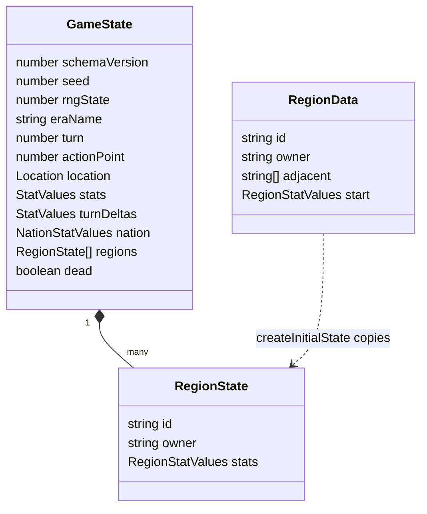
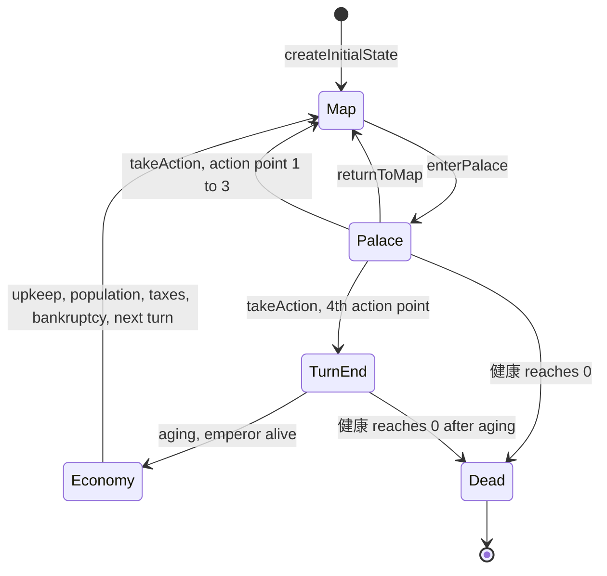

# core

Owns game state and rules. It has no DOM dependency and takes randomness only from `nextRandom`. Every rule is a pure function from a `GameState` to a new `GameState`. A `GameState` is plain, serializable data (numbers, strings, booleans, plain objects, arrays), so a later slice can save it as JSON.

Implements the `UC-CORE-*` use cases in `docs/architecture.md`.

## State


`StatValues` is `Record<EmperorStatId, number>`, `NationStatValues` is `Record<NationStatId, number>`, and `RegionStatValues` is `Record<RegionStatId, number>`. `Location` is `'map' | PalaceId`.

- `schemaVersion` is `3`. There are no saves yet, so nothing migrates from `2`.
- `turn` counts half-seasons since ascension. `0` is 元年 春上.
- `actionPoint` is an index into `ACTION_POINTS` (0 to 3).
- `location` is `'map'` or a `PalaceId`.
- `stats` holds every stat owned by the emperor.
- `turnDeltas` adds up the applied emperor stat changes of the current turn. It resets when the turn ends.
- `nation` holds every stat owned by the nation. For now that is only `treasury` (國庫).
- `regions` holds one entry per region, in the order of the region data passed to `createInitialState`. `owner` is a string. The player's regions have owner `PLAYER_OWNER` (`'player'`). Any other owner is a foreign power, which later slices add. Adjacency is static data and is not stored in the state.
- `dead` is set when 健康 reaches 0. A dead state accepts no action.

Derived values, never stored:
- age = `ascensionAge + floor(turn / turnsPerYear)`
- reign year = `floor(turn / turnsPerYear) + 1` (元年 is 1)
- half-season = `HALF_SEASONS[turn % turnsPerYear]`

## Region data
UC-CORE-014. `core` does not hold the region list. `content` does, and passes it to `createInitialState` through this interface:

```ts
const PLAYER_OWNER = 'player';
interface RegionData {
  id: string;
  owner: string;
  adjacent: readonly string[];
  start: RegionStatValues;
}
interface RegionState { id: string; owner: string; stats: RegionStatValues }
```

`createInitialState` copies each entry's `id`, `owner` and `start` into a `RegionState`, keeping the order. Adding a region means adding one data entry; no `core` code changes.

## Registries
Registries are data. Adding a stat, palace or action means adding an entry here and its text in `content`. `content` keys its text by these IDs.

| Registry | IDs, in order |
|---|---|
| `STAT_REGISTRY` | Emperor (`EMPEROR_STAT_IDS`): `health` 健康, `learning` 學識, `arts` 才藝, `resolve` 魄力, each `min` 0, `max` 100. Nation (`NATION_STAT_IDS`): `treasury` 國庫 in taels, `min` `-Infinity`, `max` `Infinity`. Region (`REGION_STAT_IDS`): `morale` 民心 `min` 0 `max` 100, `population` 人口 `min` 0 `max` `Infinity`, `prosperity` 富庶 `min` 0 `max` 100. `STAT_IDS` lists all eight in this order. |
| `HALF_SEASONS` | `spring-early`, `spring-late`, `summer-early`, `summer-late`, `autumn-early`, `autumn-late`, `winter-early`, `winter-late` (春上 to 冬下) |
| `ACTION_POINTS` | `dawn` 朝, `noon` 午, `dusk` 夕, `night` 夜 |
| `CATALOG.palaces` | `chongwen` 崇文館 → `study`; `hanmo` 翰墨軒 → `arts`; `yanwu` 演武場 → `riding`; `qingong` 寢宮 → `rest` |
| `CATALOG.actions` | `study`, `arts`, `riding`, `rest`. Each lists the action points it is allowed in. In this slice every action is allowed in all four. |

魄力 has no effect yet. The registry's `Infinity` bounds are never stored in a `GameState`.

## Balance table
Every tunable number lives in `BALANCE` in `src/model/balance.ts`. These are the values. The regions' starting 民心, 人口 and 富庶 are region data, listed in `packages/content/ARCHITECTURE.md`.

| Key | Value |
|---|---|
| `ascensionAge` | 16 |
| `turnsPerYear` | 8 |
| `actionPointsPerTurn` | 4 |
| `startingStats` | budget 150, each stat 15 to 70 |
| `actionVariance` | 1: the first effect of an action gets a seeded whole number from −1 to +1 |
| `actions.study` (讀經史) | 學識 +3, 健康 −1 |
| `actions.arts` (習書畫琴棋) | 才藝 +3 |
| `actions.riding` (騎射) | 健康 +2, 魄力 +2 |
| `actions.rest` (靜養) | 健康 +3 |
| `aging` | from age 40, 健康 loses `1 + floor((age − 40) / 5)` at the end of each turn: 1 at 40–44, 2 at 45–49, up to 6 at 65–69 |
| `startingTreasury` | 500000 taels |
| `tax.halfYearDivisor` | 200000: each collection, every player-owned region pays `floor(人口 × 富庶 × 民心 / 200000)` taels. Two collections make the yearly yield. |
| `tax.collectOn` | `['spring-early', 'autumn-early']` (春上, 秋上) |
| `upkeep` | 120000 taels every turn |
| `bankruptcyMoraleLoss` | 3: 民心 lost by each player-owned region at the end of a turn that leaves 國庫 below 0 |
| `population` | once a year: `growAtOrAbove` 120, `shrinkAtOrBelow` 80, `ratePercent` 2. When 民心 + 富庶 ≥ 120, 人口 grows by `floor(人口 × 2 / 100)`; when it is ≤ 80, 人口 shrinks by the same amount; otherwise 人口 does not change. |

With the starting regions, one collection yields 547,437 taels and upkeep costs 960,000 a year, so the treasury gains about 135,000 a year. The first collection is at the end of 夏下, after 4 upkeeps leave 20,000.

## Rules
- UC-CORE-011 年號:
  - `isValidEraName(name)` is true only for exactly 2 Han characters (`/^\p{Script=Han}{2}$/u`). It does not trim.
  - `drawEraNameSuggestions(seed, pool, count = 3)` returns `count` distinct entries of `pool`, drawn with the seed. Its random stream starts from `(seed ^ 0x9e3779b9) >>> 0`, so it does not change the game's `rngState`. The pool comes from `content`.
- UC-CORE-001 starting stats: `createInitialState(seed, eraName, regions)` sets every emperor stat to the minimum (15), then splits the rest of the budget (90) by four seeded weights, one per stat in registry order. Each share is rounded down and capped so no stat passes 70. Points left over go one at a time, in registry order, to stats below 70. The stats always add up to 150.
- UC-CORE-014 regions: `createInitialState` sets `nation.treasury` to `startingTreasury` and copies the regions as described under "Region data". It draws no random numbers for them.
- UC-CORE-012 turn loop:
  - `enterPalace(state, palaceId)` and `returnToMap(state)` change only `location`. They never use an action point. Entering from a palace, entering an unknown palace, or any move when dead returns the state unchanged.
  - `takeAction(state, actionId, catalog = CATALOG)` is rejected, with the state unchanged, if the emperor is dead (`'dead'`), is on the map (`'not-in-palace'`), the palace does not offer the action (`'not-offered'`), or the action is not allowed in the current action point (`'not-allowed-now'`).
  - Otherwise it applies the action's effects, with the variance on the first effect, clamps each stat to its range, and reports the applied changes, leaving out zero changes. It adds them to `turnDeltas`, returns to the map, and uses the action point.
  - After the 4th action the turn ends: aging applies; if the emperor survives, the economy is settled (below); the emperor's turn totals (`turnDeltas` plus aging, in registry order, leaving out zeros) are reported; `turn` goes up by 1, `actionPoint` goes back to 0, and `turnDeltas` resets.
- UC-CORE-013 aging and death: aging follows the balance table. The emperor dies when 健康 reaches 0, checked after each action and again after aging at the end of the turn. On death `dead` becomes `true`, the turn does not advance, and the economy is not settled.
- UC-CORE-015 and UC-CORE-016 economy: `settleEconomy(nation, regions, nextHalfSeason)` runs at the end of every turn the emperor survives. `nextHalfSeason` is the half-season the game moves into. In order:
  1. Upkeep: 國庫 loses `upkeep`.
  2. Population (UC-CORE-016), only when `nextHalfSeason` is 春上, so once a year: each player-owned region's 人口 changes as in the balance table, clamped to 0 or more.
  3. Taxes (UC-CORE-015), only when `nextHalfSeason` is 春上 or 秋上: 國庫 gains the sum of each player-owned region's payment, computed from its 人口 after step 2. Taxes therefore arrive as the game enters 春上 and 秋上, and are reported in the 冬下 and 夏下 summaries. No tax is collected at game start.
  4. Bankruptcy: if 國庫 is now below 0, every player-owned region loses `bankruptcyMoraleLoss` 民心, clamped to 0. The game goes on.
  - 國庫 has no bounds. Regions with another owner pay no tax and are not changed.



## Interface
```ts
type ActionRejection = 'dead' | 'not-in-palace' | 'not-offered' | 'not-allowed-now';
interface StatChange { stat: StatId; amount: number }
interface RegionChange { region: string; changes: StatChange[] }
interface EconomyReport { taxIncome: number; upkeep: number; regionChanges: RegionChange[] }
interface TurnEnd { aging: number; totals: StatChange[]; economy: EconomyReport }
type ActionOutcome =
  | { ok: false; reason: ActionRejection; state: GameState }
  | { ok: true; state: GameState; changes: StatChange[]; turnEnd: TurnEnd | null };

function createInitialState(seed: number, eraName: string, regions: readonly RegionData[]): GameState;
function regionTax(stats: RegionStatValues): number;
function settleEconomy(
  nation: NationStatValues,
  regions: readonly RegionState[],
  nextHalfSeason: HalfSeasonId,
): { nation: NationStatValues; regions: RegionState[]; report: EconomyReport };
```

`turnEnd` is set when the action ended the turn, including when the emperor then dies of age. It is `null` when the emperor dies from the action itself. `aging` is the 健康 lost to age, as a positive number. `totals` holds emperor stats only.

`economy.taxIncome` and `economy.upkeep` are positive numbers of taels (`taxIncome` is 0 outside collections). `regionChanges` lists, in region order, each region with a non-zero applied change, and its changes in registry order (民心, 人口, 富庶). When the emperor dies of age, `economy` is `{ taxIncome: 0, upkeep: 0, regionChanges: [] }`.
