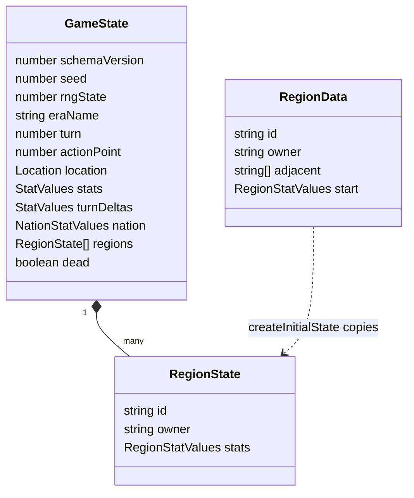

# core

Owns game state and rules. It has no DOM dependency and takes randomness only from `nextRandom`. Every rule is a pure function from a `GameState` to a new `GameState`. A `GameState` is plain, serializable data (numbers, strings, booleans, plain objects, arrays), so a later slice can save it as JSON.

Behaviour is described in `USE_CASES.md`, as the `UC-CORE-*` use cases.

## State


`StatValues` is `Record<EmperorStatId, number>`, `NationStatValues` is `Record<NationStatId, number>`, and `RegionStatValues` is `Record<RegionStatId, number>`. `Location` is `'map' | PalaceId`.

- `schemaVersion` goes up whenever the shape of `GameState` changes. There are no saves yet, so nothing migrates.
- `turn` counts half-seasons since ascension. `0` is 元年 春上.
- `actionPoint` is an index into `ACTION_POINTS`.
- `location` is `'map'` or a `PalaceId`.
- `stats` holds every stat owned by the emperor.
- `turnDeltas` adds up the applied emperor stat changes of the current turn. It resets when the turn ends.
- `nation` holds every stat owned by the nation.
- `regions` holds one entry per region, in the order of the region data passed to `createInitialState`. The player's regions have owner `PLAYER_OWNER`. Any other owner is a foreign power. Adjacency is static data and is not stored in the state.
- `dead` is set when the emperor dies. A dead state accepts no action.

Derived values are never stored:
- age = `BALANCE.ascensionAge + floor(turn / BALANCE.turnsPerYear)`
- reign year = `floor(turn / BALANCE.turnsPerYear) + 1` (元年 is 1)
- half-season = `HALF_SEASONS[turn % BALANCE.turnsPerYear]`

## Region data
`core` does not hold the region list. `content` does, and passes it to `createInitialState` through this interface:

```ts
const PLAYER_OWNER = 'player';
interface RegionData {
  id: string;
  owner: string;
  adjacent: readonly string[];
  start: RegionStatValues;
}
interface RegionState { id: string; owner: string; stats: RegionStatValues }
```

`createInitialState` copies each entry's `id`, `owner` and `start` into a `RegionState`, keeping the order. Adding a region means adding one data entry; no `core` code changes.

## Registries
Registries are data. Adding a stat, palace or action means adding an entry to its registry and its text in `content`. `content` keys its text by these IDs.

| Registry | Holds |
|---|---|
| `STAT_REGISTRY` | Every stat, with its owner (emperor, nation or region) and its bounds. `EMPEROR_STAT_IDS`, `NATION_STAT_IDS` and `REGION_STAT_IDS` list each owner's stats, and `STAT_IDS` lists all of them. |
| `HALF_SEASONS` | The half-seasons of a year, in order |
| `ACTION_POINTS` | The action points of a turn, in order |
| `CATALOG.palaces` | Each palace and the actions it offers |
| `CATALOG.actions` | Each action and the action points it is allowed in |

Registry order is the display order. Infinite bounds are never stored in a `GameState`.

## Balance
Every tunable number lives in `BALANCE` in `src/model/balance.ts`. Docs refer to its keys, never to its values.

## Interface
```ts
type ActionRejection = 'dead' | 'not-in-palace' | 'not-offered' | 'not-allowed-now';
interface StatChange { stat: StatId; amount: number }
interface RegionChange { region: string; changes: StatChange[] }
interface EconomyReport { taxIncome: number; upkeep: number; regionChanges: RegionChange[] }
interface TurnEnd { aging: number; totals: StatChange[]; economy: EconomyReport }
type ActionOutcome =
  | { ok: false; reason: ActionRejection; state: GameState }
  | { ok: true; state: GameState; changes: StatChange[]; turnEnd: TurnEnd | null };

function createInitialState(seed: number, eraName: string, regions: readonly RegionData[]): GameState;
function regionTax(stats: RegionStatValues): number;
function settleEconomy(
  nation: NationStatValues,
  regions: readonly RegionState[],
  nextHalfSeason: HalfSeasonId,
): { nation: NationStatValues; regions: RegionState[]; report: EconomyReport };
```

`turnEnd` is set when the action ended the turn, including when the emperor then dies of age. It is `null` when the emperor dies from the action itself. `aging` is the 健康 lost to age, as a positive number. `totals` holds emperor stats only.

`economy.taxIncome` and `economy.upkeep` are positive numbers of taels (`taxIncome` is 0 outside collections). `regionChanges` lists, in region order, each region with a non-zero applied change, and its changes in registry order. When the emperor dies of age, `economy` is `{ taxIncome: 0, upkeep: 0, regionChanges: [] }`.
