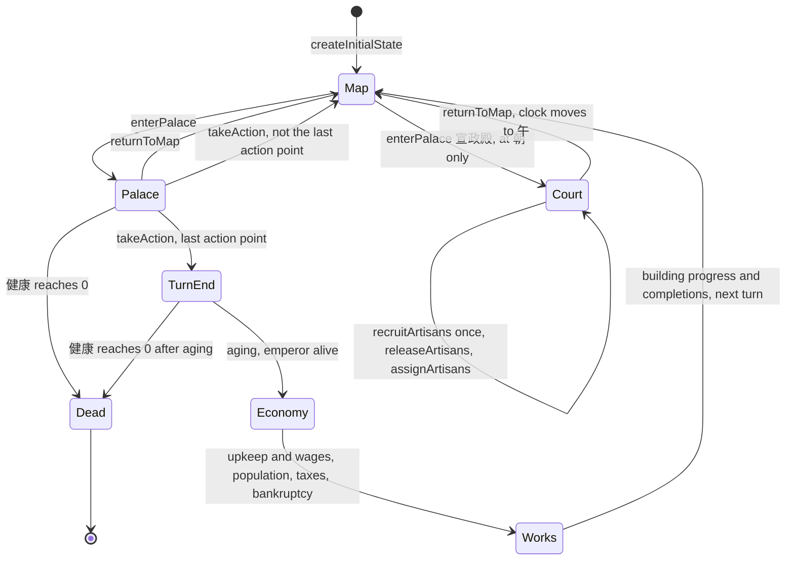

# core use cases

Status is `planned` or `implemented`. An `implemented` use case must be referenced by a test. Structure is in `ARCHITECTURE.md`. Exact numbers are in `BALANCE` (`src/model/balance.ts`), and this file names the keys only.

| ID | Use case | Status |
|---|---|---|
| UC-CORE-001 | 皇帝培養個人屬性：健康、學識、才藝、魄力 | implemented |
| UC-CORE-002 | 與皇后互動 | planned |
| UC-CORE-003 | 舉行早朝：只在朝時進入宣政殿，耗用該行動點 | implemented |
| UC-CORE-004 | 任命官員：官員、官位、賦閑，早朝時將賦閑官員任命至官位 | implemented |
| UC-CORE-005 | 處理政事 | planned |
| UC-CORE-006 | 發生並處理戰爭 | planned |
| UC-CORE-007 | 觸發特殊事件 | planned |
| UC-CORE-008 | 選妃，或經由事件納妃 | planned |
| UC-CORE-009 | 誕育子嗣 | planned |
| UC-CORE-010 | 教導皇子女 | planned |
| UC-CORE-011 | 選定年號：候選年號與自訂年號驗證 | implemented |
| UC-CORE-012 | 半季回合：在宮殿以行動點執行行動 | implemented |
| UC-CORE-013 | 年老衰弱與駕崩 | implemented |
| UC-CORE-014 | 九州地域：由資料載入地域，各有民心、人口、富庶與歸屬 | implemented |
| UC-CORE-015 | 國庫：春上與秋上收稅、每半季支付宮廷用度與工匠工錢、國庫虧空時各地民心下降 | implemented |
| UC-CORE-016 | 每年人口隨民心與富庶增減 | implemented |
| UC-CORE-017 | 舉薦人選：每次早朝一次，舉薦一名候選人（一般官員或名臣），錄用或婉拒 | implemented |
| UC-CORE-018 | 開科取士：每三年一科，於該年一次早朝自一批應試者中擇人錄取 | implemented |
| UC-CORE-019 | 工匠：早朝時徵召（每次早朝一次）與遣散閒置工匠，每半季由國庫支付工錢 | planned |
| UC-CORE-020 | 營建工程：指派工匠至全國工程，累積工匠·半季直至落成 | planned |

## UC-CORE-011 年號
- `isValidEraName(name)` is true only for exactly two Han characters. It does not trim.
- `drawEraNameSuggestions(seed, pool, count = 3)` returns `count` distinct entries of `pool`, drawn with the seed. It uses its own random stream derived from the seed, so it does not change the game's `rngState`. The pool comes from `content`.

## UC-CORE-001 Starting stats
`createInitialState(seed, eraName, regions, names)` sets every emperor stat to `BALANCE.startingStats.min`, then splits the rest of `BALANCE.startingStats.budget` by four seeded weights, one per stat in registry order. Each share is rounded down and capped so no stat passes `BALANCE.startingStats.max`. Points left over go one at a time, in registry order, to stats below the cap. The stats always add up to the budget.

## UC-CORE-014 Regions
`createInitialState` sets `nation.treasury` to `BALANCE.startingTreasury` and copies the regions as described in `ARCHITECTURE.md` under "Region data". It draws no random numbers for them.

## UC-CORE-012 Turn loop
- `enterPalace(state, palaceId)` and `returnToMap(state)` change only `location`. They never use an action point, except for 宣政殿 (UC-CORE-003). Entering from a palace, entering an unknown palace, entering a palace that `canEnterPalace` refuses, or any move when dead returns the state unchanged. A palace may offer no actions; it can still be entered and left, and every action there is rejected as `'not-offered'`. 宣政殿 (`xuanzheng`, `COURT_PALACE_ID`) is such a palace: it is in the catalog and offers no actions. `DEPARTMENTS` lists each court department's options in order.
- `canEnterPalace(state, palaceId)` is true when the emperor is alive, on the map, the palace is in the catalog, and the palace is open now. Every palace is open at every action point except 宣政殿 (UC-CORE-003).
- `takeAction(state, actionId, catalog = CATALOG)` is rejected, with the state unchanged, if the emperor is dead (`'dead'`), is on the map (`'not-in-palace'`), the palace does not offer the action (`'not-offered'`), or the action is not allowed in the current action point (`'not-allowed-now'`).
- Otherwise it applies the action's effects from `BALANCE.actions`, with a seeded variance of up to `BALANCE.actionVariance` on the first effect. It clamps each stat to its range and reports the applied changes, leaving out zero changes. It adds them to `turnDeltas`, returns to the map, and uses the action point.
- After the last action point of the turn, the turn ends: aging applies; if the emperor survives, the economy is settled (below), then building progress is added (UC-CORE-020); the emperor's turn totals (`turnDeltas` plus aging, in registry order, leaving out zeros) are reported; `turn` goes up by 1, `actionPoint` goes back to the first, and `turnDeltas` resets.

## UC-CORE-003 早朝
- 宣政殿 is open only at 朝 (`COURT_ACTION_POINT`, the first action point of each half-season). At any other action point `canEnterPalace` is false and `enterPalace` returns the state unchanged.
- Being in 宣政殿 is 早朝 (`isMorningCourt(state)`: alive and `location` is 宣政殿). 早朝 spends that morning's action point: while inside, the clock stays on 朝, and leaving with `returnToMap` puts the player on the map at 午 (the next action point). Leaving never ends the turn, since 朝 is not the last action point.
- So there is at most one 早朝 per half-season. Nothing inside 宣政殿 draws random numbers or uses another action point.

## UC-CORE-004 Officials and appointments
**Officials.** `GameState.officials` lists every official. Each has an ID, a name, four stats from the stat registry (文治, 武功, 野心 and 忠誠, owner `official`, each within its `STAT_REGISTRY` bounds), either exactly one post or none (賦閑), and `notable`: the 名臣 ID for a 名臣, or `null` for an ordinary official. Stats never change for now, and they have no effect on play yet.

**Posts.** `listPosts(state)` gives the posts that exist now, in display order:
1. 中樞: 丞相, 大將軍, 太傅 (`CENTRAL_POST_IDS`).
2. 六部: for each of 吏、戶、禮、兵、刑、工 in `MINISTRY_DEPARTMENT_IDS` order, its 尚書 then its 侍郎 (`MINISTRY_RANKS`).
3. 地方: for each region in `state.regions` order that the player owns, its 知州 then its 總兵 (`REGION_OFFICES`). A region has these posts only while the player owns it.

**Starting court.** `createInitialState(seed, eraName, regions, names)` generates officials from the game's random stream, after the emperor stats. One ordinary official is generated for each post in `listPosts` order and holds it, then `BALANCE.officials.startingIdle` more are generated as 賦閑. Each ordinary official is an outlier with chance `BALANCE.officials.outlierChance`; each stat is then drawn uniformly, both ends included, from that stat's range in `BALANCE.officials.ordinary` or `BALANCE.officials.outlier`. Every starting official is ordinary (`notable: null`). 名臣 join only through 舉薦 (UC-CORE-017) and 開科取士 (UC-CORE-018).

**Names.** A name is a surname plus a given name, both drawn from the pool passed in `names` (from `content`). No two officials in a game share a name, and a name in `names.reserved` is never generated. If a draw repeats a taken or reserved name, it draws again. If the pool cannot supply a free name, `createInitialState` throws.

**Appointing.** `appointOfficial(state, postId, officialId)` puts a 賦閑 official into a post. The post's previous holder, if any, becomes 賦閑. It uses no action point, draws no random numbers, and may be repeated any number of times during one 早朝. It is rejected, with the state unchanged, when:
- it is not 早朝, including when the emperor is dead (`'not-in-court'`);
- the post names an office of a region in `state.regions` that the player does not own (`'region-not-owned'`);
- the post is not in `listPosts(state)` otherwise (`'unknown-post'`);
- no official has that ID (`'unknown-official'`);
- the official already holds a post, including this one (`'not-idle'`).

The checks run in that order. There is no dismissal (罷免) yet.

## UC-CORE-017 舉薦人選
**名臣.** `content` passes the 名臣 list as `NotableData` (see `ARCHITECTURE.md`, "名臣 data"). Each 名臣 has an ID, a name, a type (文 `civil`, 武 `military` or 文武 `both`), four fixed official stats, and an entry gate: a minimum on one emperor stat. A 名臣 is *eligible* when the emperor's stat meets the gate (at or above the minimum) and no official in `state.officials` has that 名臣's ID as `notable`.

**Once per 早朝.** `canRecommend(state)` is true during 早朝 when 舉薦 has not been used this half-season, that is, when `state.recommendation` is `null` or its `turn` is not `state.turn`. Since there is at most one 早朝 per half-season, 舉薦 can be used once per 早朝, and it is open again at the next one.

**Drawing.** `recommend(state, notables, names)` draws one candidate from the game's random stream and stores it in `state.recommendation`, stamped with the current turn. It uses no action point. It is rejected, with the state unchanged, when it is not 早朝, including when the emperor is dead (`'not-in-court'`), or when 舉薦 was already used this half-season (`'already-used'`). Otherwise, in order:
1. One draw decides whether a 名臣 comes forward. The chance is `BALANCE.recommendation.notableBase` plus `BALANCE.recommendation.notableBonus` × (學識 + 魄力) / 200, so it grows with the emperor's 學識 and 魄力.
2. On a hit, one more draw picks a 名臣 from the eligible ones, weighted by the emperor's 學識 for 文, 魄力 for 武, and the average of the two for 文武. Every other 名臣 has weight 0.
3. On a miss, or when no 名臣 is eligible, or when every eligible 名臣 has weight 0, the candidate is an ordinary official drawn exactly as at the start (UC-CORE-004): outlier roll, stats, then a name that no official in the game has and that is not reserved.

The candidate has a name, four stats, and `notable` (the 名臣 ID, or `null`).

**Deciding.** `acceptCandidate(state)` adds the candidate to `officials` as 賦閑, with a new ID that no official has had and its `notable`. `declineCandidate(state)` discards it. Both clear the candidate but keep the turn stamp, so 舉薦 stays used until the next 早朝. Neither draws random numbers. Both are rejected, with the state unchanged, when it is not 早朝 (`'not-in-court'`) or there is no candidate from this half-season (`'no-candidate'`). A declined ordinary candidate is gone for good. A declined 名臣 stays eligible and may be drawn again at a later 舉薦. A candidate left undecided when the half-season moves on can no longer be accepted.

## UC-CORE-018 開科取士
**Exam years.** A reign year is an exam year when it is the first of each cycle of `BALANCE.exam.intervalYears` years: 元年, then every `intervalYears` years after it (`isExamYear(state)`). `nextExamYear(state)` is the first exam year after the current reign year.

**Once per exam year.** `canHoldExam(state)` is true during 早朝 in an exam year when no exam has been held in this reign year, that is, when `state.exam` is `null` or its `turn` falls in an earlier reign year. So an exam can be held at any one 早朝 of an exam year, and the next one opens in the next exam year.

**Holding.** `holdExam(state, notables, names)` draws `BALANCE.exam.candidates` candidates from the game's random stream and stores them in `state.exam`, stamped with the current turn. It uses no action point. It is rejected, with the state unchanged, when it is not 早朝, including when the emperor is dead (`'not-in-court'`), when the reign year is not an exam year (`'not-exam-year'`), or when an exam was already held this reign year (`'already-held'`). The checks run in that order. Each slot is drawn in turn, the way one 舉薦 candidate is drawn (UC-CORE-017), with these differences:
1. The 名臣 chance per slot is the same as for 舉薦, from `BALANCE.recommendation`.
2. On a hit, only 文 and 文武 名臣 can be picked, with the 舉薦 weights. A 名臣 must be eligible as for 舉薦 (gate met, not at court) and must not already be a candidate in this exam.
3. On a miss, or when no 名臣 can be picked, the candidate is ordinary. The outlier roll is the same as for starting officials (`BALANCE.officials.outlierChance`, then `BALANCE.officials.outlier`). Without an outlier, each stat is drawn from its range in `BALANCE.exam.ordinary`, which leans civil. The name must not belong to any official in the game or to an earlier candidate in this exam, and must not be reserved.

**Confirming.** `confirmExam(state, picks)` takes the positions in `state.exam.candidates` of the accepted candidates. Each accepted candidate joins `officials` as 賦閑, in candidate order, with a new ID that no official has had and its `notable`. Repeated positions count once. An empty `picks` is allowed. Every other candidate is discarded: an ordinary one is gone for good, and a 名臣 stays eligible for later 舉薦 and exams. Confirming clears the candidates but keeps the turn stamp, so the exam stays used for the rest of the reign year. It draws no random numbers. It is rejected, with the state unchanged, when it is not 早朝 (`'not-in-court'`), when there are no candidates from this half-season (`'no-candidates'`), or when a position is not a candidate (`'unknown-candidate'`). Candidates left unconfirmed when the half-season moves on can no longer be accepted, and the exam still counts as held.

## UC-CORE-019 工匠
**Count.** The nation has a total of 工匠 (`GameState.works.artisans`). A new game starts with 0. Each 工匠 is either idle or assigned to one building (UC-CORE-020). Idle 工匠 (`idleArtisans(state)`) are the total minus everything assigned. 工匠 do not change region 人口, 民心 or taxes for now.

**Free population.** `freePopulation(state)` is the total 人口 of the player-owned regions minus the total 工匠, never below 0. (士兵 will also be taken off once 兵部 exists.)

**Steps.** Every 工匠 count the player chooses is a whole multiple of `BALANCE.works.step`, so totals and assignments always stay multiples of the step.

**Recruiting (徵召).** `maxRecruit(state)` is `freePopulation` × `BALANCE.works.recruitPercent` percent, rounded to the nearest multiple of the step (halves round up). `canRecruit(state)` is true during 早朝 when 徵召 has not been used this half-season (`works.recruitedTurn` is not `turn`) and `maxRecruit` is above 0. `recruitArtisans(state, count)` adds `count` idle 工匠 and stamps the turn, so it can be used once per 早朝. It uses no action point and draws no random numbers. It is rejected, with the state unchanged, when it is not 早朝, including when dead (`'not-in-court'`), when already used this half-season (`'already-used'`), or when `count` is not a step multiple from one step up to `maxRecruit` (`'invalid-count'`, which also covers `maxRecruit` being 0). The checks run in that order.

**Releasing (遣散).** `releaseArtisans(state, count)` removes `count` idle 工匠, free of charge. It may be used any number of times during one 早朝. It only takes idle 工匠: to release 工匠 working on a building, first lower that building's assignment. It is rejected, with the state unchanged, when it is not 早朝, including when dead (`'not-in-court'`), or when `count` is not a step multiple from one step up to the idle count (`'invalid-count'`). Releasing every idle 工匠 is `count` = `idleArtisans(state)`.

**Wages.** Paid at the end of each half-season the emperor survives, together with upkeep (UC-CORE-015).

## UC-CORE-020 營建工程
**Buildings.** `content` passes the building list as `BuildingData` (see `ARCHITECTURE.md`, "Building data"): an ID and the required manpower in 工匠·半季. `createInitialState` copies them, in order, into `works.buildings` with progress 0 and no 工匠 assigned. There are no prerequisites between buildings and no material cost; wages are the only cost.

**Status.** `buildingStatus(building)` is:
- `'completed'` (已落成) once progress has reached the required manpower;
- `'not-started'` (未動工) while progress and assignment are both 0;
- `'in-progress'` (營建中) otherwise, including a paused building that has progress but no 工匠.

`halfSeasonsToFinish(building)` is the number of half-seasons left at the current assignment, (required − progress) ÷ assigned rounded up, or `null` when nothing is assigned or the building is completed.

**Assigning.** `assignArtisans(state, buildingId, count)` sets that building's assignment to `count`. Raising it draws from idle 工匠 and lowering it returns them to idle. Several buildings can be in progress at once. Setting 0 pauses the building and keeps its progress. It uses no action point, draws no random numbers, and may be repeated during one 早朝. It is rejected, with the state unchanged, when:
- it is not 早朝, including when dead (`'not-in-court'`);
- no building has that ID (`'unknown-building'`);
- the building is completed (`'completed'`);
- `count` is negative or not a whole multiple of the step (`'invalid-count'`);
- the raise is more than the idle 工匠 (`'not-enough-idle'`), so the total assigned never exceeds the total 工匠.

The checks run in that order.

**Progress.** At the end of each half-season the emperor survives, after the economy is settled, each unfinished building adds its current assignment to its progress. Progress never goes past the required manpower. A building that reaches it becomes completed: its assignment drops to 0, so its 工匠 are idle again, and its ID is listed in `TurnEnd.completed`, in building order. A completed building cannot be assigned 工匠 again. When the emperor dies, nothing progresses and `completed` is empty. What a completed building does comes in a later slice.

## UC-CORE-013 Aging and death
From `BALANCE.aging.startAge`, the emperor loses 健康 at the end of each turn. The loss starts at `BALANCE.aging.baseLoss` and grows by 1 every `BALANCE.aging.yearsPerStep` years of age. The emperor dies when 健康 reaches 0, checked after each action and again after aging at the end of the turn. On death `dead` becomes `true`, the turn does not advance, and the economy is not settled.

## UC-CORE-015 and UC-CORE-016 Economy
`settleEconomy(nation, regions, nextHalfSeason, artisans)` runs at the end of every turn the emperor survives. `nextHalfSeason` is the half-season the game moves into, and `artisans` is the nation's total 工匠 (UC-CORE-019; `0` when left out). In order:
1. Upkeep and wages: 國庫 loses `BALANCE.upkeep`, and also the 工匠 wages: `artisans` × `BALANCE.works.wagePerArtisan`, rounded down. Every 工匠 is paid, idle or assigned. The report gives the wages apart from the upkeep (`wages`, a positive number, `0` without 工匠).
2. Population (UC-CORE-016), only when `nextHalfSeason` is 春上, so once a year: each player-owned region's 人口 grows by `BALANCE.population.ratePercent` percent (rounded down) when 民心 + 富庶 is at least `growAtOrAbove`, shrinks by the same amount when it is at most `shrinkAtOrBelow`, and otherwise stays. 人口 never goes below 0.
3. Taxes (UC-CORE-015), only when `nextHalfSeason` is in `BALANCE.tax.collectOn`: 國庫 gains each player-owned region's `regionTax`, `floor(人口 × 富庶 × 民心 / BALANCE.tax.halfYearDivisor)`, computed from its 人口 after step 2. Taxes arrive as the game enters a collection half-season, so they are reported in the summary of the half-season before it. No tax is collected at game start.
4. Bankruptcy: if 國庫 is now below 0, including when wages pushed it there, every player-owned region loses `BALANCE.bankruptcyMoraleLoss` 民心, never going below 0. The game goes on.

國庫 has no bounds. Regions with another owner pay no tax and are not changed.

