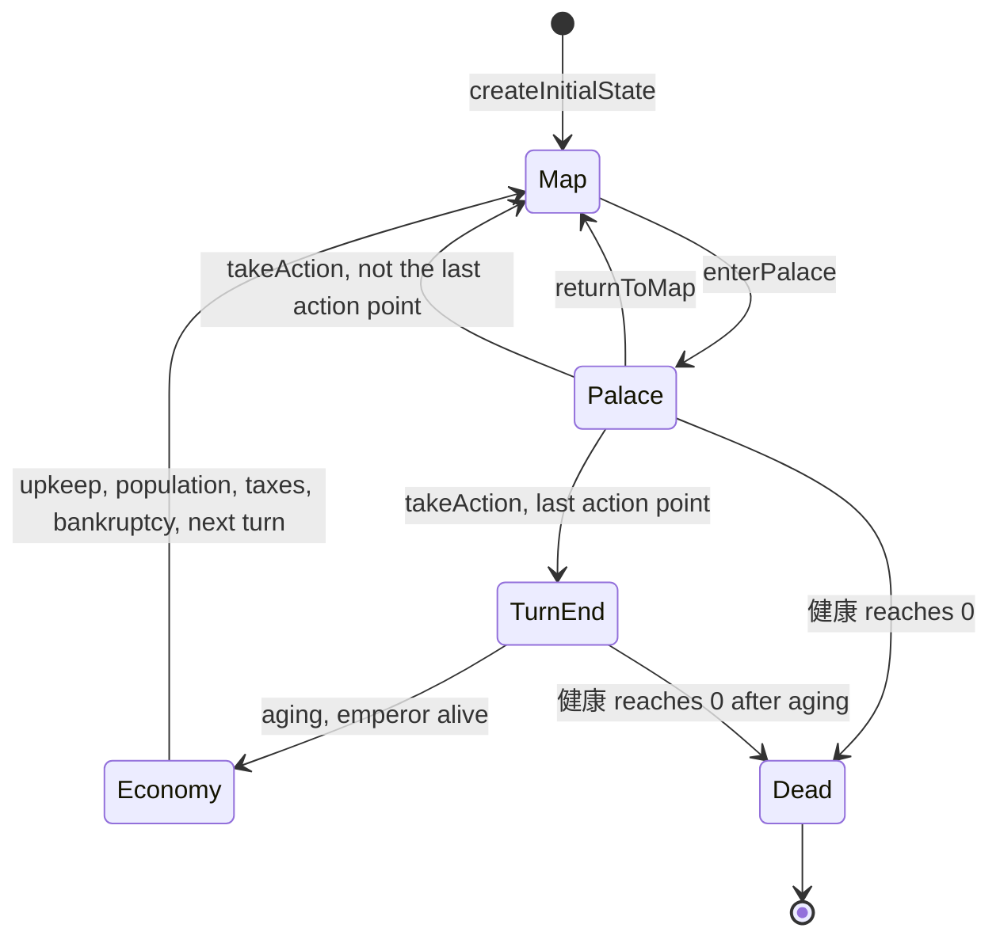

# core use cases

Status is `planned` or `implemented`. An `implemented` use case must be referenced by a test. Structure is in `ARCHITECTURE.md`. Exact numbers are in `BALANCE` (`src/model/balance.ts`), and this file names the keys only.

| ID | Use case | Status |
|---|---|---|
| UC-CORE-001 | 皇帝培養個人屬性：健康、學識、才藝、魄力 | implemented |
| UC-CORE-002 | 與皇后互動 | planned |
| UC-CORE-003 | 舉行早朝 | planned |
| UC-CORE-004 | 任命官員 | planned |
| UC-CORE-005 | 處理政事 | planned |
| UC-CORE-006 | 發生並處理戰爭 | planned |
| UC-CORE-007 | 觸發特殊事件 | planned |
| UC-CORE-008 | 選妃，或經由事件納妃 | planned |
| UC-CORE-009 | 誕育子嗣 | planned |
| UC-CORE-010 | 教導皇子女 | planned |
| UC-CORE-011 | 選定年號：候選年號與自訂年號驗證 | implemented |
| UC-CORE-012 | 半季回合：在宮殿以行動點執行行動 | implemented |
| UC-CORE-013 | 年老衰弱與駕崩 | implemented |
| UC-CORE-014 | 九州地域：由資料載入地域，各有民心、人口、富庶與歸屬 | implemented |
| UC-CORE-015 | 國庫：春上與秋上收稅、每半季支付宮廷用度、國庫虧空時各地民心下降 | implemented |
| UC-CORE-016 | 每年人口隨民心與富庶增減 | implemented |

## UC-CORE-011 年號
- `isValidEraName(name)` is true only for exactly two Han characters. It does not trim.
- `drawEraNameSuggestions(seed, pool, count = 3)` returns `count` distinct entries of `pool`, drawn with the seed. It uses its own random stream derived from the seed, so it does not change the game's `rngState`. The pool comes from `content`.

## UC-CORE-001 Starting stats
`createInitialState(seed, eraName, regions)` sets every emperor stat to `BALANCE.startingStats.min`, then splits the rest of `BALANCE.startingStats.budget` by four seeded weights, one per stat in registry order. Each share is rounded down and capped so no stat passes `BALANCE.startingStats.max`. Points left over go one at a time, in registry order, to stats below the cap. The stats always add up to the budget.

## UC-CORE-014 Regions
`createInitialState` sets `nation.treasury` to `BALANCE.startingTreasury` and copies the regions as described in `ARCHITECTURE.md` under "Region data". It draws no random numbers for them.

## UC-CORE-012 Turn loop
- `enterPalace(state, palaceId)` and `returnToMap(state)` change only `location`. They never use an action point. Entering from a palace, entering an unknown palace, or any move when dead returns the state unchanged.
- `takeAction(state, actionId, catalog = CATALOG)` is rejected, with the state unchanged, if the emperor is dead (`'dead'`), is on the map (`'not-in-palace'`), the palace does not offer the action (`'not-offered'`), or the action is not allowed in the current action point (`'not-allowed-now'`).
- Otherwise it applies the action's effects from `BALANCE.actions`, with a seeded variance of up to `BALANCE.actionVariance` on the first effect. It clamps each stat to its range and reports the applied changes, leaving out zero changes. It adds them to `turnDeltas`, returns to the map, and uses the action point.
- After the last action point of the turn, the turn ends: aging applies; if the emperor survives, the economy is settled (below); the emperor's turn totals (`turnDeltas` plus aging, in registry order, leaving out zeros) are reported; `turn` goes up by 1, `actionPoint` goes back to the first, and `turnDeltas` resets.

## UC-CORE-013 Aging and death
From `BALANCE.aging.startAge`, the emperor loses 健康 at the end of each turn. The loss starts at `BALANCE.aging.baseLoss` and grows by 1 every `BALANCE.aging.yearsPerStep` years of age. The emperor dies when 健康 reaches 0, checked after each action and again after aging at the end of the turn. On death `dead` becomes `true`, the turn does not advance, and the economy is not settled.

## UC-CORE-015 and UC-CORE-016 Economy
`settleEconomy(nation, regions, nextHalfSeason)` runs at the end of every turn the emperor survives. `nextHalfSeason` is the half-season the game moves into. In order:
1. Upkeep: 國庫 loses `BALANCE.upkeep`.
2. Population (UC-CORE-016), only when `nextHalfSeason` is 春上, so once a year: each player-owned region's 人口 grows by `BALANCE.population.ratePercent` percent (rounded down) when 民心 + 富庶 is at least `growAtOrAbove`, shrinks by the same amount when it is at most `shrinkAtOrBelow`, and otherwise stays. 人口 never goes below 0.
3. Taxes (UC-CORE-015), only when `nextHalfSeason` is in `BALANCE.tax.collectOn`: 國庫 gains each player-owned region's `regionTax`, `floor(人口 × 富庶 × 民心 / BALANCE.tax.halfYearDivisor)`, computed from its 人口 after step 2. Taxes arrive as the game enters a collection half-season, so they are reported in the summary of the half-season before it. No tax is collected at game start.
4. Bankruptcy: if 國庫 is now below 0, every player-owned region loses `BALANCE.bankruptcyMoraleLoss` 民心, never going below 0. The game goes on.

國庫 has no bounds. Regions with another owner pay no tax and are not changed.

