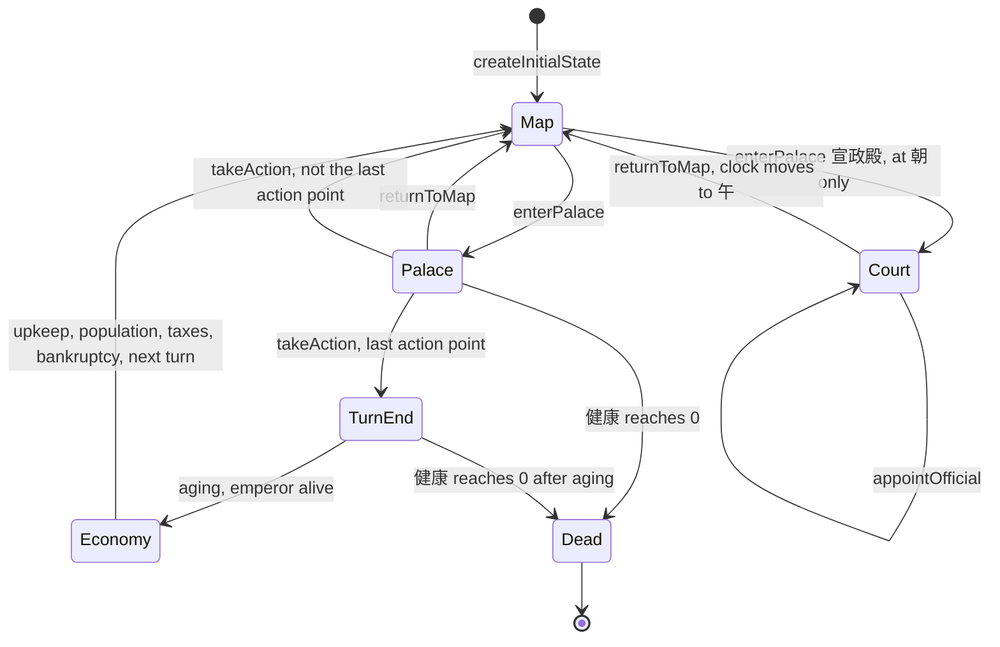

# core use cases

Status is `planned` or `implemented`. An `implemented` use case must be referenced by a test. Structure is in `ARCHITECTURE.md`. Exact numbers are in `BALANCE` (`src/model/balance.ts`), and this file names the keys only.

| ID | Use case | Status |
|---|---|---|
| UC-CORE-001 | 皇帝培養個人屬性：健康、學識、才藝、魄力 | implemented |
| UC-CORE-002 | 與皇后互動 | planned |
| UC-CORE-003 | 舉行早朝：只在朝時進入宣政殿，耗用該行動點 | implemented |
| UC-CORE-004 | 任命官員：官員、官位、賦閑，早朝時將賦閑官員任命至官位 | implemented |
| UC-CORE-005 | 處理政事 | planned |
| UC-CORE-006 | 發生並處理戰爭 | planned |
| UC-CORE-007 | 觸發特殊事件 | planned |
| UC-CORE-008 | 選妃，或經由事件納妃 | planned |
| UC-CORE-009 | 誕育子嗣 | planned |
| UC-CORE-010 | 教導皇子女 | planned |
| UC-CORE-011 | 選定年號：候選年號與自訂年號驗證 | implemented |
| UC-CORE-012 | 半季回合：在宮殿以行動點執行行動 | implemented |
| UC-CORE-013 | 年老衰弱與駕崩 | implemented |
| UC-CORE-014 | 九州地域：由資料載入地域，各有民心、人口、富庶與歸屬 | implemented |
| UC-CORE-015 | 國庫：春上與秋上收稅、每半季支付宮廷用度、國庫虧空時各地民心下降 | implemented |
| UC-CORE-016 | 每年人口隨民心與富庶增減 | implemented |

## UC-CORE-011 年號
- `isValidEraName(name)` is true only for exactly two Han characters. It does not trim.
- `drawEraNameSuggestions(seed, pool, count = 3)` returns `count` distinct entries of `pool`, drawn with the seed. It uses its own random stream derived from the seed, so it does not change the game's `rngState`. The pool comes from `content`.

## UC-CORE-001 Starting stats
`createInitialState(seed, eraName, regions, names)` sets every emperor stat to `BALANCE.startingStats.min`, then splits the rest of `BALANCE.startingStats.budget` by four seeded weights, one per stat in registry order. Each share is rounded down and capped so no stat passes `BALANCE.startingStats.max`. Points left over go one at a time, in registry order, to stats below the cap. The stats always add up to the budget.

## UC-CORE-014 Regions
`createInitialState` sets `nation.treasury` to `BALANCE.startingTreasury` and copies the regions as described in `ARCHITECTURE.md` under "Region data". It draws no random numbers for them.

## UC-CORE-012 Turn loop
- `enterPalace(state, palaceId)` and `returnToMap(state)` change only `location`. They never use an action point, except for 宣政殿 (UC-CORE-003). Entering from a palace, entering an unknown palace, entering a palace that `canEnterPalace` refuses, or any move when dead returns the state unchanged. A palace may offer no actions; it can still be entered and left, and every action there is rejected as `'not-offered'`. 宣政殿 (`xuanzheng`, `COURT_PALACE_ID`) is such a palace: it is in the catalog and offers no actions. `DEPARTMENTS` lists each court department's options in order.
- `canEnterPalace(state, palaceId)` is true when the emperor is alive, on the map, the palace is in the catalog, and the palace is open now. Every palace is open at every action point except 宣政殿 (UC-CORE-003).
- `takeAction(state, actionId, catalog = CATALOG)` is rejected, with the state unchanged, if the emperor is dead (`'dead'`), is on the map (`'not-in-palace'`), the palace does not offer the action (`'not-offered'`), or the action is not allowed in the current action point (`'not-allowed-now'`).
- Otherwise it applies the action's effects from `BALANCE.actions`, with a seeded variance of up to `BALANCE.actionVariance` on the first effect. It clamps each stat to its range and reports the applied changes, leaving out zero changes. It adds them to `turnDeltas`, returns to the map, and uses the action point.
- After the last action point of the turn, the turn ends: aging applies; if the emperor survives, the economy is settled (below); the emperor's turn totals (`turnDeltas` plus aging, in registry order, leaving out zeros) are reported; `turn` goes up by 1, `actionPoint` goes back to the first, and `turnDeltas` resets.

## UC-CORE-003 早朝
- 宣政殿 is open only at 朝 (`COURT_ACTION_POINT`, the first action point of each half-season). At any other action point `canEnterPalace` is false and `enterPalace` returns the state unchanged.
- Being in 宣政殿 is 早朝 (`isMorningCourt(state)`: alive and `location` is 宣政殿). 早朝 spends that morning's action point: while inside, the clock stays on 朝, and leaving with `returnToMap` puts the player on the map at 午 (the next action point). Leaving never ends the turn, since 朝 is not the last action point.
- So there is at most one 早朝 per half-season. Nothing inside 宣政殿 draws random numbers or uses another action point.

## UC-CORE-004 Officials and appointments
**Officials.** `GameState.officials` lists every official. Each has an ID, a name, four stats from the stat registry (文治, 武功, 野心 and 忠誠, owner `official`, each within its `STAT_REGISTRY` bounds), and either exactly one post or none (賦閑). Stats never change for now, and they have no effect on play yet.

**Posts.** `listPosts(state)` gives the posts that exist now, in display order:
1. 中樞: 丞相, 大將軍, 太傅 (`CENTRAL_POST_IDS`).
2. 六部: for each of 吏、戶、禮、兵、刑、工 in `MINISTRY_DEPARTMENT_IDS` order, its 尚書 then its 侍郎 (`MINISTRY_RANKS`).
3. 地方: for each region in `state.regions` order that the player owns, its 知州 then its 總兵 (`REGION_OFFICES`). A region has these posts only while the player owns it.

**Starting court.** `createInitialState(seed, eraName, regions, names)` generates officials from the game's random stream, after the emperor stats. One ordinary official is generated for each post in `listPosts` order and holds it, then `BALANCE.officials.startingIdle` more are generated as 賦閑. Each ordinary official is an outlier with chance `BALANCE.officials.outlierChance`; each stat is then drawn uniformly, both ends included, from that stat's range in `BALANCE.officials.ordinary` or `BALANCE.officials.outlier`. 名臣 are a separate kind (a later issue) and are never generated here.

**Names.** A name is a surname plus a given name, both drawn from the pool passed in `names` (from `content`). No two officials in a game share a name, and a name in `names.reserved` is never generated. If a draw repeats a taken or reserved name, it draws again. If the pool cannot supply a free name, `createInitialState` throws.

**Appointing.** `appointOfficial(state, postId, officialId)` puts a 賦閑 official into a post. The post's previous holder, if any, becomes 賦閑. It uses no action point, draws no random numbers, and may be repeated any number of times during one 早朝. It is rejected, with the state unchanged, when:
- it is not 早朝, including when the emperor is dead (`'not-in-court'`);
- the post names an office of a region in `state.regions` that the player does not own (`'region-not-owned'`);
- the post is not in `listPosts(state)` otherwise (`'unknown-post'`);
- no official has that ID (`'unknown-official'`);
- the official already holds a post, including this one (`'not-idle'`).

The checks run in that order. There is no dismissal (罷免) yet.

## UC-CORE-013 Aging and death
From `BALANCE.aging.startAge`, the emperor loses 健康 at the end of each turn. The loss starts at `BALANCE.aging.baseLoss` and grows by 1 every `BALANCE.aging.yearsPerStep` years of age. The emperor dies when 健康 reaches 0, checked after each action and again after aging at the end of the turn. On death `dead` becomes `true`, the turn does not advance, and the economy is not settled.

## UC-CORE-015 and UC-CORE-016 Economy
`settleEconomy(nation, regions, nextHalfSeason)` runs at the end of every turn the emperor survives. `nextHalfSeason` is the half-season the game moves into. In order:
1. Upkeep: 國庫 loses `BALANCE.upkeep`.
2. Population (UC-CORE-016), only when `nextHalfSeason` is 春上, so once a year: each player-owned region's 人口 grows by `BALANCE.population.ratePercent` percent (rounded down) when 民心 + 富庶 is at least `growAtOrAbove`, shrinks by the same amount when it is at most `shrinkAtOrBelow`, and otherwise stays. 人口 never goes below 0.
3. Taxes (UC-CORE-015), only when `nextHalfSeason` is in `BALANCE.tax.collectOn`: 國庫 gains each player-owned region's `regionTax`, `floor(人口 × 富庶 × 民心 / BALANCE.tax.halfYearDivisor)`, computed from its 人口 after step 2. Taxes arrive as the game enters a collection half-season, so they are reported in the summary of the half-season before it. No tax is collected at game start.
4. Bankruptcy: if 國庫 is now below 0, every player-owned region loses `BALANCE.bankruptcyMoraleLoss` 民心, never going below 0. The game goes on.

國庫 has no bounds. Regions with another owner pay no tax and are not changed.

