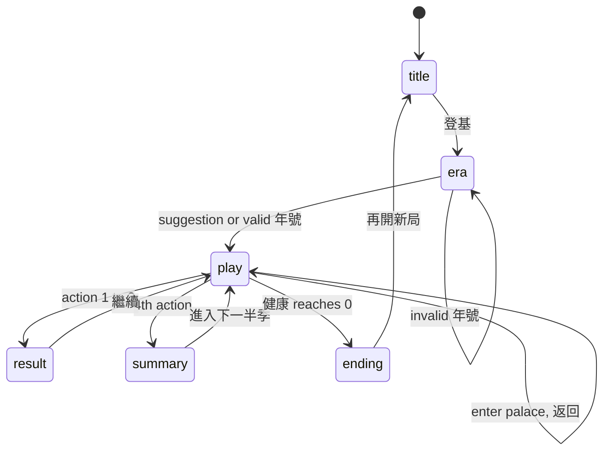
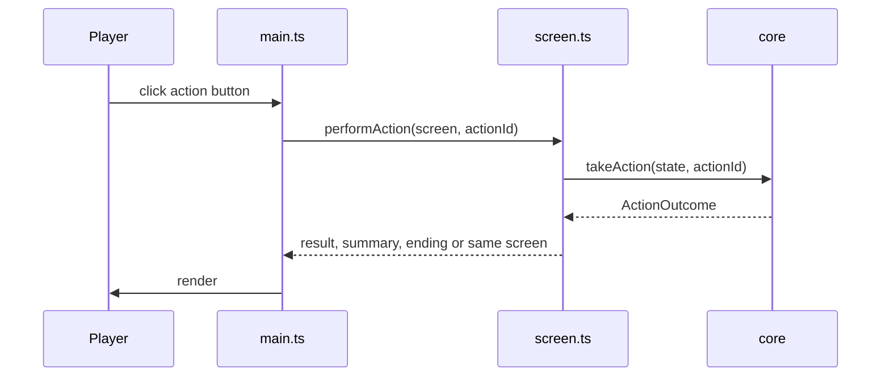

# web

Owns the Vite user interface. Rendering functions take data and return markup, so they can be tested without a browser.

Data flow: player input becomes a `core` action, and the resulting state is rendered with `content` text.

## Assets
`web` owns image assets. They live in `src/assets/` and are imported through Vite, so the build fingerprints them. Player-facing text, including image alt text, still comes from `content`.

The entry point (`main.ts`) imports each asset and passes its URL to the render functions as an argument, so render tests do not depend on Vite.

Purely decorative images, such as the title scroll, use `alt=""` and get no text from `content`.

## Use cases
- UC-WEB-001: the title screen renders an `` of the palace, scaled to the viewport width with its aspect ratio kept, never cropped and not stretched to the viewport height. Over the image at top center sits a decorative scroll image (`alt=""`), about 35% of the image width, with its top about 3% down. The `<h1>` with the game title is centered on the scroll's paper panel in dark ink brown (`#3b1f0e`), with the font stack `"DFKai-SB", "BiauKai", "KaiTi", serif`. The scroll's size and position are percentages of the palace image, and the title's font size scales with the image, with a `clamp()` minimum of 1.5rem. There is no animation.
- UC-WEB-002: the title screen has a `<button type="button">` with the `startButton` text, placed over the palace image at bottom center, on the stone path, offset about 6% up from the image bottom. It keeps its dark red background, gold border and gold text, has rounded corners and a soft shadow, scales with the image, and keeps a tap target of at least 44px. Clicking it starts a new game: `main.ts` picks a random 32-bit seed with `crypto.getRandomValues`, calls `startGame(seed, gameText.eraNamePool)`, and renders the 年號 screen.
- UC-WEB-003 年號 screen (`#era-screen`): heading, prompt, three suggestion buttons (`#era-suggestion-0` to `#era-suggestion-2`, each with `data-era`), a text input (`#era-input`) with a label, and a confirm button (`#era-confirm`). Clicking a suggestion starts the game with it. Confirming trims the typed text; if it is not exactly 2 Han characters, the screen shows `#era-error` (`role="alert"`) with `eraError`, keeps the typed text in the input, and does not start. The typed text is HTML-escaped when rendered.
- UC-WEB-004 game screens. Each has the header (`#game-header`): date (`#header-date`, such as 「承平元年 春上」), action point (`#header-action-point`, such as 朝), age (`#header-age`, such as 十六歲), and the 4 stats in registry order (`#header-stats`, one `<span data-stat="health">健康 45</span>` each).
  - Map (`#palace-map`): `mapHeading` and a grid of buttons, one per palace in catalog order, `#palace-<id>` with `data-palace`.
  - Palace (`#palace-view`): palace name, description, one button per action (`#action-<id>`, `data-action`), and `#back-to-map` (返回). Entering and leaving use no action point.
  - Action result (`#action-result`): the action name and its change line (「學識 +3，健康 −1」), and `#continue` (繼續) back to the map.
  - Turn summary (`#turn-summary`), shown instead of the action result after the 4th action: heading 「<ended half-season>總結」, the last action's change line (`#summary-action`), the half-season totals including aging (`#summary-totals`), and `#next-turn` (「進入<next half-season>」) back to the map. The header shows the new turn.
- UC-WEB-005 ending (`#ending`), shown as soon as the emperor dies, after an action or after aging: heading 駕崩, the 年號 (`#ending-era`), reign length (`#ending-reign`, 「在位N年」, where N is the reign year of death, 元年 counting as 1), age at death (`#ending-age`, 「享年N歲」), and `#restart` (再開新局) back to the title screen. There is no verdict or 諡號 yet.

## Screen state
`web` tracks the current screen. `core` tracks map or palace in `GameState.location`. `src/screen.ts` holds the pure transitions.

```ts
type Screen =
  | { screen: 'title' }
  | { screen: 'era'; seed: number; suggestions: string[]; draft: string; error: boolean }
  | { screen: 'play'; state: GameState }
  | { screen: 'result'; state: GameState; actionId: ActionId; changes: StatChange[] }
  | { screen: 'summary'; state: GameState; actionId: ActionId; changes: StatChange[]; endedHalfSeason: HalfSeasonId; totals: StatChange[] }
  | { screen: 'ending'; state: GameState };
```

`play` renders the map or the palace from `state.location`. A rejected action leaves the screen unchanged. Render functions take a `Screen` and the `content` text and return markup. Only `main.ts` touches the DOM: one click listener finds the element by ID or `data-*` attribute, calls a transition, and redraws.




