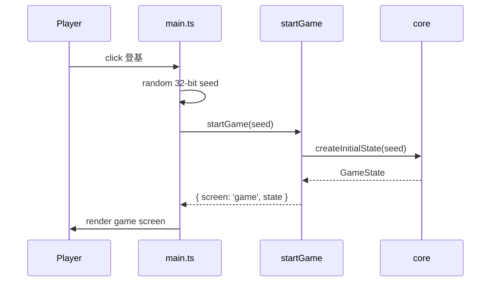

# web

Owns the Vite user interface. Rendering functions take data and return markup, so they can be tested without a browser.

Data flow: player input becomes a `core` action, and the resulting state is rendered with `content` text.

## Assets
`web` owns image assets. They live in `src/assets/` and are imported through Vite, so the build fingerprints them. Player-facing text, including image alt text, still comes from `content`.

The entry point (`main.ts`) imports the asset and passes its URL to the render function as an argument, so render tests do not depend on Vite.

## Use cases
- UC-WEB-001: the title screen renders an `<h1>` with the game title above an `` of the palace, scaled to the viewport width with its aspect ratio kept.
- UC-WEB-002: the title screen has a `<button type="button">` with the `startButton` text, centered below the image. Clicking it starts a new game: `main.ts` picks a random 32-bit seed with `crypto.getRandomValues`, calls `startGame(seed)`, and renders the game screen, which shows the placeholder heading and body. Gameplay is not defined yet.

## Screen state
`web` tracks the current screen, not `core`. `src/screen.ts` holds the pure functions.

```ts
type Screen = { screen: 'title' } | { screen: 'game'; state: GameState };
```

`startGame(seed: number): Screen` is pure and returns `{ screen: 'game', state: createInitialState(seed) }`. Render functions take a `Screen` or its parts and return markup. Only `main.ts` touches the DOM. There is no way back to the title screen; a page refresh shows it again.


