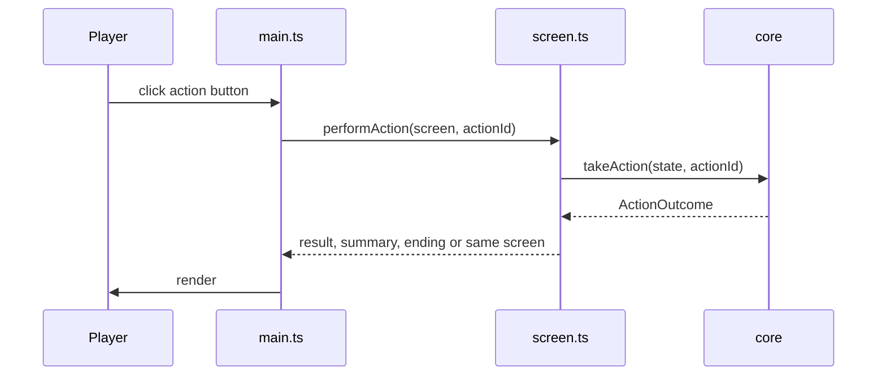

# web

Owns the Vite user interface. Rendering functions take data and return markup, so they can be tested without a browser.

Behaviour is described in `USE_CASES.md`. Layout values (sizes, colours, fonts, positions) live in `src/style.css`, and element IDs live in the render code.

Data flow: player input becomes a `core` action, and the resulting state is rendered with `content` text.

## Assets
`web` owns image assets. They live in `src/assets/` and are imported through Vite, so the build fingerprints them. Player-facing text, including image alt text, still comes from `content`.

The entry point (`main.ts`) imports each asset and passes its URL to the render functions as an argument (`ScreenImages` in `src/render.ts`), so render tests do not depend on Vite. Per-palace images are the exception to importing in `main.ts`: `PALACE_BACKGROUNDS` in `src/palaceBackgrounds.ts` is a `Record<PalaceId, string>` of imported image URLs, so the type check catches a palace without a background. `main.ts` passes it on in `ScreenImages`, and render functions still only receive URLs.

Purely decorative images use `alt=""` and get no text from `content`.

Positions on an image that tests must check live in TypeScript, not `src/style.css`. The palace anchors on the map are `PALACE_ANCHORS` in `src/palaceMap.ts`, a `Record<PalaceId, { x: number; y: number }>` in percent of the image, so the type check catches a palace without an anchor. The render code writes each anchor as inline `left` and `top` styles.

The 輿圖 world map follows the same rule: each region's grid cell comes from `content`'s region data, and the render code writes it as inline `grid-column` and `grid-row` styles, with the grid's size taken from the largest cell. Each region's fill colour is its owner's colour from `content`'s nation list, written as an inline `background` style; the empty-cell background and every other map style stay in `src/style.css`. One function in `src/worldMap.ts`, `renderWorldMap`, draws the grid, the 軍團 markers and the legend for both 輿圖 and 調兵遣將. It takes the state, the text and a mode: on 輿圖 the regions are buttons and the markers plain marks; on 調兵遣將 the markers are buttons, the regions plain cells, and the cells the selected 軍團 may move into get a move button.

Placement that depends on rendered sizes, which CSS alone cannot express, is split the same way: a pure function in TypeScript computes it from measured rectangles, and `main.ts`, the only DOM code, measures after each draw (and when the window resizes or the image loads) and writes the result as inline styles. The 宣政殿 options list uses this: `placeCourtOptions` in `src/courtOptions.ts` takes the clicked department button, the image and the list width, and returns the list's left offset and the caret's position, so the "kept inside the image" rule is tested without a browser.

## Screen state
`web` tracks the current screen. `core` tracks map or palace in `GameState.location`. `src/screen.ts` holds the pure transitions.

```ts
type Screen =
  | { screen: 'title' }
  | { screen: 'era'; seed: number; suggestions: string[]; draft: string; error: boolean }
  | { screen: 'play'; state: GameState; department?: DepartmentId }
  | { screen: 'result'; state: GameState; actionId: ActionId; changes: StatChange[] }
  | { screen: 'summary'; state: GameState; actionId: ActionId; changes: StatChange[]; endedHalfSeason: HalfSeasonId; totals: StatChange[]; economy: EconomyReport; completed: string[]; training: number | null }
  | { screen: 'atlas'; state: GameState; region?: string }
  | { screen: 'appoint'; state: GameState; post?: PostId; sort?: OfficialStatId }
  | { screen: 'recommend'; state: GameState }
  | { screen: 'exam'; state: GameState; picks: number[]; sort?: OfficialStatId }
  | { screen: 'recruit'; state: GameState; count: number }
  | { screen: 'release'; state: GameState; count: number }
  | { screen: 'build'; state: GameState }
  | { screen: 'taxes'; state: GameState }
  | { screen: 'levy'; state: GameState; gained?: number }
  | { screen: 'budget'; state: GameState }
  | { screen: 'sacrifice'; state: GameState }
  | { screen: 'conscript'; state: GameState; count: number }
  | { screen: 'discharge'; state: GameState; count: number }
  | { screen: 'drill'; state: GameState }
  | { screen: 'legion'; state: GameState; general?: string; count: number; suggestions: string[]; draft: string; error?: 'invalid-name' | 'name-taken' }
  | { screen: 'deploy'; state: GameState; legion?: string }
  | { screen: 'ending'; state: GameState };
```

`play` renders the map or the palace from `state.location`. `atlas` is the 輿圖 world map; `region` is the ID of the region whose panel is open, UI state only, absent when none is. `department` is the department whose options are open in 宣政殿 (`COURT_PALACE` in `src/screen.ts`). It is UI state only, absent everywhere else, and dropped by every transition that leaves the palace. `appoint` is the 官員任命 screen, opened from 宣政殿 while `state.location` stays 宣政殿; `post` is the selected post and `sort` the stat the 賦閑 list is sorted by, both UI state only. Its appointments go through `core`'s `appointOfficial`, so the `GameState` changes on this screen without leaving 宣政殿. `recommend` is the 舉薦人選 screen, also opened from 宣政殿 while `state.location` stays 宣政殿. The candidate it shows is `state.recommendation.candidate`, which `core`'s `recommend` stored, so the screen holds no copy. `exam` is the 開科取士 screen, also opened from 宣政殿 while `state.location` stays 宣政殿. The candidates it lists are `state.exam.candidates`, which `core`'s `holdExam` stored. `picks` are the ticked candidates' positions in that list, and `sort` is the stat the list is sorted by, both UI state only. `main.ts` passes `gameText.notables` and `gameText.officialNames` to the transition that calls `recommend` or `holdExam`. `recruit`, `release` and `build` are 工部's 徵召工匠, 遣散工匠 and 營建工程 screens, also opened from 宣政殿 while `state.location` stays 宣政殿. `count` is the number chosen in the picker, UI state only; the limits it is kept within (`maxRecruit`, `idleArtisans`) come from `core`, and the 工匠 and buildings are read from `state.works`. `taxes`, `levy` and `budget` are 戶部's 調整賦稅, 額外徵稅 and 收支表 screens, also opened from 宣政殿 while `state.location` stays 宣政殿. The tax level is read from `state.revenue.taxLevel` and changed through `core`'s `setTaxLevel`, so `taxes` holds no copy. `levy`'s `gained` is set once the levy is done: the taels `core`'s `levy` reported, UI state only, for the result line. `sacrifice` is 禮部's 祭祀 confirm screen, also opened from 宣政殿 while `state.location` stays 宣政殿; it holds no UI state, and holding goes through `core`'s `holdSacrifice`, which returns to `play` in 宣政殿. `conscript`, `discharge` and `drill` are 兵部's 徵召士兵, 解甲歸田 and 操練軍隊 screens, also opened from 宣政殿 while `state.location` stays 宣政殿. `count` is the number chosen in the picker, UI state only, kept within `core`'s `maxConscript` or `state.army.soldiers`; the soldiers, training and drill are read from `state.army`. `drill` holds no UI state; starting a drill goes through `core`'s `startDrill` and stays on `drill`, which then shows the drill running. `legion` and `deploy` are 兵部's 組建軍團 and 調兵遣將 screens, also opened from 宣政殿 while `state.location` stays 宣政殿. On `legion`, `general` is the chosen official's ID, `count` the picker's number, `suggestions` the names drawn when it opened, `draft` the typed name and `error` the last name rejection, all UI state only. `draft` is written by the name input's `input` event without a redraw, the way the slider previews, so typing survives the redraws other clicks cause. On `deploy`, `legion` is the selected 軍團's ID, UI state only; the 軍團 themselves are read from `state.army.legions`. `main.ts` passes `gameText.regions` to every transition that calls a 軍團 rule, and `gameText.legionNamePool` to `chooseCourtOption`. `summary`'s `completed` copies `TurnEnd.completed`, the buildings finished that half-season, and its `training` copies `TurnEnd.training`. A rejected action leaves the screen unchanged. Render functions take a `Screen` and the `content` text and return markup. Only `main.ts` touches the DOM: one click listener finds the element by ID or `data-*` attribute, calls a transition, and redraws. A slider is the exception, because redrawing during a drag would drop it: while it is dragged (`input` events), `main.ts` writes the strings of a pure preview function from `src/render.ts` into the preview elements without redrawing; on release (`change` event) it calls a transition and redraws. The 調整賦稅 slider uses this with `renderTaxPreview`.

Interactive elements get stable IDs, or `data-*` attributes for repeated items, so tests and `screenshots.json` scenarios can find them.


