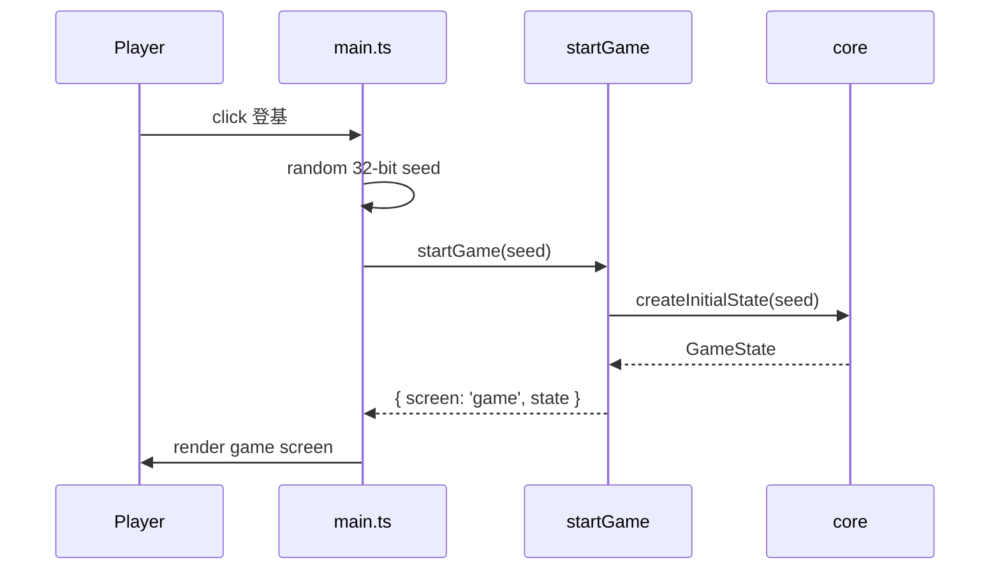

# web

Owns the Vite user interface. Rendering functions take data and return markup, so they can be tested without a browser.

Data flow: player input becomes a `core` action, and the resulting state is rendered with `content` text.

## Assets
`web` owns image assets. They live in `src/assets/` and are imported through Vite, so the build fingerprints them. Player-facing text, including image alt text, still comes from `content`.

The entry point (`main.ts`) imports each asset and passes its URL to the render functions as an argument, so render tests do not depend on Vite.

Purely decorative images, such as the title scroll, use `alt=""` and get no text from `content`.

## Use cases
- UC-WEB-001: the title screen renders an `` of the palace, scaled to the viewport width with its aspect ratio kept, never cropped and not stretched to the viewport height. Over the image at top center sits a decorative scroll image (`alt=""`), about 35% of the image width, with its top about 3% down. The `<h1>` with the game title is centered on the scroll's paper panel in dark ink brown (`#3b1f0e`), with the font stack `"DFKai-SB", "BiauKai", "KaiTi", serif`. The scroll's size and position are percentages of the palace image, and the title's font size scales with the image, with a `clamp()` minimum of 1.5rem. There is no animation.
- UC-WEB-002: the title screen has a `<button type="button">` with the `startButton` text, placed over the palace image at bottom center, on the stone path, offset about 6% up from the image bottom. It keeps its dark red background, gold border and gold text, has rounded corners and a soft shadow, scales with the image, and keeps a tap target of at least 44px. Clicking it starts a new game: `main.ts` picks a random 32-bit seed with `crypto.getRandomValues`, calls `startGame(seed)`, and renders the game screen, which shows the placeholder heading and body. Gameplay is not defined yet.

## Screen state
`web` tracks the current screen, not `core`. `src/screen.ts` holds the pure functions.

```ts
type Screen = { screen: 'title' } | { screen: 'game'; state: GameState };
```

`startGame(seed: number): Screen` is pure and returns `{ screen: 'game', state: createInitialState(seed) }`. Render functions take a `Screen` or its parts and return markup. Only `main.ts` touches the DOM. There is no way back to the title screen; a page refresh shows it again.


