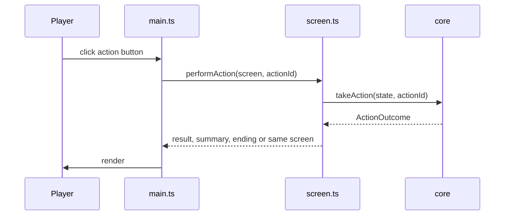

# web

Owns the Vite user interface. Rendering functions take data and return markup, so they can be tested without a browser.

Behaviour is described in `USE_CASES.md`. Layout values (sizes, colours, fonts, positions) live in `src/style.css`, and element IDs live in the render code.

Data flow: player input becomes a `core` action, and the resulting state is rendered with `content` text.

## Assets
`web` owns image assets. They live in `src/assets/` and are imported through Vite, so the build fingerprints them. Player-facing text, including image alt text, still comes from `content`.

The entry point (`main.ts`) imports each asset and passes its URL to the render functions as an argument (`ScreenImages` in `src/render.ts`), so render tests do not depend on Vite. Per-palace images are the exception to importing in `main.ts`: `PALACE_BACKGROUNDS` in `src/palaceBackgrounds.ts` is a `Record<PalaceId, string>` of imported image URLs, so the type check catches a palace without a background. `main.ts` passes it on in `ScreenImages`, and render functions still only receive URLs.

Purely decorative images use `alt=""` and get no text from `content`.

Positions on an image that tests must check live in TypeScript, not `src/style.css`. The palace anchors on the map are `PALACE_ANCHORS` in `src/palaceMap.ts`, a `Record<PalaceId, { x: number; y: number }>` in percent of the image, so the type check catches a palace without an anchor. The render code writes each anchor as inline `left` and `top` styles.

## Screen state
`web` tracks the current screen. `core` tracks map or palace in `GameState.location`. `src/screen.ts` holds the pure transitions.

```ts
type Screen =
  | { screen: 'title' }
  | { screen: 'era'; seed: number; suggestions: string[]; draft: string; error: boolean }
  | { screen: 'play'; state: GameState; department?: DepartmentId }
  | { screen: 'result'; state: GameState; actionId: ActionId; changes: StatChange[] }
  | { screen: 'summary'; state: GameState; actionId: ActionId; changes: StatChange[]; endedHalfSeason: HalfSeasonId; totals: StatChange[]; economy: EconomyReport }
  | { screen: 'atlas'; state: GameState }
  | { screen: 'appoint'; state: GameState; post?: PostId; sort?: OfficialStatId }
  | { screen: 'recommend'; state: GameState }
  | { screen: 'ending'; state: GameState };
```

`play` renders the map or the palace from `state.location`. `department` is the department whose options are open in 宣政殿 (`COURT_PALACE` in `src/screen.ts`). It is UI state only, absent everywhere else, and dropped by every transition that leaves the palace. `appoint` is the 官員任命 screen, opened from 宣政殿 while `state.location` stays 宣政殿; `post` is the selected post and `sort` the stat the 賦閑 list is sorted by, both UI state only. Its appointments go through `core`'s `appointOfficial`, so the `GameState` changes on this screen without leaving 宣政殿. `recommend` is the 舉薦人選 screen, also opened from 宣政殿 while `state.location` stays 宣政殿. The candidate it shows is `state.recommendation.candidate`, which `core`'s `recommend` stored, so the screen holds no copy. `main.ts` passes `gameText.notables` and `gameText.officialNames` to the transition that calls `recommend`. A rejected action leaves the screen unchanged. Render functions take a `Screen` and the `content` text and return markup. Only `main.ts` touches the DOM: one click listener finds the element by ID or `data-*` attribute, calls a transition, and redraws.

Interactive elements get stable IDs, or `data-*` attributes for repeated items, so tests and `screenshots.json` scenarios can find them.


