# web use cases

Status is `planned` or `implemented`. An `implemented` use case must be referenced by a test. Structure is in `ARCHITECTURE.md`. Layout values are in `src/style.css`, element IDs in the render code, and text in `content`.

| ID | Use case | Status |
|---|---|---|
| UC-WEB-001 | 顯示標題畫面 | implemented |
| UC-WEB-002 | 開始遊戲：登基後進入年號畫面 | implemented |
| UC-WEB-003 | 年號畫面 | implemented |
| UC-WEB-004 | 宮殿地圖、宮殿、行動結果與半季總結畫面（含國庫、稅入、用度與地域變化） | implemented |
| UC-WEB-005 | 駕崩結局與再開新局 | implemented |
| UC-WEB-006 | 輿圖畫面：自崇文館開啟的天下格狀地圖，各地域以歸屬國之色標示，點選地域顯示其歸屬與民心、人口、富庶，附圖例，開啟不耗行動點 | implemented |
| UC-WEB-007 | 宣政殿：只在朝時開放的早朝，圖上內閣與六部按鈕，展開各部選項，退回宮城 | implemented |
| UC-WEB-008 | 官員任命畫面：按中樞、六部、地方列出官位，選官位後自賦閑官員中任命 | implemented |
| UC-WEB-009 | 舉薦人選畫面：顯示一名候選人（名臣另有標記），錄用或婉拒；每次早朝限用一次 | implemented |
| UC-WEB-010 | 開科取士畫面：列出應試者（名臣另有標記），可依屬性排序，勾選錄取後確定；非開科之年顯示下次開科 | implemented |
| UC-WEB-011 | 徵召工匠畫面：以一萬為單位選定人數後徵召；每次早朝限用一次 | implemented |
| UC-WEB-012 | 遣散工匠畫面：以一萬為單位或全部遣散閒置工匠 | implemented |
| UC-WEB-013 | 營建工程畫面：列出全部工程的簡介、所需工匠·半季與狀態，增減各工程的工匠 | implemented |
| UC-WEB-014 | 調整賦稅畫面：五段滑桿選定稅率，拖動時顯示稅率名稱與下次預計稅入，放開即生效 | implemented |
| UC-WEB-015 | 額外徵稅畫面：提示可得稅銀與民心大減，確認後徵收並顯示所得；每次早朝限用一次 | implemented |
| UC-WEB-016 | 收支表畫面：國庫、稅率、各地下次預計稅入與合計、半年宮廷用度、下次收稅時節 | implemented |
| UC-WEB-017 | 祭祀畫面：提示耗國庫、耗用午時、可減低本年天災之虞，舉行或返回；每個在位年限一次 | implemented |
| UC-WEB-018 | 徵召士兵畫面：顯示士兵總數、可徵人口與此次至多，按級距選定人數後徵召；每次早朝限用一次 | implemented |
| UC-WEB-019 | 解甲歸田畫面：顯示士兵總數，按級距或全部遣返士兵 | implemented |
| UC-WEB-020 | 操練軍隊畫面：顯示士兵總數與訓練，提示耗費與為期一年，確認後開始；操練期間按鈕停用並顯示尚餘半季 | implemented |

## UC-WEB-001 Title screen
The palace image fills the viewport width with its aspect ratio kept, never cropped or stretched. A decorative scroll sits over the top centre of the image, with the game title written on it. The scroll and title scale with the image. There is no animation.

## UC-WEB-002 Starting a game
The start button sits over the bottom centre of the palace image, on the stone path, scales with the image, and keeps a comfortable tap target. Clicking it starts a new game: `main.ts` picks a random 32-bit seed with `crypto.getRandomValues`, calls `startGame(seed, gameText.eraNamePool)`, and shows the 年號 screen.

## UC-WEB-003 年號 screen
A heading and prompt, three suggested 年號 buttons, a labelled text input, and a confirm button. Clicking a suggestion starts the game with it. Confirming trims the typed text. If it is not a valid 年號, the screen shows an error as an alert, keeps the typed text, and does not start. Typed text is HTML-escaped when rendered. `chooseEraName(screen, input, regions, names, buildings)` passes the region data (`gameText.regions` in `main.ts`), the official name pool (`gameText.officialNames`) and the building list (`gameText.buildings`) to `createInitialState`.

## UC-WEB-004 Game screens
Every game screen has a header with the date, the action point, the emperor's age, the four emperor stats in registry order (emperor-owned stats only), and 國庫 in taels.
- Header placement: on the screens built on an image (the palace map and the palace views), the header is a banner over the top edge of the image: a semi-transparent dark band with gold text that takes no space above the image. Its contents and order do not change. On the screens without an image (action result, turn summary, 輿圖, 官員任命, 舉薦人選, 開科取士, 徵召工匠, 遣散工匠, 營建工程, 調整賦稅, 額外徵稅, 收支表, 祭祀, 徵召士兵, 解甲歸田, 操練軍隊) the header is a bar above the content, as before.
- Palace map: the illustrated palace map, laid out like the title screen: it fills the viewport width, is never upscaled past its native width, keeps its aspect ratio, and is never cropped. The 宮城 heading stays in the markup for screen readers but is visually hidden. Each palace, in catalog order, is a button placed on the image and centred on that palace's anchor, so the button is also the label for its place and stays on it at any size. The buttons scale with the image, keep a comfortable tap target, and stay above the header banner where the two meet. Every palace in the catalog has an anchor inside the image. A palace that `canEnterPalace` refuses right now (宣政殿 at any action point but 朝) keeps its place but is a disabled button, visibly dimmed, and clicking it does nothing. The map has no 輿圖 button and nothing below the image.
- Palace: each palace shows its own background image, laid out like the map (full viewport width, never upscaled past its native width, aspect ratio kept, never cropped), with alt text from `content`. Every palace in the catalog has a background. A semi-transparent panel over the lower part of the image holds the palace name and description, one button per action it offers, and a button back to the map; text stays readable on every background. A palace that offers no actions shows a "nothing to do here" line instead of the action list. 崇文館 also shows the 輿圖 button (UC-WEB-006), styled and placed apart from the action buttons because it is not an action. When the viewport is too narrow for the banner and the panel to both fit over the image, the banner stays over the image and the panel moves below it. Entering and leaving use no action point. 宣政殿 is the exception: it is open only at 朝, uses that action point, and has the same image and banner but no panel (UC-WEB-007).
- Action result: the action name, its changes, and a button to continue to the map.
- Turn summary, shown instead of the action result after the last action of a turn: a heading naming the half-season that ended, the last action's changes, the half-season totals including aging, the treasury line (tax income when there was any, and upkeep), then, only when 工匠 or soldiers were paid, a separate wages line (`formatWages`) giving the 工匠 wages and the soldier wages side by side, each part only when it is above 0, then, only when a drill was running in the half-season that ended (`TurnEnd.training` is not `null`), a training line with the training change, such as 訓練 +2 (+0 at the cap), then, only when buildings were completed, a line naming them in building order, one line per region that changed (or a single "no change" line), and a button into the next half-season. The header then shows the new turn, with 國庫 after taxes, upkeep and both wages.

## UC-WEB-006 輿圖
Opened from 崇文館 only. Opening and closing it, and selecting regions on it, use no action point and do not change the `GameState`. It is read-only: nothing on it gives orders.

It shows the header, a heading, the world map, a legend, and a button, whose text names 崇文館, that returns to 崇文館.
- **Map.** A grid of square cells covering every cell from the top-left corner to the furthest region on each axis. Each region in `state.regions` that has region data fills its own cell: a button showing the region's name, filled with its owner's colour from the nation list (UC-CONTENT-005), with name text that stays readable on every nation colour. The player's capital also shows the 京師 mark. Cells with no region get a plain background, are not buttons, and are hidden from screen readers. On a narrow screen the cells shrink so the whole map fits the width without scrolling sideways.
- **Selecting.** Clicking a region selects it and opens a panel with its name, its owner's name, and its 民心, 人口 and 富庶 from the current state, formatted like elsewhere. Any region can be selected, foreign or the player's. Clicking another region switches the panel to it; the selected cell is marked as selected. The panel has a close button that clears the selection. With nothing selected, a hint line in its place tells the player to click a region. The atlas always opens with nothing selected.
- **Legend.** One entry per nation in nation-list order, each a swatch of its colour and its name.

`openAtlas(screen)` goes from `play` in 崇文館 to `atlas` with nothing selected, keeping the same `state` object. From anywhere else (the map, another palace, or any other screen) it returns the screen unchanged. `selectAtlasRegion(screen, region)` sets the selected region on an `atlas` screen to `region` when it is the ID of a region in `state.regions`, and clears it when `region` is `null`; any other ID, or any other screen, returns the screen unchanged. `closeAtlas(screen)` goes from `atlas` back to `play` with the same `state`, dropping the selection, so the player is back in 崇文館.

## UC-WEB-005 Ending
Shown as soon as the emperor dies, after an action or after aging: a heading, the 年號, the reign length (the reign year of death, 元年 counting as 1), the age at death, and a button that returns to the title screen. There is no verdict or 諡號 yet.

## UC-WEB-007 宣政殿
Entered from its button on the palace map, only at 朝 (UC-CORE-003); at other action points the button is disabled. Being inside is 早朝: the header keeps showing 朝, and leaving puts the player on the map at 午, or at 夕 when 祭祀 was held during this 早朝 (UC-CORE-003). It shows its background image and the header banner like the other palace views, but no palace panel. Its name stays in the markup as a heading for screen readers but is visually hidden.

- Over the lower right of the image sits one horizontal row of buttons that scales with the image: 內閣 and the six 部 in `core` registry order (`DEPARTMENT_IDS`), then 退. Each department button shows its short name and is announced by its full name, both from `content`. 退 is set apart from the departments by a gap and a different style.
- 退 returns to the map, and the 朝 action point is now spent: the map shows 午. If 祭祀 was held during this 早朝, 午 is spent too and the map shows 夕. Leaving never ends the half-season.
- Clicking a department highlights it and opens its options, in registry order, as a vertical list directly above the clicked department, with the list's right edge lined up with that button's right edge. If that would push the list past the image's left edge (such as 內閣 on a narrow viewport), the list shifts right just enough to stay inside the image. A small downward caret under the list points at the centre of the clicked button, and stays on the button even when the list has shifted. The list follows its department button in the markup, so keyboard and screen-reader order goes from a department to its options to the next department. Clicking another department switches the list to that department. Clicking the open department closes the list. Leaving 宣政殿 closes it, so it is closed on the next visit.
- Open options (`OPEN_COURT_OPTIONS` in `src/screen.ts`; for now 吏部's 舉薦人選, 官員任命 and 開科取士, 戶部's 調整賦稅, 額外徵稅 and 收支表, 禮部's 祭祀, 兵部's 徵召士兵, 解甲歸田 and 操練軍隊, and 工部's 徵召工匠, 遣散工匠 and 營建工程) are enabled buttons with their name and no tag. Clicking one opens its screen (UC-WEB-009, UC-WEB-008, UC-WEB-010, UC-WEB-014, UC-WEB-015, UC-WEB-016, UC-WEB-017, UC-WEB-018, UC-WEB-019, UC-WEB-020, UC-WEB-011, UC-WEB-012, UC-WEB-013). 兵部's options are, in order, 徵召士兵, 解甲歸田 and 操練軍隊. 徵召士兵 is enabled only when `canConscript` is true: once used this 早朝 it is a disabled button with the same "already recruited" tag as 徵召工匠, and when `maxConscript` is 0 a disabled button with the same "no one to recruit" tag. 解甲歸田 is enabled only when there is at least one soldier, and otherwise is a disabled button with a "no soldiers" tag. 操練軍隊 is always enabled during 早朝, also while a drill is running, so the player can see how long is left. These tags are styled like the "not yet open" tag. 禮部's options are, in order, 祭祀 and 外交, which stays "not yet open". 祭祀 is enabled only when `canHoldSacrifice` is true: once held in this reign year it is a disabled button with an "already held this year" tag, styled like the "not yet open" tag, until the next 春上. 戶部's options are, in order, 調整賦稅, 額外徵稅 and 收支表. 調整賦稅 and 收支表 are always enabled during 早朝. 額外徵稅 is enabled only when `canLevy` is true: once used this 早朝 it is a disabled button with an "already levied" tag, styled like the "not yet open" tag, until the next 早朝. 工部's options are, in order, 徵召工匠, 遣散工匠, 營建工程 (formerly named 建造) and 打造兵器, which stays "not yet open". 徵召工匠 is enabled only when `canRecruit` is true: once used this 早朝 it is a disabled button with an "already recruited" tag, and when `maxRecruit` is 0 a disabled button with a "no one to recruit" tag. 遣散工匠 is enabled only when there are idle 工匠, and otherwise is a disabled button with a "no idle 工匠" tag. 營建工程 is always enabled during 早朝. These tags are styled like the "not yet open" tag. Once 舉薦 has been used this 早朝 (`canRecommend` is false), 舉薦人選 is a disabled button with its name and a small "already recommended" tag, styled like the "not yet open" tag, until the next 早朝. 開科取士 is enabled only when `canHoldExam` is true. In an exam year after the exam is held, it is a disabled button with an "already held" tag. In any other year it is a disabled button with a tag saying how many years remain until the next exam (`nextExamYear` minus the current reign year), in Chinese numerals, such as "in two years". Both tags are styled like the "not yet open" tag. Every other option is a disabled button with its name and a small "not yet open" tag; clicking a disabled option does nothing.
- Which department is open is `web` screen state only. Opening, switching and closing keep the same `GameState` object and use no action point.

`toggleDepartment(screen, departmentId)` applies only to `play` in 宣政殿 (`COURT_PALACE`). From anywhere else, or with an ID that is not a department, it returns the screen unchanged. `chooseCourtOption(screen, optionId, notables, names)` applies only to `play` in 宣政殿 with an open option; for 舉薦人選 it also needs `canRecommend`, for 開科取士 `canHoldExam`, for 徵召工匠 `canRecruit`, for 遣散工匠 at least one idle 工匠, for 額外徵稅 `canLevy`, for 祭祀 `canHoldSacrifice`, for 徵召士兵 `canConscript`, and for 解甲歸田 at least one soldier. Otherwise it returns the screen unchanged.

## UC-WEB-014 調整賦稅
Opened from 戶部 → 調整賦稅 during 早朝. It can be opened any number of times in one 早朝. Nothing on this screen uses an action point, and the header keeps showing 朝.

- The screen has the header bar, a heading, and a one-line hint at the top saying the tax rate affects 民心. It shows no 民心 numbers.
- A slider with five notches, one per tax level in `TAX_LEVEL_IDS` order, lightest on the left. It snaps to the notches and starts at the current tax rate. The five level names are written under the notches.
- Below it, the selected level's name and the expected total tax at the next collection at that level (the sum of `expectedTax`), in taels. Both update while the slider is dragged, without changing the `GameState`.
- On release the level is saved through `setTaxLevel`; there is no confirm button. The header, which shows 國庫, does not change.
- A button returns to 宣政殿 with 戶部's options open.

`setTax(screen, level)` applies only to `taxes` and saves the level, staying on `taxes`. A rejection by `core`, any other input, or a call from another screen returns the screen unchanged. `renderTaxPreview(state, level, text, game)` gives the level name and the expected-total line for any level, for `main.ts` to write while dragging. `backToCourt(screen)` returns from `taxes`, `levy` and `budget` to `play` in 宣政殿 with 戶部 open.

## UC-WEB-015 額外徵稅
Opened from 戶部 → 額外徵稅 during 早朝, when `canLevy` is true. Nothing on this screen uses an action point.

- The screen has the header bar, a heading, and one line of hint giving the amount the levy will bring in (`levyAmount`, in taels) and saying it will greatly lower 民心. It shows no 民心 numbers.
- 徵收 calls `levy`. The screen then shows, in place of the hint and the two buttons, a result line with the taels gained and a single button back to 宣政殿 with 戶部 open, where 額外徵稅 now shows as already levied. The header shows 國庫 with the levy added.
- 返回 goes back to 宣政殿 with 戶部 open without levying.

`confirmLevy(screen)` applies only to `levy` before it is done, and sets `gained`. A rejection by `core`, or a call from another screen, returns the screen unchanged.

## UC-WEB-017 祭祀
Opened from 禮部 → 祭祀 during 早朝, when `canHoldSacrifice` is true.

- The screen has the header bar, a heading, and one line of hint saying 祭祀 costs 國庫, uses up the 午 slot, and may lower the risk of natural disasters this year. It shows no numbers: not the cost, and no 民心 or stat values.
- 舉行 calls `holdSacrifice` and returns straight to 宣政殿 with 禮部 open, where 祭祀 now shows as already held this year. The header shows 國庫 with the cost taken off and still shows 朝: the player stays in 早朝 and can use the other departments. Leaving with 退 then puts the player on the map at 夕 (UC-WEB-007).
- 返回 goes back to 宣政殿 with 禮部 open without holding it. Nothing is spent.

`confirmSacrifice(screen)` applies only to `sacrifice`, and returns `play` in 宣政殿 with `department` `rites`. A rejection by `core`, or a call from another screen, returns the screen unchanged. `backToCourt(screen)` returns from `sacrifice` to `play` in 宣政殿 with 禮部 open.

## UC-WEB-018 徵召士兵
Opened from 兵部 → 徵召士兵 during 早朝, when `canConscript` is true. Nothing on this screen uses an action point, and the header keeps showing 朝.

- The screen has the header bar, a heading, and lines with the current soldier count, the free population (`freePopulation`) and this 徵召's maximum (`maxConscript`), in persons, and a one-line hint that new recruits lower the army's training.
- The same number picker as 徵召工匠 (UC-WEB-011), in steps of `BALANCE.army.step`, from one step up to `maxConscript`, starting at one step, with a maximum button.
- A confirm button calls `conscriptSoldiers` with the chosen number. The player returns to 宣政殿 with 兵部's options open, where 徵召士兵 now shows as already used until the next 早朝.
- A back button returns to 宣政殿 with 兵部 open without conscripting; 徵召士兵 stays unused.

`stepCount(screen, direction)` and `maxCount(screen)` also apply to `conscript` and `discharge`, with that screen's step and limit. `confirmConscript(screen)` applies only to `conscript`. A rejection by `core`, any other input, or a call from another screen returns the screen unchanged. `backToCourt(screen)` returns from `conscript`, `discharge` and `drill` to `play` in 宣政殿 with 兵部 open.

## UC-WEB-019 解甲歸田
Opened from 兵部 → 解甲歸田 during 早朝, when there is at least one soldier. It can be opened any number of times in one 早朝. Nothing on this screen uses an action point.

- The screen has the header bar, a heading, and a line with the current soldier count, in persons.
- The same number picker, from one step up to the soldier count, whose maximum button is labelled as releasing all soldiers and sets the picker to every soldier.
- A confirm button calls `releaseSoldiers` with the chosen number, at no cost, and returns to 宣政殿 with 兵部 open.
- A back button returns to 宣政殿 with 兵部 open without releasing.

`confirmDischarge(screen)` applies only to `discharge`. A rejection by `core` or a call from another screen returns the screen unchanged.

## UC-WEB-020 操練軍隊
Opened from 兵部 → 操練軍隊 during 早朝, any number of times, whether or not a drill is running. Nothing on this screen uses an action point, and the header keeps showing 朝.

- The screen has the header bar, a heading, and lines with the current soldier count, in persons, and the current training value.
- When no drill is running: a one-line hint giving the cost (`BALANCE.army.drillCost`, in taels), saying it is paid once up front, that the drill lasts one year, and that training rises each half-season. A confirm button calls `startDrill`. The player stays on this screen, which now shows the drill running, and the header shows 國庫 with the cost taken off.
- While a drill is running: in place of the hint, a line saying the army is drilling, with the half-seasons left (`drillTurnsLeft`) in Chinese numerals, and the confirm button is shown disabled.
- A back button returns to 宣政殿 with 兵部 open.

`confirmDrill(screen)` applies only to `drill`, and returns `drill` with the new state. A rejection by `core` (including a drill already running), or a call from another screen, returns the screen unchanged.

## UC-WEB-016 收支表
Opened from 戶部 → 收支表 during 早朝, any number of times. It is read-only and uses no action point.

- The screen has the header bar, a heading, and lines with the current 國庫 and the current tax level's name.
- A table with one row per player-owned region, in region order: its name and its expected tax at the next collection at the current level (`expectedTax`), in taels, then a total row.
- A line with the court upkeep per half a year: `BALANCE.upkeep` times half of `BALANCE.turnsPerYear`. This is display only; upkeep is still paid every half-season. 工匠 wages are not on this sheet.
- A line naming the half-season of the next collection (`nextCollection`).
- A button returns to 宣政殿 with 戶部 open.

## UC-WEB-011 徵召工匠
Opened from 工部 → 徵召工匠 during 早朝, when `canRecruit` is true. Nothing on this screen uses an action point, and the header keeps showing 朝.

- The screen has the header bar, a heading, and lines with the total 工匠, the free population (`freePopulation`) and this 徵召's maximum (`maxRecruit`), in persons.
- A number picker chooses how many to recruit, in steps of `BALANCE.works.step`. It starts at one step. A minus button lowers it by one step and is disabled at one step. A plus button raises it by one step and is disabled at the maximum. A maximum button sets it to the maximum.
- A confirm button calls `recruitArtisans` with the chosen number. The new 工匠 are idle. The player returns to 宣政殿 with 工部's options open, where 徵召工匠 now shows as already used until the next 早朝.
- A back button returns to 宣政殿 with 工部 open without recruiting; 徵召 stays unused.

`stepCount(screen, direction)` (`1` or `-1`) and `maxCount(screen)` apply to `recruit` and `release`; a step past either end leaves the screen unchanged. `confirmRecruit(screen)` applies only to `recruit`. A rejection by `core`, any other input, or a call from another screen returns the screen unchanged. `backToCourt(screen)` returns from `recruit`, `release` and `build` to `play` in 宣政殿 with 工部 open.

## UC-WEB-012 遣散工匠
Opened from 工部 → 遣散工匠 during 早朝, when there is at least one idle 工匠. It can be opened any number of times in one 早朝. Nothing on this screen uses an action point.

- The screen has the header bar, a heading, and lines with the total 工匠 and the idle 工匠, in persons.
- The same number picker as 徵召工匠, from one step up to the idle 工匠, whose maximum button is labelled as releasing all idle 工匠 and sets the picker to every idle 工匠.
- A confirm button calls `releaseArtisans` with the chosen number, at no cost, and returns to 宣政殿 with 工部 open.
- A back button returns to 宣政殿 with 工部 open without releasing.
- Only idle 工匠 can be released. To free 工匠 working on a building, lower its assignment in 營建工程 first.

`confirmRelease(screen)` applies only to `release`. A rejection by `core` or a call from another screen returns the screen unchanged.

## UC-WEB-013 營建工程
Opened from 工部 → 營建工程 during 早朝. Nothing on this screen uses an action point.

- The screen has the header bar, a heading, a line with the total and idle 工匠, and a table with one row per building in `state.works.buildings` order: its name and one-line description (from `content`), its required manpower in 工匠·半季, its status, and its 工匠.
- Status: 未動工; 營建中 with progress / required, and a rough number of half-seasons left at the current assignment (`halfSeasonsToFinish`), or a "paused" mark when it has progress but no 工匠; or 已落成.
- Each unfinished building shows its assigned 工匠 between a minus and a plus button. Each click changes the assignment by one step through `assignArtisans`: plus takes from idle 工匠 and is disabled when there are none, minus returns them to idle and is disabled at 0. The table and the idle count update at once. A completed building shows no buttons.
- A back button returns to 宣政殿 with 工部 open.

`changeAssignment(screen, buildingId, direction)` (`1` or `-1`) applies only to `build`. A rejection by `core`, any other input, or a call from another screen returns the screen unchanged.

## UC-WEB-009 舉薦人選
Opened from 吏部 → 舉薦人選 during 早朝, once per 早朝. Opening it calls `core`'s `recommend`, which draws the candidate; nothing on this screen uses an action point, and the header keeps showing 朝.

- The screen has the header bar, a heading, and one candidate: their name and their 文治, 武功, 野心 and 忠誠. A 名臣 also shows a 名臣 mark. An ordinary candidate does not.
- Two buttons: accept and decline. Accepting calls `acceptCandidate`, so the candidate joins as 賦閑 and appears in 官員任命's 賦閑 list. Declining calls `declineCandidate`. Either way the player returns to 宣政殿 with 吏部's options open, where 舉薦人選 now shows as already used.
- There is no way to leave without deciding. If the state holds no candidate from this half-season, the screen shows only a button back to 宣政殿.

`acceptRecommendation(screen)` and `declineRecommendation(screen)` apply only to `recommend`; a rejection by `core`, or a call from another screen, returns the screen unchanged. `backToCourt(screen)` also returns from `recommend` to `play` in 宣政殿 with 吏部 open.

## UC-WEB-010 開科取士
Opened from 吏部 → 開科取士 during 早朝 in an exam year, once per exam year. Opening it calls `core`'s `holdExam`, which draws the candidates. Nothing on this screen uses an action point, and the header keeps showing 朝.

- The screen has the header bar, a heading, a line with how many candidates are ticked, and a checklist of every candidate: a checkbox, the name, and their 文治, 武功, 野心 and 忠誠. A 名臣 also shows the 名臣 mark next to their name, as on 舉薦人選. An ordinary candidate does not.
- Clicking a candidate's checkbox ticks or unticks them. Ticks are kept while sorting.
- Each stat column header is a sort button. Clicking one sorts the list by that stat, highest first, ties kept in candidate order. The active sort button is marked. With no sort chosen the list is in candidate order.
- A confirm button calls `confirmExam` with the ticked candidates. Confirming with none ticked is allowed. The ticked candidates join as 賦閑 and appear in 官員任命's 賦閑 list. The player returns to 宣政殿 with 吏部's options open, where 開科取士 now shows as already held.
- There is no way to leave without confirming. If the state holds no candidates from this half-season, the screen shows only a button back to 宣政殿.

`toggleExamPick(screen, index)` and `sortExam(screen, stat)` apply only to `exam`, and only with a candidate position or an official stat. `confirmExamPicks(screen)` applies only to `exam`. A rejection by `core`, any other input, or a call from another screen returns the screen unchanged. `backToCourt(screen)` also returns from `exam` to `play` in 宣政殿 with 吏部 open.

## UC-WEB-008 官員任命
Opened from 吏部 → 官員任命 during 早朝. Nothing on this screen uses an action point; the header keeps showing 朝.

- The screen has the header bar, a heading, and the post list from `listPosts`, in three groups with their own headings: 中樞, 六部 and 地方. 地方 rows come region by region, in region order. Each row shows the post's full name (`formatPostName`), the holder's name, and the holder's 文治, 武功, 野心 and 忠誠. A vacant post shows a "vacant" mark instead of a name, and empty stat cells.
- Clicking a post selects it. In place of the post list, the screen then names the selected post and its holder, and lists every 賦閑 official with their name and four stats, plus a button to appoint each. With no 賦閑 official it shows a single "none" line.
- Each stat column header is a sort button. Clicking one sorts the 賦閑 list by that stat, highest first, ties kept in `officials` order; the active sort button is marked. With no sort chosen the list is in `officials` order. The sort is kept while the player selects other posts and makes appointments, and is dropped on leaving the screen.
- Appointing calls `appointOfficial`. On success the selection closes and the post list shows the new holder; the previous holder, if any, is now in the 賦閑 list. A rejected appointment leaves the screen unchanged.
- A button closes the selection and returns to the post list. Another button, always shown, returns to 宣政殿 with 吏部's options open.

The screen is the `appoint` screen; its selected `post` and `sort` are UI state only. `backToCourt(screen)` returns from it to `play` in 宣政殿. `selectPost(screen, postId)` accepts only a post in `listPosts`; `sortIdle(screen, stat)` only an official stat; `appoint(screen, officialId)` only with a post selected. Any other input, or a call from another screen, returns the screen unchanged.

## Screen flow

```mermaid
stateDiagram-v2
  [*] --> title
  title --> era: 登基
  era --> era: invalid 年號
  era --> play: suggestion or valid 年號
  play --> play: enter palace, 返回
  play --> play: enter 宣政殿, at 朝 only
  play --> play: 退 from 宣政殿, clock moves to 午
  play --> play: open, switch or close a department, in 宣政殿
  play --> appoint: 官員任命, in 宣政殿
  appoint --> appoint: select post, sort, appoint, back to posts
  appoint --> play: back to 宣政殿
  play --> recommend: 舉薦人選, in 宣政殿, once per 早朝
  recommend --> play: accept or decline, back to 宣政殿
  play --> exam: 開科取士, in 宣政殿, once per exam year
  exam --> exam: tick, untick, sort
  exam --> play: confirm, back to 宣政殿
  play --> recruit: 徵召工匠, in 宣政殿, once per 早朝
  recruit --> recruit: minus, plus, maximum
  recruit --> play: confirm or back, to 宣政殿
  play --> release: 遣散工匠, in 宣政殿, with idle 工匠
  release --> release: minus, plus, all idle
  release --> play: confirm or back, to 宣政殿
  play --> build: 營建工程, in 宣政殿
  build --> build: raise or lower an assignment
  build --> play: back to 宣政殿
  play --> taxes: 調整賦稅, in 宣政殿
  taxes --> taxes: drag, release saves the level
  taxes --> play: back to 宣政殿
  play --> levy: 額外徵稅, in 宣政殿, once per 早朝
  levy --> levy: 徵收, shows the amount gained
  levy --> play: 返回, or back after levying, to 宣政殿
  play --> budget: 收支表, in 宣政殿
  budget --> play: back to 宣政殿
  play --> sacrifice: 祭祀, in 宣政殿, once per reign year
  sacrifice --> play: 舉行 or 返回, to 宣政殿
  play --> conscript: 徵召士兵, in 宣政殿, once per 早朝
  conscript --> conscript: minus, plus, maximum
  conscript --> play: confirm or back, to 宣政殿
  play --> discharge: 解甲歸田, in 宣政殿, with soldiers
  discharge --> discharge: minus, plus, all soldiers
  discharge --> play: confirm or back, to 宣政殿
  play --> drill: 操練軍隊, in 宣政殿
  drill --> drill: confirm starts the drill, when none is running
  drill --> play: back to 宣政殿
  play --> atlas: 輿圖, in 崇文館
  atlas --> play: back to 崇文館
  play --> result: not the last action of the turn
  play --> summary: last action of the turn
  result --> play: 繼續
  summary --> play: 進入下一半季
  play --> ending: 健康 reaches 0
  ending --> title: 再開新局
```

