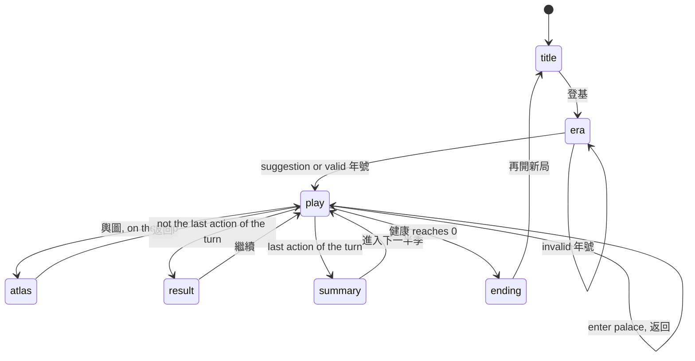

# web use cases

Status is `planned` or `implemented`. An `implemented` use case must be referenced by a test. Structure is in `ARCHITECTURE.md`. Layout values are in `src/style.css`, element IDs in the render code, and text in `content`.

| ID | Use case | Status |
|---|---|---|
| UC-WEB-001 | 顯示標題畫面 | implemented |
| UC-WEB-002 | 開始遊戲：登基後進入年號畫面 | implemented |
| UC-WEB-003 | 年號畫面 | implemented |
| UC-WEB-004 | 宮殿地圖、宮殿、行動結果與半季總結畫面（含國庫、稅入、用度與地域變化） | implemented |
| UC-WEB-005 | 駕崩結局與再開新局 | implemented |
| UC-WEB-006 | 輿圖畫面：列出各地域的民心、人口、富庶，開啟不耗行動點 | implemented |

## UC-WEB-001 Title screen
The palace image fills the viewport width with its aspect ratio kept, never cropped or stretched. A decorative scroll sits over the top centre of the image, with the game title written on it. The scroll and title scale with the image. There is no animation.

## UC-WEB-002 Starting a game
The start button sits over the bottom centre of the palace image, on the stone path, scales with the image, and keeps a comfortable tap target. Clicking it starts a new game: `main.ts` picks a random 32-bit seed with `crypto.getRandomValues`, calls `startGame(seed, gameText.eraNamePool)`, and shows the 年號 screen.

## UC-WEB-003 年號 screen
A heading and prompt, three suggested 年號 buttons, a labelled text input, and a confirm button. Clicking a suggestion starts the game with it. Confirming trims the typed text. If it is not a valid 年號, the screen shows an error as an alert, keeps the typed text, and does not start. Typed text is HTML-escaped when rendered. `chooseEraName(screen, input, regions)` passes the region data (`gameText.regions` in `main.ts`) to `createInitialState`.

## UC-WEB-004 Game screens
Every game screen has a header with the date, the action point, the emperor's age, the four emperor stats in registry order (emperor-owned stats only), and 國庫 in taels.
- Palace map: the illustrated palace map, laid out like the title screen: it fills the viewport width, is never upscaled past its native width, keeps its aspect ratio, and is never cropped. The header stays above it. The 宮城 heading stays in the markup for screen readers but is visually hidden. Each palace, in catalog order, is a button placed on the image and centred on that palace's anchor, so the button is also the label for its place and stays on it at any size. The buttons scale with the image and keep a comfortable tap target. Every palace in the catalog has an anchor inside the image. The 輿圖 button follows the map.
- Palace: the palace name and description, one button per action it offers, and a button back to the map. A palace that offers no actions shows a "nothing to do here" line instead of the action list. Entering and leaving use no action point.
- Action result: the action name, its changes, and a button to continue to the map.
- Turn summary, shown instead of the action result after the last action of a turn: a heading naming the half-season that ended, the last action's changes, the half-season totals including aging, the treasury line (tax income when there was any, and upkeep), one line per region that changed (or a single "no change" line), and a button into the next half-season. The header then shows the new turn, with 國庫 after taxes and upkeep.

## UC-WEB-006 輿圖
Opened from the palace map only. Opening and closing it use no action point and do not change the `GameState`. It shows the header, a heading, and a table with one row per region in `state.regions` order: the region name (the capital marked as 京師), 民心, 人口 and 富庶. A button returns to the palace map.

`openAtlas(screen)` goes from `play` on the map to `atlas`, keeping the same `state` object. From anywhere else it returns the screen unchanged. `closeAtlas(screen)` goes from `atlas` back to `play` with the same `state`.

## UC-WEB-005 Ending
Shown as soon as the emperor dies, after an action or after aging: a heading, the 年號, the reign length (the reign year of death, 元年 counting as 1), the age at death, and a button that returns to the title screen. There is no verdict or 諡號 yet.

## Screen flow

