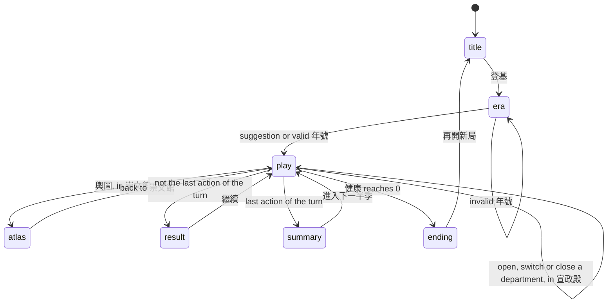

# web use cases

Status is `planned` or `implemented`. An `implemented` use case must be referenced by a test. Structure is in `ARCHITECTURE.md`. Layout values are in `src/style.css`, element IDs in the render code, and text in `content`.

| ID | Use case | Status |
|---|---|---|
| UC-WEB-001 | 顯示標題畫面 | implemented |
| UC-WEB-002 | 開始遊戲：登基後進入年號畫面 | implemented |
| UC-WEB-003 | 年號畫面 | implemented |
| UC-WEB-004 | 宮殿地圖、宮殿、行動結果與半季總結畫面（含國庫、稅入、用度與地域變化） | implemented |
| UC-WEB-005 | 駕崩結局與再開新局 | implemented |
| UC-WEB-006 | 輿圖畫面：自崇文館開啟，列出各地域的民心、人口、富庶，開啟不耗行動點 | implemented |
| UC-WEB-007 | 宣政殿：圖上內閣與六部按鈕，展開各部的待開放選項，退回宮城 | implemented |

## UC-WEB-001 Title screen
The palace image fills the viewport width with its aspect ratio kept, never cropped or stretched. A decorative scroll sits over the top centre of the image, with the game title written on it. The scroll and title scale with the image. There is no animation.

## UC-WEB-002 Starting a game
The start button sits over the bottom centre of the palace image, on the stone path, scales with the image, and keeps a comfortable tap target. Clicking it starts a new game: `main.ts` picks a random 32-bit seed with `crypto.getRandomValues`, calls `startGame(seed, gameText.eraNamePool)`, and shows the 年號 screen.

## UC-WEB-003 年號 screen
A heading and prompt, three suggested 年號 buttons, a labelled text input, and a confirm button. Clicking a suggestion starts the game with it. Confirming trims the typed text. If it is not a valid 年號, the screen shows an error as an alert, keeps the typed text, and does not start. Typed text is HTML-escaped when rendered. `chooseEraName(screen, input, regions)` passes the region data (`gameText.regions` in `main.ts`) to `createInitialState`.

## UC-WEB-004 Game screens
Every game screen has a header with the date, the action point, the emperor's age, the four emperor stats in registry order (emperor-owned stats only), and 國庫 in taels.
- Header placement: on the screens built on an image (the palace map and the palace views), the header is a banner over the top edge of the image: a semi-transparent dark band with gold text that takes no space above the image. Its contents and order do not change. On the screens without an image (action result, turn summary, 輿圖) the header is a bar above the content, as before.
- Palace map: the illustrated palace map, laid out like the title screen: it fills the viewport width, is never upscaled past its native width, keeps its aspect ratio, and is never cropped. The 宮城 heading stays in the markup for screen readers but is visually hidden. Each palace, in catalog order, is a button placed on the image and centred on that palace's anchor, so the button is also the label for its place and stays on it at any size. The buttons scale with the image, keep a comfortable tap target, and stay above the header banner where the two meet. Every palace in the catalog has an anchor inside the image. The map has no 輿圖 button and nothing below the image.
- Palace: each palace shows its own background image, laid out like the map (full viewport width, never upscaled past its native width, aspect ratio kept, never cropped), with alt text from `content`. Every palace in the catalog has a background. A semi-transparent panel over the lower part of the image holds the palace name and description, one button per action it offers, and a button back to the map; text stays readable on every background. A palace that offers no actions shows a "nothing to do here" line instead of the action list. 崇文館 also shows the 輿圖 button (UC-WEB-006), styled and placed apart from the action buttons because it is not an action. When the viewport is too narrow for the banner and the panel to both fit over the image, the banner stays over the image and the panel moves below it. Entering and leaving use no action point. 宣政殿 is the exception: it has the same image and banner but no panel (UC-WEB-007).
- Action result: the action name, its changes, and a button to continue to the map.
- Turn summary, shown instead of the action result after the last action of a turn: a heading naming the half-season that ended, the last action's changes, the half-season totals including aging, the treasury line (tax income when there was any, and upkeep), one line per region that changed (or a single "no change" line), and a button into the next half-season. The header then shows the new turn, with 國庫 after taxes and upkeep.

## UC-WEB-006 輿圖
Opened from 崇文館 only. Opening and closing it use no action point and do not change the `GameState`. It shows the header, a heading, and a table with one row per region in `state.regions` order: the region name (the capital marked as 京師), 民心, 人口 and 富庶. A button, whose text names 崇文館, returns to 崇文館.

`openAtlas(screen)` goes from `play` in 崇文館 to `atlas`, keeping the same `state` object. From anywhere else (the map, another palace, or any other screen) it returns the screen unchanged. `closeAtlas(screen)` goes from `atlas` back to `play` with the same `state`, so the player is back in 崇文館.

## UC-WEB-005 Ending
Shown as soon as the emperor dies, after an action or after aging: a heading, the 年號, the reign length (the reign year of death, 元年 counting as 1), the age at death, and a button that returns to the title screen. There is no verdict or 諡號 yet.

## UC-WEB-007 宣政殿
Entered from its button on the palace map like any palace, at any action point. It shows its background image and the header banner like the other palace views, but no palace panel. Its name stays in the markup as a heading for screen readers but is visually hidden.

- Over the lower right of the image sits one horizontal row of buttons that scales with the image: 內閣 and the six 部 in `core` registry order (`DEPARTMENT_IDS`), then 退. Each department button shows its short name and is announced by its full name, both from `content`. 退 is set apart from the departments by a gap and a different style.
- 退 works like 返回宮城: back to the map, no action point used.
- Clicking a department highlights it and opens its options, in registry order, as a vertical list that is always right-aligned with the 工 button and sits directly above it, whichever department was clicked. Clicking another department switches the list to that department. Clicking the open department closes the list. Leaving 宣政殿 closes it, so it is closed on the next visit.
- Each option is a disabled button with its name and a small "not yet open" tag. Clicking it does nothing.
- Which department is open is `web` screen state only. Opening, switching and closing keep the same `GameState` object and use no action point.

`toggleDepartment(screen, departmentId)` applies only to `play` in 宣政殿 (`COURT_PALACE`). From anywhere else, or with an ID that is not a department, it returns the screen unchanged.

## Screen flow

