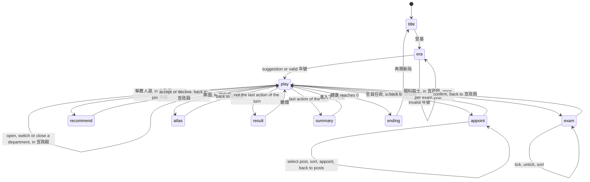

# web use cases

Status is `planned` or `implemented`. An `implemented` use case must be referenced by a test. Structure is in `ARCHITECTURE.md`. Layout values are in `src/style.css`, element IDs in the render code, and text in `content`.

| ID | Use case | Status |
|---|---|---|
| UC-WEB-001 | 顯示標題畫面 | implemented |
| UC-WEB-002 | 開始遊戲：登基後進入年號畫面 | implemented |
| UC-WEB-003 | 年號畫面 | implemented |
| UC-WEB-004 | 宮殿地圖、宮殿、行動結果與半季總結畫面（含國庫、稅入、用度與地域變化） | implemented |
| UC-WEB-005 | 駕崩結局與再開新局 | implemented |
| UC-WEB-006 | 輿圖畫面：自崇文館開啟，列出各地域的民心、人口、富庶，開啟不耗行動點 | implemented |
| UC-WEB-007 | 宣政殿：只在朝時開放的早朝，圖上內閣與六部按鈕，展開各部選項，退回宮城 | implemented |
| UC-WEB-008 | 官員任命畫面：按中樞、六部、地方列出官位，選官位後自賦閑官員中任命 | implemented |
| UC-WEB-009 | 舉薦人選畫面：顯示一名候選人（名臣另有標記），錄用或婉拒；每次早朝限用一次 | implemented |
| UC-WEB-010 | 開科取士畫面：列出應試者（名臣另有標記），可依屬性排序，勾選錄取後確定；非開科之年顯示下次開科 | implemented |

## UC-WEB-001 Title screen
The palace image fills the viewport width with its aspect ratio kept, never cropped or stretched. A decorative scroll sits over the top centre of the image, with the game title written on it. The scroll and title scale with the image. There is no animation.

## UC-WEB-002 Starting a game
The start button sits over the bottom centre of the palace image, on the stone path, scales with the image, and keeps a comfortable tap target. Clicking it starts a new game: `main.ts` picks a random 32-bit seed with `crypto.getRandomValues`, calls `startGame(seed, gameText.eraNamePool)`, and shows the 年號 screen.

## UC-WEB-003 年號 screen
A heading and prompt, three suggested 年號 buttons, a labelled text input, and a confirm button. Clicking a suggestion starts the game with it. Confirming trims the typed text. If it is not a valid 年號, the screen shows an error as an alert, keeps the typed text, and does not start. Typed text is HTML-escaped when rendered. `chooseEraName(screen, input, regions, names)` passes the region data (`gameText.regions` in `main.ts`) and the official name pool (`gameText.officialNames`) to `createInitialState`.

## UC-WEB-004 Game screens
Every game screen has a header with the date, the action point, the emperor's age, the four emperor stats in registry order (emperor-owned stats only), and 國庫 in taels.
- Header placement: on the screens built on an image (the palace map and the palace views), the header is a banner over the top edge of the image: a semi-transparent dark band with gold text that takes no space above the image. Its contents and order do not change. On the screens without an image (action result, turn summary, 輿圖, 官員任命, 舉薦人選, 開科取士) the header is a bar above the content, as before.
- Palace map: the illustrated palace map, laid out like the title screen: it fills the viewport width, is never upscaled past its native width, keeps its aspect ratio, and is never cropped. The 宮城 heading stays in the markup for screen readers but is visually hidden. Each palace, in catalog order, is a button placed on the image and centred on that palace's anchor, so the button is also the label for its place and stays on it at any size. The buttons scale with the image, keep a comfortable tap target, and stay above the header banner where the two meet. Every palace in the catalog has an anchor inside the image. A palace that `canEnterPalace` refuses right now (宣政殿 at any action point but 朝) keeps its place but is a disabled button, visibly dimmed, and clicking it does nothing. The map has no 輿圖 button and nothing below the image.
- Palace: each palace shows its own background image, laid out like the map (full viewport width, never upscaled past its native width, aspect ratio kept, never cropped), with alt text from `content`. Every palace in the catalog has a background. A semi-transparent panel over the lower part of the image holds the palace name and description, one button per action it offers, and a button back to the map; text stays readable on every background. A palace that offers no actions shows a "nothing to do here" line instead of the action list. 崇文館 also shows the 輿圖 button (UC-WEB-006), styled and placed apart from the action buttons because it is not an action. When the viewport is too narrow for the banner and the panel to both fit over the image, the banner stays over the image and the panel moves below it. Entering and leaving use no action point. 宣政殿 is the exception: it is open only at 朝, uses that action point, and has the same image and banner but no panel (UC-WEB-007).
- Action result: the action name, its changes, and a button to continue to the map.
- Turn summary, shown instead of the action result after the last action of a turn: a heading naming the half-season that ended, the last action's changes, the half-season totals including aging, the treasury line (tax income when there was any, and upkeep), one line per region that changed (or a single "no change" line), and a button into the next half-season. The header then shows the new turn, with 國庫 after taxes and upkeep.

## UC-WEB-006 輿圖
Opened from 崇文館 only. Opening and closing it use no action point and do not change the `GameState`. It shows the header, a heading, and a table with one row per region in `state.regions` order: the region name (the capital marked as 京師), 民心, 人口 and 富庶. A button, whose text names 崇文館, returns to 崇文館.

`openAtlas(screen)` goes from `play` in 崇文館 to `atlas`, keeping the same `state` object. From anywhere else (the map, another palace, or any other screen) it returns the screen unchanged. `closeAtlas(screen)` goes from `atlas` back to `play` with the same `state`, so the player is back in 崇文館.

## UC-WEB-005 Ending
Shown as soon as the emperor dies, after an action or after aging: a heading, the 年號, the reign length (the reign year of death, 元年 counting as 1), the age at death, and a button that returns to the title screen. There is no verdict or 諡號 yet.

## UC-WEB-007 宣政殿
Entered from its button on the palace map, only at 朝 (UC-CORE-003); at other action points the button is disabled. Being inside is 早朝: the header keeps showing 朝, and leaving puts the player on the map at 午. It shows its background image and the header banner like the other palace views, but no palace panel. Its name stays in the markup as a heading for screen readers but is visually hidden.

- Over the lower right of the image sits one horizontal row of buttons that scales with the image: 內閣 and the six 部 in `core` registry order (`DEPARTMENT_IDS`), then 退. Each department button shows its short name and is announced by its full name, both from `content`. 退 is set apart from the departments by a gap and a different style.
- 退 returns to the map, and the 朝 action point is now spent: the map shows 午.
- Clicking a department highlights it and opens its options, in registry order, as a vertical list directly above the clicked department, with the list's right edge lined up with that button's right edge. If that would push the list past the image's left edge (such as 內閣 on a narrow viewport), the list shifts right just enough to stay inside the image. A small downward caret under the list points at the centre of the clicked button, and stays on the button even when the list has shifted. The list follows its department button in the markup, so keyboard and screen-reader order goes from a department to its options to the next department. Clicking another department switches the list to that department. Clicking the open department closes the list. Leaving 宣政殿 closes it, so it is closed on the next visit.
- Open options (`OPEN_COURT_OPTIONS` in `src/screen.ts`; for now 吏部's 舉薦人選, 官員任命 and 開科取士) are enabled buttons with their name and no tag. Clicking one opens its screen (UC-WEB-009, UC-WEB-008, UC-WEB-010). Once 舉薦 has been used this 早朝 (`canRecommend` is false), 舉薦人選 is a disabled button with its name and a small "already recommended" tag, styled like the "not yet open" tag, until the next 早朝. 開科取士 is enabled only when `canHoldExam` is true. In an exam year after the exam is held, it is a disabled button with an "already held" tag. In any other year it is a disabled button with a tag saying how many years remain until the next exam (`nextExamYear` minus the current reign year), in Chinese numerals, such as "in two years". Both tags are styled like the "not yet open" tag. Every other option is a disabled button with its name and a small "not yet open" tag; clicking a disabled option does nothing.
- Which department is open is `web` screen state only. Opening, switching and closing keep the same `GameState` object and use no action point.

`toggleDepartment(screen, departmentId)` applies only to `play` in 宣政殿 (`COURT_PALACE`). From anywhere else, or with an ID that is not a department, it returns the screen unchanged. `chooseCourtOption(screen, optionId, notables, names)` applies only to `play` in 宣政殿 with an open option; for 舉薦人選 it also needs `canRecommend`, and for 開科取士 `canHoldExam`. Otherwise it returns the screen unchanged.

## UC-WEB-009 舉薦人選
Opened from 吏部 → 舉薦人選 during 早朝, once per 早朝. Opening it calls `core`'s `recommend`, which draws the candidate; nothing on this screen uses an action point, and the header keeps showing 朝.

- The screen has the header bar, a heading, and one candidate: their name and their 文治, 武功, 野心 and 忠誠. A 名臣 also shows a 名臣 mark. An ordinary candidate does not.
- Two buttons: accept and decline. Accepting calls `acceptCandidate`, so the candidate joins as 賦閑 and appears in 官員任命's 賦閑 list. Declining calls `declineCandidate`. Either way the player returns to 宣政殿 with 吏部's options open, where 舉薦人選 now shows as already used.
- There is no way to leave without deciding. If the state holds no candidate from this half-season, the screen shows only a button back to 宣政殿.

`acceptRecommendation(screen)` and `declineRecommendation(screen)` apply only to `recommend`; a rejection by `core`, or a call from another screen, returns the screen unchanged. `backToCourt(screen)` also returns from `recommend` to `play` in 宣政殿 with 吏部 open.

## UC-WEB-010 開科取士
Opened from 吏部 → 開科取士 during 早朝 in an exam year, once per exam year. Opening it calls `core`'s `holdExam`, which draws the candidates. Nothing on this screen uses an action point, and the header keeps showing 朝.

- The screen has the header bar, a heading, a line with how many candidates are ticked, and a checklist of every candidate: a checkbox, the name, and their 文治, 武功, 野心 and 忠誠. A 名臣 also shows the 名臣 mark next to their name, as on 舉薦人選. An ordinary candidate does not.
- Clicking a candidate's checkbox ticks or unticks them. Ticks are kept while sorting.
- Each stat column header is a sort button. Clicking one sorts the list by that stat, highest first, ties kept in candidate order. The active sort button is marked. With no sort chosen the list is in candidate order.
- A confirm button calls `confirmExam` with the ticked candidates. Confirming with none ticked is allowed. The ticked candidates join as 賦閑 and appear in 官員任命's 賦閑 list. The player returns to 宣政殿 with 吏部's options open, where 開科取士 now shows as already held.
- There is no way to leave without confirming. If the state holds no candidates from this half-season, the screen shows only a button back to 宣政殿.

`toggleExamPick(screen, index)` and `sortExam(screen, stat)` apply only to `exam`, and only with a candidate position or an official stat. `confirmExamPicks(screen)` applies only to `exam`. A rejection by `core`, any other input, or a call from another screen returns the screen unchanged. `backToCourt(screen)` also returns from `exam` to `play` in 宣政殿 with 吏部 open.

## UC-WEB-008 官員任命
Opened from 吏部 → 官員任命 during 早朝. Nothing on this screen uses an action point; the header keeps showing 朝.

- The screen has the header bar, a heading, and the post list from `listPosts`, in three groups with their own headings: 中樞, 六部 and 地方. 地方 rows come region by region, in region order. Each row shows the post's full name (`formatPostName`), the holder's name, and the holder's 文治, 武功, 野心 and 忠誠. A vacant post shows a "vacant" mark instead of a name, and empty stat cells.
- Clicking a post selects it. In place of the post list, the screen then names the selected post and its holder, and lists every 賦閑 official with their name and four stats, plus a button to appoint each. With no 賦閑 official it shows a single "none" line.
- Each stat column header is a sort button. Clicking one sorts the 賦閑 list by that stat, highest first, ties kept in `officials` order; the active sort button is marked. With no sort chosen the list is in `officials` order. The sort is kept while the player selects other posts and makes appointments, and is dropped on leaving the screen.
- Appointing calls `appointOfficial`. On success the selection closes and the post list shows the new holder; the previous holder, if any, is now in the 賦閑 list. A rejected appointment leaves the screen unchanged.
- A button closes the selection and returns to the post list. Another button, always shown, returns to 宣政殿 with 吏部's options open.

The screen is the `appoint` screen; its selected `post` and `sort` are UI state only. `backToCourt(screen)` returns from it to `play` in 宣政殿. `selectPost(screen, postId)` accepts only a post in `listPosts`; `sortIdle(screen, stat)` only an official stat; `appoint(screen, officialId)` only with a post selected. Any other input, or a call from another screen, returns the screen unchanged.

## Screen flow

